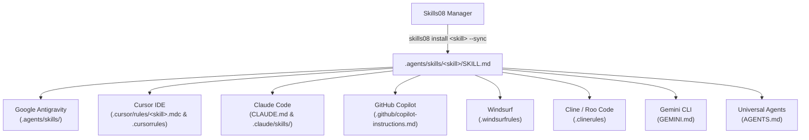

<div align="center">

# ⚡ Skills08

### *Powering Every AI Coding Agent with Better Skills.*

An open-source, local-first distribution platform, authoring framework, and lifecycle manager for AI agent skills.

[](https://github.com/atharva081106/skills08/actions/workflows/ci.yml)
[](https://github.com/atharva081106/skills08)
[](https://github.com/atharva081106/skills08)
[](https://www.python.org/)
[](./LICENSE)
[](https://github.com/atharva081106/skills08)
[](https://github.com/atharva081106/skills08)
[](https://twitter.com/intent/tweet?text=Skills08%20%E2%80%94%20The%20open-source%20package%20manager%20for%20AI%20coding%20agents%20https://github.com/atharva081106/skills08)

<p align="center">
  <a href="#-quickstart">Quickstart</a> •
  <a href="#-universal-agent-support">Universal Agents</a> •
  <a href="#-skills-catalog">Curated Catalog</a> •
  <a href="#-cli-cheat-sheet">CLI Cheat Sheet</a> •
  <a href="#-architecture">Architecture</a> •
  <a href="#-security--supply-chain">Security</a> •
  <a href="#-documentation">Documentation</a>
</p>

---

</div>

```text
  $ skills08 search "audit"
  ┌─────────────────┬────────────────┬──────────────────────────┬────────────────┐
  │ Candidate ID    │ Skill Name     │ Category                 │ Status         │
  ├─────────────────┼────────────────┼──────────────────────────┼────────────────┤
  │ SKILL08-SEC-001 │ security-audit │ Security & Vulnerability │ Available (A)  │
  └─────────────────┴────────────────┴──────────────────────────┴────────────────┘

  $ skills08 install security-audit --sync -w ./my-app
  [OK] Successfully installed 'security-audit' to .agents/skills/security-audit/
  [SYNC] Projected to Cursor (.mdc), Claude Code (CLAUDE.md), Copilot, and Windsurf!
```

---

## 🌟 Why Skills08?

Modern AI coding agents (Google Antigravity, Cursor, Claude Code, GitHub Copilot, Windsurf) are only as capable as the cognitive skills and guidelines they follow. Today, skills are fragmented across incompatible repositories, lack supply-chain validation, and often execute unvetted scripts that cause port conflicts and security hazards.

**Skills08 solves this by providing a unified, local-first platform:**

| Feature | Raw Prompts & Ad-Hoc Scripts | Skills08 Managed Platform |
| :--- | :--- | :--- |
| **Cross-Agent Portability** | ❌ Locked to a single IDE format | ✅ **One skill works across all 8 major coding agents** |
| **Execution Safety** | ⚠️ Runs unvetted bash hooks & daemons | ✅ **Model A: Safe cognitive instructions & companion playbooks** |
| **Supply Chain Verification** | ❌ No integrity or tamper detection | ✅ **Cryptographic SHA-256 lockfile verification (`verify`)** |
| **Workspace Isolation** | ❌ Manual copy-pasting into project roots | ✅ **Target any repository via `-w / --workspace-root`** |
| **Custom Rules Preservation** | ❌ Overwrites developer configs | ✅ **Safe delimited blocks: your custom rules are 100% kept** |
| **Ecosystem Conflicts** | ❌ Silent namespace collisions & shadows | ✅ **Static analysis detects collisions, shadows, and slop (`conflicts`)** |
| **Runtime Footprint** | ⚠️ Heavy Node/npm/Python dependencies | ✅ **Zero third-party runtime dependencies (Pure Python stdlib)** |

---

## 🌐 Universal Agent Support

Skills08 automatically projects installed skills into the exact native discovery formats required by every major coding agent:



### Supported IDE & Agent Formats:
1. **Google Antigravity**: Native `.agents/skills/<name>/SKILL.md` with progressive disclosure.
2. **Cursor**: Independent `.cursor/rules/<name>.mdc` cards (`globs: *`, toggleable) + `.cursorrules`.
3. **Claude Code**: Standard `CLAUDE.md` instructions block + `.claude/skills/` mirror.
4. **GitHub Copilot**: VS Code / JetBrains `.github/copilot-instructions.md`.
5. **Windsurf**: Cascade memory rules in `.windsurfrules`.
6. **Cline / Roo Code**: Execution rules in `.clinerules`.
7. **Gemini CLI & Code Assist**: Guidelines in `GEMINI.md`.
8. **Universal Open Agents**: Standard cross-platform `AGENTS.md` (OpenHands, Devin, etc.).

> **Non-Destructive Guarantee**: Skills08 writes inside delimited `<!-- BEGIN SKILLS08 MANAGED BLOCK -->` tags. Your personal developer rules, style guides, and settings outside the block are **never overwritten**.

---

## 📦 Curated Skills Catalog (Group A / v0.1)

All 12 Group A skills are pre-packaged, conflict-free, and cryptographically locked:

| Candidate ID | Skill Name | Category | Operational Focus |
| :--- | :--- | :--- | :--- |
| **`SKILL08-SEC-001`** | **`security-audit`** | 🛡️ Security | Cloudflare security playbook, secrets detection, SSRF & injection audit |
| **`SKILL08-DOC-001`** | **`humanizer`** | ✍️ Documentation | Eliminates corporate AI buzzwords, passive voice, and synthetic chatbot tone |
| **`SKILL08-UI-001`** | **`unslop`** | 🎨 UI/UX Design | Strips generic AI frontend tropes, over-rounded badges, and low-contrast text |
| **`SKILL08-UI-002`** | **`hallmark`** | 🎨 UI/UX Design | Editorial web design aesthetics, typography hierarchy, and deliberate layouts |
| **`SKILL08-FE-001`** | **`design-taste-frontend`** | 🎨 Frontend | Modern component styling, subtle borders, intentional whitespace |
| **`SKILL08-SWE-001`** | **`code-simplification`** | ⚡ Code Quality | Addy Osmani's heuristics to eliminate nesting, reduce lines, and improve clarity |
| **`SKILL08-SWE-002`** | **`simplify-codebase`** | ⚡ Code Quality | Architectural complexity reduction, dead-code removal, and refactoring |
| **`SKILL08-TST-001`** | **`browser-testing-with-devtools`** | 🧪 Testing | Automated browser interaction, DOM inspection, and DevTools console workflows |
| **`SKILL08-SWE-003`** | **`debugging-and-error-recovery`** | 🐛 Debugging | Systematic root-cause analysis, reproduction playbooks, and patch verification |
| **`SKILL08-ARC-001`** | **`archify`** | 🏛️ Architecture | Structured Architecture Decision Records (ADRs) and system modeling |
| **`SKILL08-ARC-002`** | **`understand-anything`** | 🗺️ Architecture & Intelligence | Generates interactive codebase knowledge graphs, component maps, and domain tours across 14+ languages |
| **`SKILL08-FE-002`** | **`scroll-craft`** | 🎨 Frontend | High-performance CSS/JS scroll interactions and scroll-triggered animations |
| **`SKILL08-UI-003`** | **`impeccable`** | 🎨 UI/UX Design | Polish heuristics for design tokens, typography, and interactive micro-states |

---

## 🚀 Quickstart

### ⚡ Instant One-Line Installers

#### Windows PowerShell:
```powershell
irm https://raw.githubusercontent.com/atharva081106/skills08/main/install.ps1 | iex
```

#### macOS / Linux:
```bash
curl -fsSL https://raw.githubusercontent.com/atharva081106/skills08/main/install.sh | bash
```

#### Via Pip (Direct from GitHub):
```bash
pip install git+https://github.com/atharva081106/skills08.git
```

#### Or Clone & Install Manually:
```bash
git clone https://github.com/atharva081106/skills08.git
cd skills08
pip install -e .
```

---

### 2. Standard Workflow in 30 Seconds

```bash
# Step 1: Diagnose your environment
skills08 doctor

# Step 2: Initialize your project for all coding agents
skills08 agent-init -w "D:\Projects\MyApp"

# Step 3: Search for skills you need
skills08 search "security"
skills08 search "simplification"

# Step 4: Install skills with multi-agent synchronization
skills08 install security-audit -w "D:\Projects\MyApp" --sync
skills08 install code-simplification -w "D:\Projects\MyApp" --sync

# Step 5: Verify cryptographic integrity
skills08 verify -w "D:\Projects\MyApp"

# Step 6: Check active skills and conflict status
skills08 status -w "D:\Projects\MyApp"
skills08 conflicts -w "D:\Projects\MyApp"
```

Now open `D:\Projects\MyApp` in **Google Antigravity**, **Cursor**, **Claude Code**, or **VS Code Copilot** — your agent is immediately equipped with the new skills!

---

### 3. Authoring Custom Skills for Your Team

Create a new agent skill adhering to the standard specification in seconds:

```bash
skills08 new api-guidelines \
  -d "Enforces RESTful conventions and OpenAPI schemas" \
  -c "Architecture" \
  -w "D:\Projects\MyApp"
```

Validate and package it into a distributable `.tar.gz` bundle with SHA-256 checksums:

```bash
skills08 pack "D:\Projects\MyApp\.agents\skills\api-guidelines"
```

---

## 💻 CLI Cheat Sheet

```bash
skills08 [COMMAND] [OPTIONS]
```

| Command | Arguments / Flags | Description |
| :--- | :--- | :--- |
| **`list`** | `[-c CAT] [-t TIER] [--json]` | Browse candidate catalog with clearance tiers and install status |
| **`search`** | `<query> [-c CAT] [-t TIER] [--json]` | Search catalog across keywords, descriptions, categories, and tiers |
| **`inspect`** | `<identifier> [--json]` | View provenance, locked commit SHA, author, and security rules |
| **`install`** | `<name> [--scope project\|global] [-f] [-s] [-w PATH]` | Atomically install a skill into project or global scope |
| **`uninstall`** | `<name> [--scope project\|global] [-w PATH]` | Safely remove an installed skill and clean lockfile records |
| **`update`** | `[name] [--scope project\|global] [-w PATH]` | Re-install and refresh skill(s) against the latest catalog |
| **`sync`** | `[-a AGENTS] [-w PATH] [--json]` | Project installed skills across Cursor, Claude, Copilot, Windsurf, Cline |
| **`status`** | `[--scope project\|global] [--json] [-w PATH]` | Show active skills, file counts, and scope shadowing |
| **`conflicts`** | `[--scope project\|global] [--json] [-w PATH]` | Detect cross-repo naming collisions, shadowing, and persona overlaps |
| **`verify`** | `[name] [--scope project\|global] [-V] [--json] [-w PATH]` | Cryptographically verify SHA-256 file hashes against lockfile |
| **`new`** | `<name> [-d DESC] [-c CAT] [-a AUTHOR] [-t PATH]` | Scaffold a new compliant agent skill template directory |
| **`pack`** | `<directory> [-o OUT] [-n NAME] [--json]` | Validate and package a skill into `.tar.gz` with cryptographic checksum |
| **`doctor`** | `[-w PATH] [-g PATH] [--json]` | Run comprehensive diagnostics on Python, shell, and catalog |
| **`agent-init`** | `[-t DIR] [-a AGENTS] [--json]` | Scaffold workspace configuration for all requested coding agents |

---

## 🔒 Security & Supply Chain Invariants

Skills08 is engineered with strict supply-chain and execution safety invariants:

1. **Model A (Instruction-Only Standard)**: Eliminates dangerous process spawning, unhandled background hooks, and loopback daemons by executing skills as structured prompt playbooks and companion guidance files.
2. **Zero Third-Party Runtime Dependencies**: Built entirely using Python's standard library. Includes a pure-Python fallback YAML parser.
3. **Path Traversal Defense**: Rigorous destination containment using `pathlib.Path.is_relative_to()` prevents directory traversal attacks during installation or removal.
4. **Reparse Point & Junction Containment**: `_safe_remove_path` safely removes Windows directory junctions (`mklink /J`) and symlinks without traversing or corrupting target directories.
5. **Atomic Staging**: Installations stage into isolated randomized directories (`.skills08_staging_<name>_<ts>_<random>`) before atomic rename, preventing broken partial states.
6. **Zero Telemetry**: Completely local-first. Zero telemetry, zero analytics, zero external network requests during cataloging or verification.

---

## 🧪 Automated Test Suite

Skills08 enforces 100% test pass rate across unit, lifecycle, regression, and compatibility checks:

```bash
python tests/run_all_tests.py
```

### Verified Test Summary:
- **Total Tests**: 51
- **Passed**: 51 (100.0%)
- **Failures / Errors**: 0
- **Execution Time**: ~15.5s

```text
======================================================================
SKILLS08 PHASE 1 TEST SUITE EXECUTION SUMMARY:
Total Tests Run: 51
Passed:          51 (100.0%)
Failures:        0
Errors:          0
Skipped:         0
Execution Time:  15.531s
Overall Status:  PASS
======================================================================
```

---

## 📚 Documentation & Research Register

- **Phase 1 Master Completion Report**: [`docs/PHASE_1_COMPLETION_REPORT.md`](./docs/PHASE_1_COMPLETION_REPORT.md)
- **Phase 1.5 Validation Report**: [`validation/phase-1.5/PRODUCT_VALIDATION_REPORT.md`](./validation/phase-1.5/PRODUCT_VALIDATION_REPORT.md)
- **Findings Register**: [`validation/phase-1.5/FINDINGS_REGISTER.md`](./validation/phase-1.5/FINDINGS_REGISTER.md)
- **System Architecture**: [`docs/ARCHITECTURE.md`](./docs/ARCHITECTURE.md)
- **CLI User Manual**: [`docs/OPERATIONAL_GUIDE.md`](./docs/OPERATIONAL_GUIDE.md)
- **Security & Limitations**: [`docs/SECURITY_AND_LIMITATIONS.md`](./docs/SECURITY_AND_LIMITATIONS.md)
- **Research Baselines (D1–D7)**:
  - [D1: Source Inventory](./docs/research/SOURCE_INVENTORY.md)
  - [D2: Skills Extraction](./docs/research/SKILLS_EXTRACTION.md)
  - [D3: License Matrix](./docs/research/LICENSE_MATRIX.md)
  - [D4: Compatibility Matrix](./docs/research/COMPATIBILITY_MATRIX.md)
  - [D5: Security Audit](./docs/research/SECURITY_AUDIT.md) & [Correction Report](./docs/research/SECURITY_AUDIT_CORRECTION_REPORT.md)
  - [D6: Conflict Analysis](./docs/research/CONFLICT_ANALYSIS.md) & [Verification Report](./docs/research/D6_FINAL_VERIFICATION_REPORT.md)
  - [D7: Phase 1 Recommendations](./docs/research/PHASE_1_RECOMMENDATIONS.md)

---

## 📄 License

Distributed under the **MIT License**. See [`LICENSE`](./LICENSE) for details.  
Original upstream skills retain the copyrights of their respective authors as documented in each package's `NOTICE.md`.

<div align="center">
  <sub>Built with precision for the next generation of AI coding agents.</sub>
</div>
