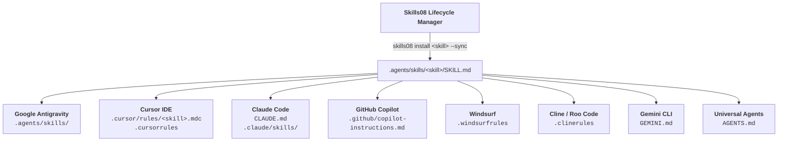

<div align="center">

```text
 ███████╗██╗  ██╗██╗██╗     ██╗     ███████╗ ██████╗  ██████╗ 
 ██╔════╝██║ ██╔╝██║██║     ██║     ██╔════╝██╔═████╗██╔════╝ 
 ███████╗█████╔╝ ██║██║     ██║     ███████╗██║██╔██║╚█████╗  
 ╚════██║██╔═██╗ ██║██║     ██║     ╚════██║████╔╝██║ ╚═══██╗ 
 ███████║██║  ██╗██║███████╗███████╗███████║╚██████╔╝██████╔╝ 
 ╚══════╝╚═╝  ╚═╝╚═╝╚══════╝╚══════╝╚══════╝ ╚═════╝ ╚═════╝  
```

# ⚡ Skills08

### *The Universal Package Manager for AI Coding Agents.*

**Equip Google Antigravity, Cursor, Claude Code, and GitHub Copilot with production-grade cognitive skills in one command.**

<br/>

[](https://github.com/atharva081106/skills08/actions/workflows/ci.yml)
[](https://github.com/atharva081106/skills08)
[](https://github.com/atharva081106/skills08)
[](https://www.python.org/)
[](./LICENSE)
[](https://github.com/atharva081106/skills08)
[](https://github.com/atharva081106/skills08)
[](https://twitter.com/intent/tweet?text=Skills08%20%E2%80%94%20The%20open-source%20package%20manager%20for%20AI%20coding%20agents%20https://github.com/atharva081106/skills08)

<br/>

<p align="center">
  <a href="#-instant-install">⚡ Quick Install</a> •
  <a href="#-why-skills08">Why Skills08?</a> •
  <a href="#-universal-agent-support">Universal Agents</a> •
  <a href="#-skills-catalog">Curated Catalog</a> •
  <a href="#-quickstart-tutorial">Tutorial</a> •
  <a href="#-cli-cheat-sheet">CLI Sheet</a> •
  <a href="#-security--supply-chain">Security</a> •
  <a href="#-documentation">Docs</a>
</p>

---

### ⚡ Instant Install

<table>
<tr>
<td><b>Windows (PowerShell)</b></td>
<td><code>irm https://raw.githubusercontent.com/atharva081106/skills08/main/install.ps1 | iex</code></td>
</tr>
<tr>
<td><b>macOS / Linux (Bash)</b></td>
<td><code>curl -fsSL https://raw.githubusercontent.com/atharva081106/skills08/main/install.sh | bash</code></td>
</tr>
<tr>
<td><b>Python Pip (Global)</b></td>
<td><code>pip install git+https://github.com/atharva081106/skills08.git</code></td>
</tr>
</table>

---

</div>

```text
  $ skills08 search "understand"
  ┌─────────────────┬─────────────────────┬────────────────────────────┬───────────────────────┐
  │ Candidate ID    │ Skill Name          │ Category                   │ Tier                  │
  ├─────────────────┼─────────────────────┼────────────────────────────┼───────────────────────┤
  │ SKILL08-ARC-002 │ understand-anything │ Architecture Intelligence  │ Community / Extension │
  └─────────────────┴─────────────────────┴────────────────────────────┴───────────────────────┘

  $ skills08 install understand-anything --sync -w ./my-app
  [OK] Successfully installed 'understand-anything' to .agents/skills/understand-anything/
  [SYNC] Projected to Cursor (.cursor/rules/understand-anything.mdc), Claude (CLAUDE.md), Copilot, and Windsurf!

  $ skills08 verify -w ./my-app
  [PASS] 43/43 files verified identical against SHA-256 digests.
```

---

## 🌟 Why Skills08?

Modern AI coding agents are only as smart as the prompt instructions and runbooks they follow. Today, skills are fragmented across incompatible repositories, lack supply-chain validation, and often attempt to run unvetted bash scripts that fail or spawn rogue background daemons.

**Skills08 replaces messy copy-pasting with a rigorous, local-first package manager:**

| Capability | Ad-Hoc Prompts & Raw Scripts | Skills08 Managed Platform |
| :--- | :--- | :--- |
| **🌐 Cross-Agent Portability** | ❌ Locked to a single IDE config | ✅ **One skill works across all 8 major coding agents** |
| **🛡️ Execution Safety** | ⚠️ Runs unvetted bash hooks & background daemons | ✅ **Model A: Safe cognitive playbooks & companion guidance** |
| **🔒 Supply-Chain Integrity** | ❌ No integrity or tamper detection | ✅ **Cryptographic SHA-256 lockfile tracking (`skills08 verify`)** |
| **📂 Non-Destructive Tagging** | ❌ Overwrites personal developer configs | ✅ **Safe delimited blocks: your custom rules are 100% kept** |
| **🎯 Workspace Targeting** | ❌ Manual file copying across folders | ✅ **Direct any command to any repo via `-w / --workspace-root`** |
| **🧭 Real-Time Conflict Detection** | ❌ Silent duplicate names & persona overlap | ✅ **Static analysis detects collisions, shadows, and slop (`conflicts`)** |
| **🚀 Runtime Footprint** | ⚠️ Heavy Node/npm/Python dependencies | ✅ **Zero third-party runtime dependencies (Pure Python stdlib)** |

---

## 🏗️ Bento Feature Grid

<table>
<tr>
<td width="50%" valign="top">

### 🛡️ Supply-Chain Verified
Every skill asset is locked with SHA-256 digests in `skills08.lock.json`. Detect tampering, file corruption, or local drift instantly with `skills08 verify`.

</td>
<td width="50%" valign="top">

### ⚡ Universal Multi-Agent Sync
Install once, use everywhere. Running `skills08 install <skill> --sync` automatically generates native configs for **Cursor, Claude Code, GitHub Copilot, Windsurf, Cline, and Antigravity**.

</td>
</tr>
<tr>
<td width="50%" valign="top">

### 🔒 Model A Instruction Safety
Eliminates process injection, bash stop hook failures, and rogue background daemon ports on Windows by prioritizing cognitive prompt playbooks over unvetted binary scripts.

</td>
<td width="50%" valign="top">

### 📁 Non-Destructive Protection
Single-file configurations (`CLAUDE.md`, `.cursorrules`, `copilot-instructions.md`) use delimited managed blocks. Your personal developer rules and shortcuts are **never overwritten**.

</td>
</tr>
<tr>
<td width="50%" valign="top">

### 🧭 Conflict & Shadowing Engine
Static analysis proactively detects cross-repository lexical collisions, dual-scope shadowing, and competing aesthetic persona prompts before they bloat your context window.

</td>
<td width="50%" valign="top">

### 🚀 Zero Third-Party Dependencies
Engineered entirely with Python's standard library (with pure-Python fallback YAML parsing). Runs cleanly on Windows 10/11, macOS, and Linux with zero bloat.

</td>
</tr>
</table>

---

## 🌐 Universal Agent Support

Skills08 automatically projects installed skills into the native discovery formats required by every major coding agent:



### Supported IDE & Agent Matrix

| Coding Agent | Native Discovery Path | How the Agent Reads It |
| :--- | :--- | :--- |
| **Google Antigravity** | `.agents/skills/<name>/SKILL.md` | Native schema with YAML frontmatter + progressive disclosure |
| **Cursor** | `.cursor/rules/<name>.mdc` & `.cursorrules` | Independent rule cards in Cursor IDE (`globs: *`, toggleable) |
| **Claude Code** | `CLAUDE.md` & `.claude/skills/` | Project instructions block loaded at every prompt |
| **GitHub Copilot** | `.github/copilot-instructions.md` | Workspace custom instructions for Copilot Chat & Completion |
| **Windsurf** | `.windsurfrules` | Cascade agent memory & instructions block |
| **Cline / Roo Code** | `.clinerules` | Extension guidelines and runbook rules |
| **Gemini CLI** | `GEMINI.md` | Gemini Code Assist instructions |
| **Universal Agents** | `AGENTS.md` | Cross-platform agent standard (OpenHands, Devin, etc.) |

---

## 📦 Curated Skills Catalog

Every skill is audited for intellectual property provenance, compatibility, and host execution safety:

### 🛡️ Security & Auditing
- **`security-audit`** (`SKILL08-SEC-001`): Cloudflare security playbook. Audits codebases for secrets, SSRF, injection vectors, and permission boundaries.

### ⚡ Code Simplification & Engineering
- **`code-simplification`** (`SKILL08-SWE-001`): Addy Osmani's heuristics to eliminate nesting, reduce lines of code, and improve readability.
- **`simplify-codebase`** (`SKILL08-SWE-002`): Architectural complexity reduction, dead-code pruning, and cognitive refactoring.
- **`debugging-and-error-recovery`** (`SKILL08-SWE-003`): Systematic root-cause analysis, reproduction playbooks, and patch verification.

### 🗺️ Architecture & Intelligence
- **`understand-anything`** (`SKILL08-ARC-002`): Analyzes codebases across 14+ languages (Python, TS, Go, Rust, Java, C++, etc.) to generate interactive architectural knowledge graphs, component relationships, and onboarding tours.
- **`archify`** (`SKILL08-ARC-001`): Structures Architecture Decision Records (ADRs) and system modeling playbooks.

### 🎨 UI/UX Design & Frontend
- **`unslop`** (`SKILL08-UI-001`): Strips generic AI frontend tropes, over-rounded badges, and low-contrast text.
- **`hallmark`** (`SKILL08-UI-002`): Editorial web design aesthetics, typography hierarchy, and deliberate layouts.
- **`design-taste-frontend`** (`SKILL08-FE-001`): Modern component styling, subtle borders, and intentional whitespace.
- **`impeccable`** (`SKILL08-UI-003`): Polish heuristics for design tokens, typography, and interactive micro-states.
- **`scroll-craft`** (`SKILL08-FE-002`): High-performance CSS/JS scroll interactions and scroll-triggered animations.

### 🧪 Testing & Documentation
- **`browser-testing-with-devtools`** (`SKILL08-TST-001`): Automated browser interaction, DOM inspection, and DevTools console workflows.
- **`humanizer`** (`SKILL08-DOC-001`): Eliminates corporate AI buzzwords, passive voice, and synthetic chatbot tone from prose and docs.

---

## 🚀 Quickstart Tutorial

### 1. Initialize a Project for All Agents
```bash
# Sets up .agents/, Cursor rules, Claude instructions, and Copilot configs
skills08 agent-init -w "D:\Projects\MyApp"
```

### 2. Search and Install Skills
```bash
# Search by keyword, category, or tier
skills08 search "security"
skills08 search "architecture"

# Install into your project workspace with automatic multi-agent projection
skills08 install security-audit -w "D:\Projects\MyApp" --sync
skills08 install understand-anything -w "D:\Projects\MyApp" --sync
```

### 3. Verify Active Skills & Integrity
```bash
# Check installed skills and scope status
skills08 status -w "D:\Projects\MyApp"

# Cryptographically verify file integrity against SHA-256 digests
skills08 verify -w "D:\Projects\MyApp"

# Check for ecosystem collisions, shadows, or persona overlaps
skills08 conflicts -w "D:\Projects\MyApp"
```

### 4. Author a Custom Skill in 60 Seconds
```bash
# Scaffold a new skill compliant with Antigravity / Agent standards
skills08 new api-guidelines \
  -d "Enforces RESTful conventions and OpenAPI schemas" \
  -c "Architecture" \
  -w "D:\Projects\MyApp"

# Validate and package into a distributable archive with checksum
skills08 pack "D:\Projects\MyApp\.agents\skills\api-guidelines"
```

---

## 💻 CLI Cheat Sheet

```bash
skills08 [COMMAND] [OPTIONS]
```

| Command | Arguments / Flags | Description |
| :--- | :--- | :--- |
| **`list`** | `[-c CAT] [-t TIER] [--json]` | Browse candidate catalog with clearance tiers and install status |
| **`search`** | `<query> [-c CAT] [-t TIER] [--json]` | Search catalog across keywords, descriptions, categories, and tiers |
| **`inspect`** | `<identifier> [--json]` | View provenance, locked commit SHA, author, and security rules |
| **`install`** | `<name> [--scope project\|global] [-f] [-s] [-w PATH]` | Atomically install a skill into project or global scope |
| **`uninstall`** | `<name> [--scope project\|global] [-w PATH]` | Safely remove an installed skill and clean lockfile records |
| **`update`** | `[name] [--scope project\|global] [-w PATH]` | Re-install and refresh skill(s) against the latest catalog |
| **`sync`** | `[-a AGENTS] [-w PATH] [--json]` | Project installed skills across Cursor, Claude, Copilot, Windsurf, Cline |
| **`status`** | `[--scope project\|global] [--json] [-w PATH]` | Show active skills, file counts, and scope shadowing |
| **`conflicts`** | `[--scope project\|global] [--json] [-w PATH]` | Detect cross-repo naming collisions, shadowing, and persona overlaps |
| **`verify`** | `[name] [--scope project\|global] [-V] [--json] [-w PATH]` | Cryptographically verify SHA-256 file hashes against lockfile |
| **`new`** | `<name> [-d DESC] [-c CAT] [-a AUTHOR] [-t PATH]` | Scaffold a new compliant agent skill template directory with `SKILL.md` |
| **`pack`** | `<directory> [-o OUT] [-n NAME] [--json]` | Validate and package a skill into `.tar.gz` with cryptographic checksum |
| **`doctor`** | `[-w PATH] [-g PATH] [--json]` | Run comprehensive diagnostics on Python, shell, and catalog |
| **`agent-init`** | `[-t DIR] [-a AGENTS] [--json]` | Scaffold workspace configuration for all requested coding agents |

---

## 🔒 Security & Supply Chain Invariants

Skills08 is engineered with strict supply-chain and execution safety invariants:

1. **Model A (Instruction-Only Standard)**: Eliminates dangerous process spawning, unhandled background hooks, and loopback daemons by executing skills as structured prompt playbooks and companion guidance files.
2. **Zero Third-Party Runtime Dependencies**: Built entirely using Python's standard library. Includes a pure-Python fallback YAML parser.
3. **Path Traversal Defense**: Rigorous destination containment using `pathlib.Path.is_relative_to()` prevents directory traversal attacks during installation or removal.
4. **Reparse Point & Junction Containment**: `_safe_remove_path` safely removes Windows directory junctions (`mklink /J`) and symlinks without traversing or corrupting target directories.
5. **Atomic Staging**: Installations stage into isolated randomized directories (`.skills08_staging_<name>_<ts>_<random>`) before atomic rename, preventing broken partial states.
6. **Zero Telemetry**: Completely local-first. Zero telemetry, zero analytics, zero external network requests during cataloging or verification.

---

## 🧪 Automated Test Suite

Skills08 enforces 100% test pass rate across unit, lifecycle, regression, and cross-platform compatibility checks:

```bash
python tests/run_all_tests.py
```

### Verified Test Summary

| Metric | Result |
| :--- | :--- |
| **Total Tests Run** | **51** |
| **Passed** | **51 (100.0%)** |
| **Failures / Errors** | **0** |
| **Execution Time** | **~15.5s** |
| **Runtimes Verified** | **Python 3.8, 3.10, 3.11, 3.12** |
| **Operating Systems** | **Windows 10/11 x64, Ubuntu Linux, macOS** |

---

## 📚 Documentation & Research Register

- **Phase 1 Master Completion Report**: [`docs/PHASE_1_COMPLETION_REPORT.md`](./docs/PHASE_1_COMPLETION_REPORT.md)
- **Phase 1.5 Validation Report**: [`validation/phase-1.5/PRODUCT_VALIDATION_REPORT.md`](./validation/phase-1.5/PRODUCT_VALIDATION_REPORT.md)
- **Findings Register**: [`validation/phase-1.5/FINDINGS_REGISTER.md`](./validation/phase-1.5/FINDINGS_REGISTER.md)
- **Viral Launch Kit**: [`docs/LAUNCH_KIT.md`](./docs/LAUNCH_KIT.md)
- **System Architecture**: [`docs/ARCHITECTURE.md`](./docs/ARCHITECTURE.md)
- **CLI User Manual**: [`docs/OPERATIONAL_GUIDE.md`](./docs/OPERATIONAL_GUIDE.md)
- **Security & Limitations**: [`docs/SECURITY_AND_LIMITATIONS.md`](./docs/SECURITY_AND_LIMITATIONS.md)
- **Research Baselines (D1–D7)**:
  - [D1: Source Inventory](./docs/research/SOURCE_INVENTORY.md)
  - [D2: Skills Extraction](./docs/research/SKILLS_EXTRACTION.md)
  - [D3: License Matrix](./docs/research/LICENSE_MATRIX.md)
  - [D4: Compatibility Matrix](./docs/research/COMPATIBILITY_MATRIX.md)
  - [D5: Security Audit](./docs/research/SECURITY_AUDIT.md) & [Correction Report](./docs/research/SECURITY_AUDIT_CORRECTION_REPORT.md)
  - [D6: Conflict Analysis](./docs/research/CONFLICT_ANALYSIS.md) & [Verification Report](./docs/research/D6_FINAL_VERIFICATION_REPORT.md)
  - [D7: Phase 1 Recommendations](./docs/research/PHASE_1_RECOMMENDATIONS.md)

---

## 📄 License & Attribution

Distributed under the **MIT License**. See [`LICENSE`](./LICENSE) for details.  
Original upstream skills retain the copyrights of their respective authors as documented in each package's `NOTICE.md`.

<br/>

<div align="center">
  <sub>⚡ Built with precision for the next generation of AI coding agents.</sub>
</div>
