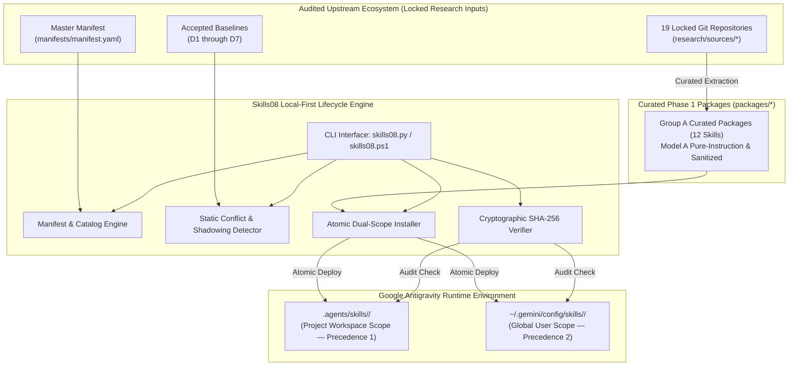

# Skills08 — System Architecture & Implementation Specification (Phase 1)

> **Document Status**: Complete & Authoritative  
> **Milestone**: Phase 1 Completion — Architecture & Engineering Specification  
> **Target Host Platform**: Google Antigravity (Local-First AI Agent Distribution Platform)  
> **Operating Environment**: Windows 10/11 x64 (PowerShell 5.1 / PowerShell 7+) & Cross-Platform POSIX  
> **Implementation Language**: Python 3.10+ (Standard Library Only — Zero External Dependencies) + Native PowerShell 5.1+  

---

## 1. Architectural Vision & Scope

**Skills08** is an open-source, local-first AI agent skills distribution and lifecycle management platform designed to provide a trusted, audited, and deterministic supply chain of cognitive skills. 

While initially targeting **Google Antigravity**, Skills08 establishes an open, file-system-driven standard that operates without cloud accounts, centralized telemetry servers, or complex daemon runtimes.



---

## 2. Discovery Roots & Precedence Hierarchy

Google Antigravity discovers skills using progressive disclosure via directory traversal:

### 2.1 Dual-Scope Discovery Hierarchy
1. **Project Scope (`.agents/skills/<name>/SKILL.md`)**:
   - Location: `.agents/skills/` relative to the workspace root (`d:\skills08`).
   - Precedence: **Highest (Precedence 1)**.
   - Purpose: Workspace-specific, version-controlled skill configurations shared across teams.
2. **Global Scope (`~/.gemini/config/skills/<name>/SKILL.md`)**:
   - Location: User home directory (`$env:USERPROFILE\.gemini\config\skills\` on Windows, `~/.gemini/config/skills/` on Linux/macOS).
   - Precedence: **Secondary (Precedence 2)**.
   - Purpose: Machine-wide default skills available across all projects unless explicitly overridden.

### 2.2 Shadowing Resolution Engine
When a skill with identical lexical directory name exists in both scopes:
- Antigravity's loader binds the project-level skill.
- Skills08 tracks this condition as **Dual-Scope Shadowing** (`CON-005`). The lifecycle manager inspects both scopes and emits an advisory notification during `status` and `conflicts` checks.

---

## 3. Core Component Model

The Skills08 implementation is modular, deterministic, and self-contained within `src/skills08/`:

```
d:/skills08/
├── packages/                          # Curated Phase 1 distributable packages
│   ├── security-audit/
│   ├── humanizer/
│   ├── unslop/
│   ├── hallmark/
│   ├── design-taste-frontend/
│   ├── code-simplification/
│   ├── simplify-codebase/
│   ├── browser-testing-with-devtools/
│   ├── debugging-and-error-recovery/
│   ├── archify/
│   ├── scroll-craft/
│   └── impeccable/
├── src/
│   └── skills08/
│       ├── __init__.py                # Package metadata and version definition
│       ├── constants.py               # Discovery paths, error codes, and schema constants
│       ├── models.py                  # Domain models (Candidate, Package, Conflict, VerificationResult)
│       ├── manifest.py                # Deterministic YAML parser for manifests/manifest.yaml
│       ├── catalog.py                 # Package index and provenance loader
│       ├── conflicts.py               # D6 rule-based static conflict and collision engine
│       ├── installer.py               # Atomic filesystem installer and uninstaller
│       ├── verifier.py                # SHA-256 cryptographic integrity verifier
│       └── cli.py                     # Command-line interface parser and command dispatcher
├── tests/                             # Automated test suite
│   ├── test_manifest.py
│   ├── test_conflicts.py
│   ├── test_installer.py
│   ├── test_verifier.py
│   ├── test_protected_baselines.py
│   └── run_all_tests.py
├── skills08.py                        # Portable Python CLI entrypoint
└── skills08.ps1                       # Native PowerShell wrapper for Windows
```

### 3.1 Component Responsibilities:

#### 1. Manifest & Catalog Engine (`manifest.py`, `catalog.py`)
- Reads and parses `manifests/manifest.yaml` (protected research input) using a deterministic fallback parser that does not require external PyYAML dependencies.
- Indexes the 12 approved Group A packages and the 1 deferred Group B candidate (`open-pencil`).
- Maps upstream commit SHAs, author attribution, and license clearance tiers.

#### 2. Static Conflict Engine (`conflicts.py`)
- Implements the conflict taxonomy established in Deliverable 6 (`CON-001` through `CON-026`).
- Detects the 5 cross-repository lexical collisions (`architecture-decision-records`, `design-taste-frontend`, `frontend-slides`, `hallmark`, `hyperframes`).
- Evaluates workspace-installed skills against global configurations to identify dual-scope shadowing (`CON-005`).
- Flags incompatible combinations (e.g. concurrent activation of conflicting aesthetic personas without scoped guidelines).

#### 3. Atomic Installer & Uninstaller (`installer.py`)
- Manages dual-scope lifecycle operations:
  - `--scope project` -> installs to `.agents/skills/<name>/`.
  - `--scope global` -> installs to `$env:USERPROFILE/.gemini/config/skills/<name>/`.
- **Atomic Operations**: Copies files to a temporary staging directory (`.skills08_tmp_*`) before moving them into place, preventing partial installations if interrupted.
- **Path Traversal Defense**: Rigorously canonicalizes target paths to ensure writes remain strictly within the designated skill root.
- **Attribution Notice Generator**: Emits a standardized `NOTICE.md` into every installed skill package, detailing upstream provenance, license terms, and modification statements.
- **Clean Removal**: Removes installed skill folders safely, rejecting operations if the target directory contains external files or fails path verification.

#### 4. Cryptographic Integrity Verifier (`verifier.py`)
- Calculates SHA-256 digests of all installed skill files.
- Compares on-disk hashes against the authoritative catalog manifest (`skills08.lock.json` / package catalog).
- Reports:
  - **MATCH**: File content is bit-for-bit identical to the curated baseline.
  - **MODIFIED**: File has been altered, tampered with, or corrupted.
  - **MISSING**: Expected skill asset is missing from disk.
  - **EXTRA**: Unexpected files introduced into the skill directory.

---

## 4. Security Architecture & Boundary Enforcement

In strict accordance with Deliverable 5 (Security Audit) and Deliverable 7 (Recommendations), the lifecycle manager implements defensive controls across all lifecycle phases:

### 4.1 Zero Upstream Code Execution
- Skills08 **never executes upstream scripts or binaries** (`.mjs`, `.sh`, `.ps1`, `.bat`, `.exe`, `.cjs`) during discovery, inspection, installation, or verification.
- All operations are strictly read-only filesystem copies and hash computations.

### 4.2 Model A Pure-Instruction Standardization
- All script-bearing candidates (`archify`, `scroll-craft`, `design-taste-frontend`, `impeccable`, `unslop`, `hallmark`) are packaged under **Model A (Instruction-Only)**:
  - Companion scripts (`scripts/kie.mjs`, `bin/archify.mjs`, `scripts/gate.mjs`, `scripts/snapshot.mjs`, `scripts/sloplint.mjs`, `scripts/impeccable`) are excluded from distributable packages.
  - Instructions are adapted to leverage Antigravity's native tools (`write_file`, `edit_file`, artifacts, canvas).
  - Eliminates process execution (`spawnSync`), loopback port listening (ports 7600/7601), and unsanitized image uploads.

### 4.3 Guidance Mode Enforcement for `security-audit`
- `security-audit` (`SKILL08-SEC-001`) is packaged strictly in **Guidance Mode**:
  - Full audit execution and dynamic target execution are explicitly disabled in prompt instructions.
  - Dynamic verification findings are routed to `NEEDS-VALIDATION.md` for manual user validation in an external sandbox.

### 4.4 Untrusted Input Sanitization
- All frontmatter metadata is validated against Antigravity's schema (`name`, `description`).
- Non-standard fields (`allowed-tools`) are stripped.
- Path inputs are sanitized to reject directory traversal sequences (`..`, `\`, `/`).

---

## 5. Native Windows Integration (PowerShell 5.1 & 7+)

To provide a seamless developer experience on Windows:
- **`skills08.py`**: Cross-platform Python CLI accessible via `python skills08.py <command>`.
- **`skills08.ps1`**: Native PowerShell wrapper script enabling commands like `.\skills08.ps1 list` or `.\skills08.ps1 install security-audit`.
- **Quoting and Argument Safety**: All PowerShell parameters are passed using safe argument arrays, preventing command-injection vulnerabilities or pipeline interpretation hazards.

---
*End of Architecture Specification (`docs/ARCHITECTURE.md`).*

