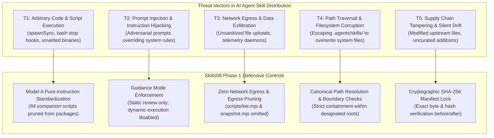

# Skills08 — Security Architecture & Limitations Summary (Phase 1)

> **Document Status**: Complete & Authoritative  
> **Milestone**: Phase 1 Completion — Security Model & Retained Limitations  
> **Host Platform**: Google Antigravity (Local-First Agent Distribution Platform)  
> **Target OS Environment**: Windows 10/11 x64 (PowerShell 5.1 / PowerShell 7+)  
> **Upstream Evidence**: D1 through D7  

---

## 1. Security Architecture & Threat Model

Skills08 treats all third-party cognitive skills, prompt instructions, companion scripts, and repository contents as **untrusted data**. 

In an AI agent environment where skills are loaded into the agent's context and executed via tool calls, the threat model encompasses five primary vectors:

---

## 2. Implemented Security Controls vs. Future Work

To ensure complete transparency and avoid misleading claims, the table below explicitly delineates controls implemented in Phase 1 versus capabilities reserved for Phase 2:

| Security Capability / Control | Implementation Status | Implementation Details & Technical Mechanism |
| :--- | :---: | :--- |
| **Zero Upstream Code Execution** | **IMPLEMENTED** | Skills08 never executes upstream scripts (`.mjs`, `.sh`, `.ps1`, `.cjs`, `.exe`) during catalog indexing, package creation, inspection, installation, or verification. |
| **Model A Pure-Instruction Mode** | **IMPLEMENTED** | All script-bearing skills (`archify`, `scroll-craft`, `design-taste-frontend`, `impeccable`, `unslop`, `hallmark`) have companion scripts omitted, avoiding process execution and loopback daemon risks. |
| **Guidance Mode Enforcement** | **IMPLEMENTED** | `security-audit` (`SKILL08-SEC-001`) is configured for static codebase exploration only. Target code execution is disabled; dynamic findings route to `NEEDS-VALIDATION.md`. |
| **Path Traversal Defenses** | **IMPLEMENTED** | All destination paths are verified via `Path.resolve()` to ensure target directories remain strictly inside `.agents/skills/` or `~/.gemini/config/skills/`. Traversal attempts (`../`) are rejected. |
| **Atomic Installation Staging** | **IMPLEMENTED** | Package files are copied to an isolated temporary staging folder (`.skills08_staging_*`) before atomic rename, preventing partial or corrupt installations if interrupted. |
| **Cryptographic Integrity Locking** | **IMPLEMENTED** | Every installed file has its SHA-256 digest tracked in `skills08.lock.json`. The `verify` command detects any bit-level tampering, modification, missing assets, or unauthorized extra files. |
| **Attribution & Provenance Bundling** | **IMPLEMENTED** | Every installed package includes an automatically generated `NOTICE.md` detailing original copyright, locked upstream commit SHA, license terms, and modification statements. |
| **Egress Vector Elimination** | **IMPLEMENTED** | Omitted `scripts/kie.mjs` in `scroll-craft` (eliminating `SEC-SCR-003` unauthenticated image upload) and `scripts/snapshot.mjs` in `unslop` (eliminating unvetted web requests). |
| **OS-Level Process Sandboxing** | *FUTURE (Phase 2)* | Windows host lacks unprivileged container sandboxing (cgroups/namespaces). Full audit execution and dynamic target execution require isolated sandbox containers planned for Phase 2. |
| **Runtime Token & Oscillation Monitoring** | *FUTURE (Phase 2)* | Dynamic prompt token counting and real-time loop detection (`CON-025`) require live agent execution hooks reserved for Phase 2. |
| **Host Resource Contention Throttling** | *FUTURE (Phase 2)* | Live CPU/RAM monitoring across concurrent subagents (`CON-026`) is deferred to Phase 2 dynamic testing. |
| **MCP Sidecar Daemon Management** | *FUTURE (Phase 2)* | Managing external Bun toolchains and Model Context Protocol daemons (`open-pencil`, `SKILL08-UI-004`) is deferred to Phase 2 / v0.2+. |

---

## 3. Retained Limitations & Mandatory Governance Disclosures

As established in the formal acceptance of Deliverable 6, the following four technical and historical limitations are preserved without modification:

### 3.1 D5 Correction Report Dual-Baseline Discrepancy
- **Accepted Baseline Record**: `18,888 bytes` (SHA-256: `8cc5824d46e9987f0b253e82e724e825196ac3edb0afb8664a53acef88a9f204`).
- **Current Disk State**: `19,014 bytes` (SHA-256: `1ee7d5f16c39e369d0d781ac0a3d627f3d18119771e341d05c982c857aa4742e`).
- **Technical Explanation**: The +126-byte difference was produced by the authorized Section 3.4 wording modification in Prompt 6 (`Residual Risk: **None**` replaced with `eliminates the specific SEC-SCR-003 upload vector; overall candidate projected residual risk remains Low / Estimated per SECURITY_AUDIT.md Section 14`).
- **Resolution**: Both records are preserved; no new baseline has been declared, and Deliverable 6 Gate 16 remains rated **PARTIAL**.

### 3.2 19-Repository Source Checkout Historical Working-Tree Integrity
- **Current Commit SHAs**: All 19 checkouts in `research/sources/` match the accepted D1 and D2 baselines (verified directly from `.git/HEAD` and `.git/refs`).
- **Historical Limitation**: A recursive full-tree hash of all untracked and working files across all 19 checkouts was not captured prior to beginning D6. Complete historical working-tree integrity throughout earlier sessions cannot be mathematically proven.
- **Certification**: We certify solely that current repository HEAD commits are identical to the accepted baselines and zero writes were directed to `research/sources/`.

### 3.3 Guidance Mode Advisory Boundary on Windows
- Guidance Mode in `security-audit` functions via **advisory prompt instructions** and subagent tool constraints.
- It does not represent an operating system security boundary (such as an seccomp filter, chroot jail, or cgroup container).
- Dynamic tests must always be conducted by human operators in an isolated virtual machine or container using the emitted `NEEDS-VALIDATION.md` report.

### 3.4 Operational Deferral of Group B (`open-pencil`)
- Candidate `SKILL08-UI-004` (`open-pencil`) is formally excluded from the v0.1 installable package roster.
- Its requirement for external Bun runtimes, native C++ canvas dependencies, and MCP server daemons makes it unsuitable for v0.1 lightweight local distribution.

---
*End of Security Architecture & Limitations Summary (`docs/SECURITY_AND_LIMITATIONS.md`).*

