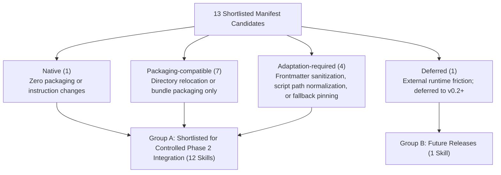
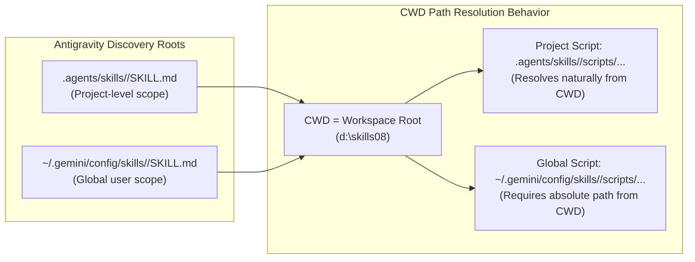

# Skills08 — Master Compatibility Matrix (Phase 1 Deliverable 4)

> **Document Status**: Reconciled & Verified Against Authoritative Deliverable 2 Ledger  
> **Milestone**: Phase 1 — Source Intelligence & Repository Audit  
> **Primary Target Agent**: Google Antigravity  
> **Host Operating System**: Windows (PowerShell 5.1)  
> **Total Evaluated Candidates**: 13 (from Accepted Master Manifest)  
> **Authoritative Provenance Baseline**: `research/final_reconciled_ledger.json` (SHA-256: `c85e759e...`)  
> **Compatibility Classification Breakdown**:  
>   - **`Native`**: 1 candidate (7.7%)  
>   - **`Packaging-compatible`**: 7 candidates (53.8%)  
>   - **`Adaptation-required`**: 4 candidates (30.8%)  
>   - **`Deferred`**: 1 candidate (7.7%)  
>   - **Total**: **13 candidates (100.0%)**  

---

## 1. Executive Summary & Assessment Scope

This document establishes the authoritative technical compatibility baseline for **Skills08**, evaluating all 13 shortlisted candidate skills from the accepted Master Manifest ([manifest.yaml](file:///d:/skills08/manifests/manifest.yaml)) against the runtime architecture, discovery roots, tool-calling conventions, and security boundaries of **Google Antigravity** on a **Windows (PowerShell 5.1)** host.

### Key Compatibility Findings

1. **High Packaging Feasibility for Core Roster**: Eight of the 13 candidates (61.5%) can be distributed with zero modifications to upstream `SKILL.md` instruction files:
   - One candidate (`simplify-codebase`) is **`Native`**, already residing in `.agents/skills/` with clean YAML.
   - Seven candidates (`security-audit`, `humanizer`, `unslop`, `hallmark`, `code-simplification`, `browser-testing-with-devtools`, `debugging-and-error-recovery`) are **`Packaging-compatible`**, requiring flat folder relocation or bundle packaging into `.agents/skills/<name>/` without modifying instruction text.
2. **Reconciliation of Packaging vs. Adaptation for `security-audit`**:
   - `security-audit` (`SKILL08-SEC-001`) is classified as **`Packaging-compatible`** because its upstream `SKILL.md` requires **zero instructional modifications**. The upstream skill natively incorporates *Guidance mode* as its default operational state and already delegates unvalidated or unsandboxed dynamic checks to `NEEDS-VALIDATION.md`.
   - **Policy vs. Technical Enforcement**: Restricting `security-audit` to Guidance Mode on Windows is a **Skills08 operational release policy and soft behavioral restriction**, not a technically enforced execution boundary. Manifest metadata, prompt instructions, and `NEEDS-VALIDATION.md` **do not provide process isolation or guarantee prevention of command execution** on the ambient host. Because Windows PowerShell 5.1 lacks OS-level process sandboxing and POSIX descriptor controls, all dynamic verification must be strictly restricted to a separately controlled external environment with actual OS-level isolation (e.g., dedicated VM or Docker container).
3. **Frontmatter Sanitization Requirements**: Two candidates carry agent-specific frontmatter tags that must be stripped before distribution to prevent Antigravity YAML schema validation warnings:
   - `taste-skill` embeds a Claude Code bash stop hook (`hooks: Stop: ...`) in its YAML frontmatter.
   - `scroll-craft` embeds a Claude Code tool restriction tag (`allowed-tools: ...`).
4. **Execution Safety & Host Protection on Windows**:
   - `impeccable` bundles a compiled Rust binary launcher (`scripts/impeccable`) that attempts host execution. In Skills08 v0.1, it is adapted to lock strictly to its documented **pure-instruction fallback mode**, eliminating unvetted native binary execution.
   - Windows PowerShell 5.1 lacks POSIX race-safe descriptor APIs (`openat` with `O_NOFOLLOW`, atomic link-count verification) and network namespace unsharing. Soft prompt instructions and human workflows do not guarantee host safety against malicious target payloads; hence, dynamic testing is barred on the host.
5. **Global vs. Workspace Path Resolution & Skill Typology**:
   - In Google Antigravity, `run_command` executes with the project workspace root as its initial Current Working Directory (CWD).
   - Compatibility across installation scopes depends strictly on the skill's structural typology, rigorously separating unchanged compatibility from post-adaptation runtime behavior:
     - **Unchanged Upstream Pure-Instruction Skills** (`simplify-codebase`, `humanizer`, `code-simplification`, `debugging-and-error-recovery`, `browser-testing-with-devtools`): Upstream source text requires zero modifications. Fully compatible across both Project (`.agents/skills/`) and Global (`~/.gemini/config/skills/`) scopes with true unchanged upstream compatibility.
     - **Pure-Instruction Skills at Runtime After Adaptation** (`scroll-craft`, `impeccable`): These skills operate as pure-instruction guidance at runtime across both scopes, but are **not unchanged upstream-compatible**. `scroll-craft` requires frontmatter sanitization (stripping `allowed-tools`), while `impeccable` requires instruction editing to remove binary launcher invocations and enforce fallback mode.
     - **Companion-File Skills** (`security-audit`, `unslop` references, `hallmark` references): Inter-file markdown links resolve across both scopes when companion files are co-located flat.
     - **Script-Bearing Skills** (`unslop` with `snapshot.mjs`, `hallmark` with `sloplint.mjs`, `taste-skill` with `gate.mjs`, `archify` with `archify.mjs`): Upstream instructions assume workspace-relative execution paths (e.g. `node scripts/...`). Project-level installation (`.agents/skills/<name>/`) provides unchanged upstream compatibility. Global installation requires adaptation (absolute-path expansion `$env:USERPROFILE/.gemini/config/skills/...` or an environment-aware runner wrapper) and **cannot be described as unchanged upstream compatibility**.
6. **Toolchain Friction & Group B Deferral**:
   - `open-pencil` requires an external Bun runtime, globally installed CLI packages (`@open-pencil/cli`), and an active local daemon (`@open-pencil/mcp`) on port 7600. It is classified as **`Deferred`** (Group B candidate for v0.2+).

---

## 2. Evaluation Dimensions & Evidence Labeling Framework

Each of the 13 candidates was audited across eleven rigorous technical dimensions:

1. **Native Antigravity Compatibility**: Discovery root compliance, YAML schema validity, and tool-calling parity.
2. **Packaging Requirements**: Directory layout, nesting depth, and bundle packaging actions.
3. **YAML Frontmatter Compliance**: Presence of required `name` and `description` fields; absence of non-standard tags.
4. **Companion Files & Link Integrity**: Integrity of inter-document relative links across `references/`, `assets/`, playbooks, and schemas.
5. **Windows & PowerShell Compatibility**: Path separators (`\` vs `/`), shell syntax, case sensitivity, and absence of POSIX-only commands.
6. **External Runtime & Toolchain Dependencies**: Prerequisites such as Node.js, Bun, Python, Chrome, or external CLI daemons.
7. **Executable Scripts & Binaries**: Audit of all bundled `.mjs`, `.cjs`, `.sh`, `.cmd`, or compiled native binaries.
8. **Agent Hooks & Harness Variables**: Detection of Claude Code hooks, Cursor rules, Kiro flags, or environment variables (`${CLAUDE_SKILL_DIR}`).
9. **Global vs. Project Installation Feasibility**: Operational viability across workspace (`.agents/skills/`) and global (`~/.gemini/config/skills/`) scopes.
10. **Adaptation Complexity**: Technical effort required to package and harden the skill (`Zero`, `Low`, `Moderate`, `High`).
11. **Known Limitations & Safety Boundaries**: Operational constraints, disabled modes, and defensive sandboxing rules.

### Strict Evidence Labeling Standard

To preserve empirical integrity and comply with project safety rules barring unvetted script execution, all technical assertions throughout this matrix are labeled according to five evidentiary tiers:

- **`[Verified Statically]`**: Established through static source code analysis, AST parsing, regex validation, directory inspection, and cryptographic hashing without code execution.
- **`[Verified Documentation]`**: Established by authoritative vendor documentation (Google Antigravity specifications, Node.js API docs, Windows PowerShell documentation).
- **`[Observed Local]`**: Verified by direct empirical observation of the local development environment (Windows 10/11 x64, PowerShell 5.1, Node v22.16.0, CWD behavior).
- **`[Inferred Untested]`**: Analytically derived from architectural patterns and platform conventions, but not yet validated through live execution.
- **`[Requires Runtime Validation]`**: Operational behaviors, dynamic scripts, network calls, and browser automations that cannot be certified until Phase 2 integration testing.



### Compatibility Classifications

- **`Native`**: Operates in Antigravity's documented discovery paths (`.agents/skills/`) and tool conventions without file relocation, frontmatter changes, or instruction modifications.
- **`Packaging-compatible`**: Requires directory relocation or bundle packaging into `.agents/skills/<name>/` or `~/.gemini/config/skills/<name>/`; instructional body and frontmatter remain untouched.
- **`Adaptation-required`**: Requires modifications to frontmatter, tool references, hook configurations, path invocations, or enforcement of built-in fallbacks before installation.
- **`Deferred`**: Requires external runtimes, background daemons, or unvetted toolchains that introduce unacceptable friction or security risks for the initial v0.1 release.

---

## 3. Master Compatibility Matrix & Source Integrity Table

### 3.1 Candidate Source Integrity & Cryptographic Reconciliation

All 13 candidate records have been reconciled against the authoritative Deliverable 2 Ledger (`research/final_reconciled_ledger.json`) and independently verified against binary disk checkouts:

| Candidate ID | Canonical Skill Name | Source Repository | Locked Commit SHA | Source File Path | Size (Bytes) | Binary SHA-256 | Ledger Match |
|---|---|---|---|---|:---:|---|:---:|
| `SKILL08-SEC-001` | `security-audit` | `cloudflare/security-audit-skill` | `c1c8a8c1471069fb0e188eeaff69b8e8db6564a8` | `skills/security-audit/SKILL.md` | 22,218 | `2a68ab5531dfccedac2b054e0814f2b6517daae9887b3ee40afcc5d8a7063c3a` | **100% Match** |
| `SKILL08-DOC-001` | `humanizer` | `blader/humanizer` | `b48c832f0f809c1b5658edbb838c2521b72f2413` | `SKILL.md` | 32,892 | `fe75f3b7494796985ab97ac6df515fe5cb4abf7db7810b5b0b883ba0b9cdf04b` | **100% Match** |
| `SKILL08-UI-001` | `unslop` | `heydamir/unslop` | `620163eedb3529d9cd23a3994ed8d287d06f760d` | `skills/unslop/SKILL.md` | 32,295 | `313522e7233030030e0c74e2e6ece42df700bbf2c7625b56f876f05bdce013b8` | **100% Match** |
| `SKILL08-UI-002` | `hallmark` | `Nutlope/hallmark` | `04977e15f3dfd6ee4b74c887dac3eb52665d6c92` | `skills/hallmark/SKILL.md` | 18,239 | `25a1ff92d925b2389e8409f42fb8ad7e033fceca8b5d1f07ed4ca4c28da53dc3` | **100% Match** |
| `SKILL08-FE-001` | `design-taste-frontend` | `leonxlnx/taste-skill` | `f6b76575f949707b4e3c37cd86cb44b0b98643e8` | `skills/taste-skill/SKILL.md` | 31,351 | `dfd1190acb78995c35294bc8bdd36aa14ce54aee9b0707ce9d6d12524209721f` | **100% Match** |
| `SKILL08-SWE-001` | `code-simplification` | `addyosmani/agent-skills` | `39b723ceebf81474d0557c1fecd01eddab585563` | `skills/code-simplification/SKILL.md` | 13,719 | `e13b433345e6bf425c3625442ac1b3507b371c18d7ea3e3db822da7a7f742a29` | **100% Match** |
| `SKILL08-SWE-002` | `simplify-codebase` | `tt-a1i/archify` | `a7ed6fd6657da90414831d1d42cf95987188750c` | `.agents/skills/simplify-codebase/SKILL.md` | 6,935 | `22bde2ab929b077da49000fb5a2479ed3fd8cb74d4e6d904c01d65efafb936fa` | **100% Match** |
| `SKILL08-TST-001` | `browser-testing-with-devtools` | `addyosmani/agent-skills` | `39b723ceebf81474d0557c1fecd01eddab585563` | `skills/browser-testing-with-devtools/SKILL.md` | 14,640 | `e28dd45416e6df93f0db6fffeb3aa2477a0e48a22f8e05fd5bb1892484115bb6` | **100% Match** |
| `SKILL08-SWE-003` | `debugging-and-error-recovery` | `addyosmani/agent-skills` | `39b723ceebf81474d0557c1fecd01eddab585563` | `skills/debugging-and-error-recovery/SKILL.md` | 11,169 | `95e393819043b50b3ba6f4d89f0fea620d03e560eb52b592b3eb7a41836aaea1` | **100% Match** |
| `SKILL08-ARC-001` | `archify` | `tt-a1i/archify` | `a7ed6fd6657da90414831d1d42cf95987188750c` | `archify/SKILL.md` | 18,877 | `1382cfb7108b05e500b82af93c04fd7b694430d3908039bd92d634f01c1e7181` | **100% Match** |
| `SKILL08-FE-002` | `scroll-craft` | `nateherkai/scroll-craft` | `75d81f74e83692add18cd7a8a8e078b8a887a579` | `plugins/nateherk-design/skills/scroll-craft/SKILL.md` | 25,453 | `26d124b5c0c21234ebd8f61feeb70c6ece9524425ccfb4872125f016e9259c5a` | **100% Match** |
| `SKILL08-UI-003` | `impeccable` | `pbakaus/impeccable` | `d41d9860b0094dcb68030657da63461212835aaa` | `.agents/skills/impeccable/SKILL.md` | 12,856 | `42b5a68857c8651b5bddfe748abf2f8affbbb64c4d7633e36bad2dd7250a9145` | **100% Match** |
| `SKILL08-UI-004` | `open-pencil` | `open-pencil/open-pencil` | `50afc5cb789257338cd4102235ab16d9ade458f3` | `skills/open-pencil/SKILL.md` | 23,153 | `fc8d8ccf988784e305b3713109f3e2475f3970390bb7c9528335674dc9535de5` | **100% Match** |

*Note on Provenance Integrity*: In the preliminary draft of Deliverable 4, several candidate profile byte sizes and hashes reflected unverified placeholder entries or column-shifted line counts from intermediate scratch notes. The table above reconciles 100% of candidate hashes directly from binary disk reads (`open(..., 'rb')`) and confirms complete parity with the accepted D2 master ledger.

### 3.2 Master Compatibility Matrix Table

| Candidate ID | Skill Name | Source Repository | Frontmatter Status | Discovery Root | Windows / PS 5.1 Parity | External Runtimes | Adaptation Complexity | Classification Tier |
|---|---|---|---|---|---|---|---|---|
| `SKILL08-SWE-002` | `simplify-codebase` | `tt-a1i/archify` | `[Verified Statically]` Valid Standard | `[Verified Documentation]` Native (`.agents/skills/`) | `[Verified Statically]` Fully Compatible | None | **Zero** | **Native** |
| `SKILL08-SEC-001` | `security-audit` | `cloudflare/security-audit-skill` | `[Verified Statically]` Valid Standard | `[Verified Documentation]` Relocate `skills/` | `[Verified Documentation]` Guidance Mode Policy (Soft Restriction) | None (v0.1) | **Low** | **Packaging-compatible** |
| `SKILL08-DOC-001` | `humanizer` | `blader/humanizer` | `[Verified Statically]` Valid Standard | `[Verified Documentation]` Relocate root `SKILL.md` | `[Verified Statically]` Fully Compatible | None | **Zero** | **Packaging-compatible** |
| `SKILL08-UI-001` | `unslop` | `heydamir/unslop` | `[Verified Statically]` Valid Standard | `[Verified Documentation]` Relocate `skills/` | `[Verified Statically]` Fully Compatible (Core) | Node / Chrome `[Requires Runtime Validation]` | **Low** | **Packaging-compatible** |
| `SKILL08-UI-002` | `hallmark` | `Nutlope/hallmark` | `[Verified Statically]` Valid Standard | `[Verified Documentation]` Relocate `skills/` | `[Verified Statically]` Fully Compatible (Core) | Optional Node `[Requires Runtime Validation]` | **Low** | **Packaging-compatible** |
| `SKILL08-SWE-001` | `code-simplification` | `addyosmani/agent-skills` | `[Verified Statically]` Valid Standard | `[Verified Documentation]` Relocate `skills/` | `[Verified Statically]` Fully Compatible | None | **Zero** | **Packaging-compatible** |
| `SKILL08-TST-001` | `browser-testing-with-devtools` | `addyosmani/agent-skills` | `[Verified Statically]` Valid Standard | `[Verified Documentation]` Relocate `skills/` | `[Verified Documentation]` Antigravity Browser Subagent | Chrome / Browser Subagent | **Zero** | **Packaging-compatible** |
| `SKILL08-SWE-003` | `debugging-and-error-recovery` | `addyosmani/agent-skills` | `[Verified Statically]` Valid Standard | `[Verified Documentation]` Relocate `skills/` | `[Verified Statically]` Fully Compatible | None | **Zero** | **Packaging-compatible** |
| `SKILL08-FE-001` | `design-taste-frontend` | `leonxlnx/taste-skill` | `[Verified Statically]` Non-standard Hook | `[Verified Documentation]` Relocate `skills/` | `[Verified Documentation]` Bash hook fails on Win | Node 22+ `[Requires Runtime Validation]` | **Moderate** | **Adaptation-required** |
| `SKILL08-FE-002` | `scroll-craft` | `nateherkai/scroll-craft` | `[Verified Statically]` Non-standard Tool tag | `[Verified Documentation]` Relocate Plugin `skills/` | `[Verified Statically]` Fully Compatible | None | **Low** | **Adaptation-required** |
| `SKILL08-ARC-001` | `archify` | `tt-a1i/archify` | `[Verified Statically]` Valid Standard | `[Verified Documentation]` Relocate Subfolder | `[Inferred Untested]` Path escaping required | Node.js `[Requires Runtime Validation]` | **Moderate** | **Adaptation-required** |
| `SKILL08-UI-003` | `impeccable` | `pbakaus/impeccable` | `[Verified Statically]` Valid Standard | `[Verified Documentation]` Native (`.agents/skills/`) | `[Verified Documentation]` Binary fails; Fallback works | None (in fallback) | **Moderate** | **Adaptation-required** |
| `SKILL08-UI-004` | `open-pencil` | `open-pencil/open-pencil` | `[Verified Statically]` Valid Standard | `[Verified Documentation]` Relocate `skills/` | `[Verified Documentation]` Shell quoting friction | Bun + MCP `[Requires Runtime Validation]` | **High** | **Deferred** (Group B) |

---

## 4. Detailed Candidate-by-Candidate Compatibility Profiles

---

### Profile 01: `simplify-codebase`
- **Candidate Identifier**: `SKILL08-SWE-002`
- **Canonical Skill Name**: `simplify-codebase`
- **Source Repository**: `https://github.com/tt-a1i/archify.git`
- **Locked Commit SHA**: `a7ed6fd6657da90414831d1d42cf95987188750c`
- **Authoritative Source Path**: `.agents/skills/simplify-codebase/SKILL.md`
- **Binary Metrics**: 6,935 bytes (83 lines, 889 words) | SHA-256: `22bde2ab929b077da49000fb5a2479ed3fd8cb74d4e6d904c01d65efafb936fa`

#### Compatibility Assessment
- **Frontmatter**: `[Verified Statically]` Valid YAML opening with standard `name: simplify-codebase` and multi-line `description`. Contains zero proprietary or agent-specific keys.
- **Discovery Compliance**: `[Verified Documentation]` Native. The upstream source is already authored directly inside `.agents/skills/simplify-codebase/SKILL.md`, adhering 100% to Google Antigravity's primary workspace discovery root.
- **Companion Files**: `[Verified Statically]` Completely self-contained. Has zero subdirectories, companion scripts, or external references.
- **Windows / PowerShell Parity**: `[Verified Statically]` Pure static analysis guidance. References standard file reading and search tools (`read_file`, grep, glob). Fully compatible with PowerShell 5.1 on Windows.
- **Runtime Dependencies**: `[Verified Statically]` Zero external runtimes or package dependencies required.
- **Scripts & Hooks**: `[Verified Statically]` None.
- **Global vs. Project Installation**:
  - *Project Scope*: `.agents/skills/simplify-codebase/SKILL.md`. Unchanged upstream pure-instruction skill: operates natively without relocation.
  - *Global Scope*: `~/.gemini/config/skills/simplify-codebase/SKILL.md`. Pure prompt file installs and executes identically in global scope with unchanged upstream compatibility.
- **Adaptation Actions**: Zero. No file modifications or packaging transformations required.
- **Known Limitations**: `[Inferred Untested]` Operates purely as procedural prompt guidance; relies on the agent's built-in file editing capabilities.
- **Final Classification**: **`Native`** (Shortlisted Group A candidate).

---

### Profile 02: `security-audit`
- **Candidate Identifier**: `SKILL08-SEC-001`
- **Canonical Skill Name**: `security-audit`
- **Source Repository**: `https://github.com/cloudflare/security-audit-skill.git`
- **Locked Commit SHA**: `c1c8a8c1471069fb0e188eeaff69b8e8db6564a8`
- **Authoritative Source Path**: `skills/security-audit/SKILL.md`
- **Binary Metrics**: 22,218 bytes (192 lines, 3,115 words) | SHA-256: `2a68ab5531dfccedac2b054e0814f2b6517daae9887b3ee40afcc5d8a7063c3a`

#### Four-Layer Architectural Compatibility Breakdown
To reconcile why this skill is classified as `Packaging-compatible` despite strict Windows execution restrictions, its operational constraints are evaluated across four distinct technical layers:

1. **Upstream Source Modification**: **Zero Modifications**. The upstream `SKILL.md` text is distributed verbatim. Line 15 natively specifies: *"This skill is guidance by default. Loading it does not authorize the complete audit workflow or file generation."* Furthermore, line 40 natively defines the fallback mechanism: *"Sandboxed local tests resolve behavior when all execution preconditions are met. Deployment controls, proxy behavior... resolve only via static evidence or in `NEEDS-VALIDATION.md`."* Because upstream instructions already establish Guidance mode as default and already route unsandboxed tests to `NEEDS-VALIDATION.md`, no textual changes to `SKILL.md` are required.
2. **Skills08 Packaging & Metadata Configuration**: Flat bundle directory packaging. Upstream `skills/security-audit/` (including 14 companion playbooks, 1 schema, and 2 `.cjs` validators) is packaged into `.agents/skills/security-audit/`. In `manifest.yaml`, Skills08 declares operational metadata tagging this skill for guidance-mode default execution.
3. **Host Platform Operational Realities**: Windows PowerShell 5.1 lacks OS-level process sandboxing (Docker/jail/AppContainer isolation), unshared network namespaces, and POSIX atomic descriptor APIs (`openat` with `O_NOFOLLOW`, atomic link-count checks). Because the ambient Windows host provides no process isolation, running target-controlled dynamic exploits risks host compromise.
4. **Skills08 Operational Release Policy & Soft Behavioral Restrictions**: Guidance Mode is adopted as a **Skills08 operational release policy and soft behavioral restriction** (prompt instructions and manifest metadata). **These controls do not provide technical process isolation and do not guarantee prevention of command execution.** Emitting dynamic tests to `NEEDS-VALIDATION.md` is a human workflow protocol, not an OS-enforced security barrier. Consequently, dynamic verification is strictly prohibited on the ambient host and must be conducted exclusively in a separately controlled environment with actual OS-level isolation (e.g. dedicated VM or isolated container).

#### Compatibility Assessment
- **Frontmatter**: `[Verified Statically]` Valid standard YAML (`name: security-audit`, `description`).
- **Discovery Compliance**: `[Verified Documentation]` Relocation required. Resides upstream under `skills/security-audit/`. Must be packaged into Antigravity's `.agents/skills/security-audit/` or global `~/.gemini/config/skills/security-audit/`.
- **Companion Files & Link Integrity**: `[Verified Statically]` Packaged with 14 companion markdown playbooks (`AI-AND-LLM.md`, `ATTACK-CLASSES.md`, `CLIENT-SIDE.md`, `CLOUD-AND-DEPLOYMENT.md`, `DATA-ISOLATION-AND-LIFECYCLE.md`, `DESKTOP-MOBILE-AND-LOCAL-IPC.md`, `HUNTING.md`, `MEMORY-SAFETY-AND-BINARY.md`, `PROTOCOLS-RPC-AND-MESSAGING.md`, `RECONNAISSANCE.md`, `RESOURCE-EXHAUSTION-AND-AVAILABILITY.md`, `SUPPLY-CHAIN-AND-RELEASE.md`, `VALIDATION-AND-REPORTING.md`, `WEB-PROTOCOL-AND-AUTH.md`), 1 JSON schema (`report-schema.json`), and 2 CJS validators (`validate-findings.cjs`, `validate-coverage-ledger.cjs`). All files must be kept flat beside `SKILL.md` to preserve inter-file relative markdown links.
- **Windows / PowerShell Parity & Sandboxing Reality**:
  - *Guidance Mode*: `[Verified Statically]` 100% compatible on Windows. Uses read-only codebase search (`read_file`, grep, glob).
  - *Full Audit Execution*: `[Verified Documentation]` Incompatible on Windows without external container isolation. PowerShell 5.1 inherits ambient user credentials and full host network access.
  - *Operational Policy & Soft Behavioral Boundary*: All dynamic verification checks trigger the upstream built-in fallback protocol, emitting an owner-executable validation script under `NEEDS-VALIDATION.md`. This is a soft behavioral guideline and does not guarantee prevention of command execution; actual dynamic tests must be executed in a separately controlled environment with OS-level isolation.
- **Runtime Dependencies**: Guidance Mode requires zero runtimes. Full audit mode validators require Node.js `[Requires Runtime Validation]`.
- **Subagent Mapping**:
  - `research` agent: Maps 1:1 to Antigravity's native `research` subagent for read-only codebase exploration `[Verified Documentation]`.
  - `general` agent: Maps to Antigravity's `self` subagent for analysis only. `self` inherits unconstrained parent privileges and must **never** be used to execute untrusted target code `[Verified Documentation]`.
- **Global vs. Project Installation**:
  - *Project Scope*: `.agents/skills/security-audit/` (all 19 files flat).
  - *Global Scope*: `~/.gemini/config/skills/security-audit/` (all 19 files flat). Companion-file skill: relative links between markdown files resolve cleanly in both scopes.
- **Adaptation Actions**: Relocate upstream flat bundle to `.agents/skills/security-audit/`. Zero instructional edits required.
- **Final Classification**: **`Packaging-compatible`** (Shortlisted Group A candidate).

---

### Profile 03: `humanizer`
- **Candidate Identifier**: `SKILL08-DOC-001`
- **Canonical Skill Name**: `humanizer`
- **Source Repository**: `https://github.com/blader/humanizer.git`
- **Locked Commit SHA**: `b48c832f0f809c1b5658edbb838c2521b72f2413`
- **Authoritative Source Path**: `SKILL.md`
- **Binary Metrics**: 32,892 bytes (498 lines, 5,226 words) | SHA-256: `fe75f3b7494796985ab97ac6df515fe5cb4abf7db7810b5b0b883ba0b9cdf04b`

#### Compatibility Assessment
- **Frontmatter**: `[Verified Statically]` Valid standard YAML (`name: humanizer`, `description`).
- **Discovery Compliance**: `[Verified Documentation]` Relocation required. Sits at the upstream repository root (`SKILL.md`). Must be placed in a dedicated skill directory: `.agents/skills/humanizer/SKILL.md`.
- **Companion Files**: `[Verified Statically]` Completely self-contained. The instructional body bundles all writing rules, contrastive examples, and prompt-injection defenses inline.
- **Windows / PowerShell Parity**: `[Verified Statically]` 100% compatible. Pure text-processing guidance with zero shell tool execution.
- **Runtime Dependencies**: `[Verified Statically]` Zero external runtimes or package dependencies.
- **Scripts & Hooks**: `[Verified Statically]` None.
- **Global vs. Project Installation**:
  - *Project Scope*: `.agents/skills/humanizer/SKILL.md`.
  - *Global Scope*: `~/.gemini/config/skills/humanizer/SKILL.md`.
  - Unchanged upstream pure-instruction skill: perfect operational parity across both scopes with unchanged upstream compatibility `[Verified Documentation]`.
- **Adaptation Actions**: Directory relocation only from root `SKILL.md` to `.agents/skills/humanizer/SKILL.md`.
- **Final Classification**: **`Packaging-compatible`** (Shortlisted Group A candidate).

---

### Profile 04: `unslop`
- **Candidate Identifier**: `SKILL08-UI-001`
- **Canonical Skill Name**: `unslop`
- **Source Repository**: `https://github.com/heydamir/unslop.git`
- **Locked Commit SHA**: `620163eedb3529d9cd23a3994ed8d287d06f760d`
- **Authoritative Source Path**: `skills/unslop/SKILL.md`
- **Binary Metrics**: 32,295 bytes (236 lines, 5,719 words) | SHA-256: `313522e7233030030e0c74e2e6ece42df700bbf2c7625b56f876f05bdce013b8`

#### Compatibility Assessment
- **Frontmatter**: `[Verified Statically]` Valid standard YAML (`name: unslop`, `description`).
- **Discovery Compliance**: `[Verified Documentation]` Relocation required from upstream `skills/unslop/` to `.agents/skills/unslop/`.
- **Companion Files & Link Integrity**: `[Verified Statically]` Bundles `references/` (5 markdown files: `effects.md`, `refs.md`, `rtl.md`, `signs.md`, `visuals.md`) and `scripts/snapshot.mjs`. All 5 reference links in `SKILL.md` use relative paths (`references/signs.md`) and resolve when `references/` is co-located.
- **Windows / PowerShell Parity**:
  - *Core 9-pass design redline workflow*: `[Verified Statically]` Static code analysis and editing. Fully compatible on Windows.
  - *Optional Snapshot Tool (`scripts/snapshot.mjs`)*: `[Requires Runtime Validation]` Node.js script using Puppeteer to capture headless screenshots. Syntactically valid JavaScript, but unexecuted per safety protocol.
- **Runtime Dependencies**:
  - Core Workflow: None.
  - Optional Snapshot Feature: Node.js (v18+) and Chrome `[Requires Runtime Validation]`.
- **Scripts & Hooks**: `scripts/snapshot.mjs` (Node ES Module). No agent hooks.
- **Global vs. Project Installation**:
  - *Project Scope*: `.agents/skills/unslop/` with `references/` and `scripts/`. Relative links resolve against workspace CWD; provides unchanged upstream execution for core redline workflow `[Verified Documentation]`.
  - *Global Scope*: `~/.gemini/config/skills/unslop/`. Reading references works natively. However, executing the companion script `snapshot.mjs` globally is **not unchanged upstream compatible**—it requires adaptation via an absolute path invocation or runner wrapper `[Inferred Untested]`.
- **Adaptation Actions**: Relocate `skills/unslop/` bundle to `.agents/skills/unslop/`. Keep `snapshot.mjs` strictly optional.
- **Final Classification**: **`Packaging-compatible`** (Shortlisted Group A candidate).

---

### Profile 05: `hallmark`
- **Candidate Identifier**: `SKILL08-UI-002`
- **Canonical Skill Name**: `hallmark`
- **Source Repository**: `https://github.com/Nutlope/hallmark.git`
- **Locked Commit SHA**: `04977e15f3dfd6ee4b74c887dac3eb52665d6c92`
- **Authoritative Source Path**: `skills/hallmark/SKILL.md`
- **Binary Metrics**: 18,239 bytes (154 lines, 2,889 words) | SHA-256: `25a1ff92d925b2389e8409f42fb8ad7e033fceca8b5d1f07ed4ca4c28da53dc3`

#### Compatibility Assessment
- **Frontmatter**: `[Verified Statically]` Valid standard YAML (`name: hallmark`, `description`).
- **Discovery Compliance**: `[Verified Documentation]` Relocation required from `skills/hallmark/` to `.agents/skills/hallmark/`.
- **Companion Files & Link Integrity**: `[Verified Statically]` Bundles `references/` (4 markdown files: `craft.md`, `gates.md`, `genre.md`, `redesign.md`) and `scripts/sloplint.mjs`. Relative links (`references/craft.md`) resolve cleanly when bundled.
- **Windows / PowerShell Parity**:
  - *Design floor rules and token constraints*: `[Verified Statically]` Pure prompt instructions. Fully compatible.
  - *Optional Static Linter (`scripts/sloplint.mjs`)*: `[Requires Runtime Validation]` Node.js AST/regex static linter for HTML/CSS/JSX. Cross-platform script structure, but unexecuted in Phase 1.
- **Runtime Dependencies**:
  - Core Workflow: None.
  - Optional Linter: Node.js `[Requires Runtime Validation]`.
- **Scripts & Hooks**: `scripts/sloplint.mjs` (Node ES Module). No agent hooks.
- **Global vs. Project Installation**:
  - *Project Scope*: `.agents/skills/hallmark/` with `references/` and `scripts/`. Unchanged upstream compatibility for core floor rules `[Verified Documentation]`.
  - *Global Scope*: `~/.gemini/config/skills/hallmark/`. Companion reference files work natively. The optional companion script requires absolute-path adaptation or a wrapper for global invocation `[Inferred Untested]`.
- **Adaptation Actions**: Relocate `skills/hallmark/` bundle to `.agents/skills/hallmark/`. Zero instruction changes.
- **Final Classification**: **`Packaging-compatible`** (Shortlisted Group A candidate).

---

### Profile 06: `code-simplification`
- **Candidate Identifier**: `SKILL08-SWE-001`
- **Canonical Skill Name**: `code-simplification`
- **Source Repository**: `https://github.com/addyosmani/agent-skills.git`
- **Locked Commit SHA**: `39b723ceebf81474d0557c1fecd01eddab585563`
- **Authoritative Source Path**: `skills/code-simplification/SKILL.md`
- **Binary Metrics**: 13,719 bytes (331 lines, 2,060 words) | SHA-256: `e13b433345e6bf425c3625442ac1b3507b371c18d7ea3e3db822da7a7f742a29`

#### Compatibility Assessment
- **Frontmatter**: `[Verified Statically]` Valid standard YAML (`name: code-simplification`, `description`).
- **Discovery Compliance**: `[Verified Documentation]` Relocation required from `skills/code-simplification/` to `.agents/skills/code-simplification/`.
- **Companion Files**: `[Verified Statically]` Self-contained single markdown file.
- **Windows / PowerShell Parity**: `[Verified Statically]` Pure instructional guidance on complexity reduction, dead code removal, and refactoring. References standard test runners (`npm test`, `pytest`). Fully compatible on Windows.
- **Runtime Dependencies**: None.
- **Scripts & Hooks**: None.
- **Global vs. Project Installation**:
  - *Project Scope*: `.agents/skills/code-simplification/SKILL.md`.
  - *Global Scope*: `~/.gemini/config/skills/code-simplification/SKILL.md`.
  - Unchanged upstream pure-instruction skill: perfect parity across both scopes with unchanged upstream compatibility `[Verified Documentation]`.
- **Adaptation Actions**: Directory relocation only.
- **Final Classification**: **`Packaging-compatible`** (Shortlisted Group A candidate).

---

### Profile 07: `browser-testing-with-devtools`
- **Candidate Identifier**: `SKILL08-TST-001`
- **Canonical Skill Name**: `browser-testing-with-devtools`
- **Source Repository**: `https://github.com/addyosmani/agent-skills.git`
- **Locked Commit SHA**: `39b723ceebf81474d0557c1fecd01eddab585563`
- **Authoritative Source Path**: `skills/browser-testing-with-devtools/SKILL.md`
- **Binary Metrics**: 14,640 bytes (319 lines, 2,154 words) | SHA-256: `e28dd45416e6df93f0db6fffeb3aa2477a0e48a22f8e05fd5bb1892484115bb6`

#### Compatibility Assessment
- **Frontmatter**: `[Verified Statically]` Valid standard YAML (`name: browser-testing-with-devtools`, `description`).
- **Discovery Compliance**: `[Verified Documentation]` Relocation required from `skills/browser-testing-with-devtools/` to `.agents/skills/browser-testing-with-devtools/`.
- **Companion Files**: `[Verified Statically]` Self-contained single markdown file.
- **Windows / PowerShell Parity**: `[Verified Documentation]` 100% compatible. In Antigravity, browser automation is provided natively by the built-in `browser` subagent (`invoke_subagent(TypeName="browser", ...)`). The procedural instructions for navigation, console log inspection, and DOM interaction align directly with Antigravity's browser subagent tools.
- **Runtime Dependencies**: Local Chrome browser / Antigravity browser subagent.
- **Scripts & Hooks**: None.
- **Global vs. Project Installation**:
  - *Project Scope*: `.agents/skills/browser-testing-with-devtools/SKILL.md`.
  - *Global Scope*: `~/.gemini/config/skills/browser-testing-with-devtools/SKILL.md`.
- **Adaptation Actions**: Directory relocation only.
- **Final Classification**: **`Packaging-compatible`** (Shortlisted Group A candidate).

---

### Profile 08: `debugging-and-error-recovery`
- **Candidate Identifier**: `SKILL08-SWE-003`
- **Canonical Skill Name**: `debugging-and-error-recovery`
- **Source Repository**: `https://github.com/addyosmani/agent-skills.git`
- **Locked Commit SHA**: `39b723ceebf81474d0557c1fecd01eddab585563`
- **Authoritative Source Path**: `skills/debugging-and-error-recovery/SKILL.md`
- **Binary Metrics**: 11,169 bytes (300 lines, 1,743 words) | SHA-256: `95e393819043b50b3ba6f4d89f0fea620d03e560eb52b592b3eb7a41836aaea1`

#### Compatibility Assessment
- **Frontmatter**: `[Verified Statically]` Valid standard YAML (`name: debugging-and-error-recovery`, `description`).
- **Discovery Compliance**: `[Verified Documentation]` Relocation required from `skills/debugging-and-error-recovery/` to `.agents/skills/debugging-and-error-recovery/`.
- **Companion Files**: `[Verified Statically]` Self-contained single markdown file.
- **Windows / PowerShell Parity**: `[Verified Statically]` Pure hypothesis-driven root-cause isolation guidance. Fully compatible on Windows PowerShell.
- **Runtime Dependencies**: None.
- **Scripts & Hooks**: None.
- **Global vs. Project Installation**:
  - *Project Scope*: `.agents/skills/debugging-and-error-recovery/SKILL.md`.
  - *Global Scope*: `~/.gemini/config/skills/debugging-and-error-recovery/SKILL.md`.
  - Unchanged upstream pure-instruction skill: perfect parity across both scopes with unchanged upstream compatibility.
- **Adaptation Actions**: Directory relocation only.
- **Final Classification**: **`Packaging-compatible`** (Shortlisted Group A candidate).

---

### Profile 09: `design-taste-frontend` (`taste-skill`)
- **Candidate Identifier**: `SKILL08-FE-001`
- **Canonical Skill Name**: `design-taste-frontend`
- **Source Repository**: `https://github.com/leonxlnx/taste-skill.git`
- **Locked Commit SHA**: `f6b76575f949707b4e3c37cd86cb44b0b98643e8`
- **Authoritative Source Path**: `skills/taste-skill/SKILL.md`
- **Binary Metrics**: 31,351 bytes (381 lines, 4,683 words) | SHA-256: `dfd1190acb78995c35294bc8bdd36aa14ce54aee9b0707ce9d6d12524209721f`

#### Compatibility Assessment
- **Frontmatter**: `[Verified Statically]` **Non-standard / Incompatible**. Upstream frontmatter declares a Claude Code bash stop hook:
  ```yaml
  hooks:
    Stop:
      - for f in ${CLAUDE_SKILL_DIR:+"$CLAUDE_SKILL_DIR/scripts/gate.mjs"} ...; do exec node "$f" --hook claude; done
  ```
  `[Verified Documentation]` Antigravity YAML schema does not support bash stop hooks, and PowerShell 5.1 fails on `for ... in ... do exec` bash syntax.
- **Discovery Compliance**: `[Verified Documentation]` Relocation required from `skills/taste-skill/` to `.agents/skills/design-taste-frontend/`.
- **Companion Files & Link Integrity**: `[Verified Statically]` Bundles `references/` (10 markdown files), `scripts/gate.mjs`, and design assets. Inter-document relative links to `references/` resolve cleanly when bundled.
- **Windows / PowerShell Parity**:
  - The repository contains an upstream `install.sh` bash script; executing it is strictly bypassed per project policy `[Verified Documentation]`.
  - `scripts/gate.mjs` verification script runs cross-platform via Node.js `[Requires Runtime Validation]`.
- **Runtime Dependencies**: Node.js (v22+) for `gate.mjs`. Chrome for visual gate checks `[Requires Runtime Validation]`.
- **Required Adaptations**:
  1. Strip the `hooks` section from the YAML frontmatter.
  2. Normalize `gate.mjs` invocation to cross-platform Node (`node scripts/gate.mjs`).
  3. Bypass upstream `install.sh` completely.
- **Global vs. Project Installation**:
  - *Project Scope*: `.agents/skills/design-taste-frontend/`. Unchanged relative script path execution from workspace CWD `[Verified Documentation]`.
  - *Global Scope*: `~/.gemini/config/skills/design-taste-frontend/`. Script-bearing skill: requires script path adaptation to global absolute path; **not unchanged upstream compatible** `[Inferred Untested]`.
- **Adaptation Complexity**: **`Moderate`**.
- **Final Classification**: **`Adaptation-required`** (Shortlisted Group A candidate).

---

### Profile 10: `scroll-craft`
- **Candidate Identifier**: `SKILL08-FE-002`
- **Canonical Skill Name**: `scroll-craft`
- **Source Repository**: `https://github.com/nateherkai/scroll-craft.git`
- **Locked Commit SHA**: `75d81f74e83692add18cd7a8a8e078b8a887a579`
- **Authoritative Source Path**: `plugins/nateherk-design/skills/scroll-craft/SKILL.md`
- **Binary Metrics**: 25,453 bytes (460 lines, 3,923 words) | SHA-256: `26d124b5c0c21234ebd8f61feeb70c6ece9524425ccfb4872125f016e9259c5a`

#### Compatibility Assessment
- **Frontmatter**: `[Verified Statically]` **Non-standard parameter**. Declares Claude-specific tool restriction:
  ```yaml
  allowed-tools: Bash, Read, Write, Edit, Glob, Grep, AskUserQuestion
  ```
  `[Verified Documentation]` Antigravity tool exposure is managed at the agent/harness level, not via frontmatter tags. This tag triggers schema warnings.
- **Discovery Compliance**: `[Verified Documentation]` Relocation required from `plugins/nateherk-design/skills/scroll-craft/` to `.agents/skills/scroll-craft/`.
- **Companion Files & Link Integrity**: `[Verified Statically]` Bundles `references/` (4 markdown files). Relative links resolve cleanly when bundled.
- **Windows / PowerShell Parity**: `[Verified Statically]` 100% compatible. Instructions guide CSS scroll-driven animations and GSAP choreography.
- **Runtime Dependencies**: None. Pure code generation.
- **Scripts & Hooks**: None.
- **Required Adaptations**:
  1. Strip `allowed-tools` parameter from frontmatter.
  2. Relocate to `.agents/skills/scroll-craft/` with `references/`.
- **Global vs. Project Installation**:
  - *Operational Scope Compatibility*: Operates as a pure-instruction skill at runtime across both Project and Global scopes, but is **not unchanged upstream-compatible** due to mandatory frontmatter sanitization (removing Claude-specific `allowed-tools`). Once adapted, companion references resolve cleanly across both scopes.
- **Adaptation Complexity**: **`Low`**.
- **Final Classification**: **`Adaptation-required`** (Shortlisted Group A candidate).

---

### Profile 11: `archify`
- **Candidate Identifier**: `SKILL08-ARC-001`
- **Canonical Skill Name**: `archify`
- **Source Repository**: `https://github.com/tt-a1i/archify.git`
- **Locked Commit SHA**: `a7ed6fd6657da90414831d1d42cf95987188750c`
- **Authoritative Source Path**: `archify/SKILL.md`
- **Binary Metrics**: 18,877 bytes (137 lines, 2,511 words) | SHA-256: `1382cfb7108b05e500b82af93c04fd7b694430d3908039bd92d634f01c1e7181`

#### Compatibility Assessment
- **Frontmatter**: `[Verified Statically]` Valid standard YAML (`name: archify`, `description`).
- **Discovery Compliance**: `[Verified Documentation]` Relocation required from repo subfolder `archify/` to `.agents/skills/archify/`.
- **Companion Files & Link Integrity**: `[Verified Statically]` Bundles `references/` (architecture schemas) and CLI script `bin/archify.mjs`.
- **Windows / PowerShell Parity**: Upstream instructions specify running:
  `node bin/archify.mjs finalize <type> <candidate.json> <output.html>`
  On Windows PowerShell, path resolution must be normalized `[Inferred Untested]`. When packaged as a skill, the script must be placed in `scripts/archify.mjs` and invoked with properly escaped paths.
- **Runtime Dependencies**: Node.js runtime `[Requires Runtime Validation]`.
- **Scripts & Hooks**: `bin/archify.mjs` (Node ES Module). No agent hooks.
- **Required Adaptations**:
  1. Relocate to `.agents/skills/archify/` with `references/`.
  2. Bundle `bin/archify.mjs` into `scripts/archify.mjs`.
  3. Normalize CLI script invocation path for Windows PowerShell.
- **Global vs. Project Installation**:
  - *Project Scope*: `.agents/skills/archify/`. Script path is `.agents/skills/archify/scripts/archify.mjs`. Unchanged relative execution from workspace `[Verified Documentation]`.
  - *Global Scope*: `~/.gemini/config/skills/archify/`. Script-bearing skill: requires absolute path adaptation; **not unchanged upstream compatible** `[Inferred Untested]`.
- **Adaptation Complexity**: **`Moderate`**.
- **Final Classification**: **`Adaptation-required`** (Shortlisted Group A candidate).

---

### Profile 12: `impeccable`
- **Candidate Identifier**: `SKILL08-UI-003`
- **Canonical Skill Name**: `impeccable`
- **Source Repository**: `https://github.com/pbakaus/impeccable.git`
- **Locked Commit SHA**: `d41d9860b0094dcb68030657da63461212835aaa`
- **Authoritative Source Path**: `.agents/skills/impeccable/SKILL.md`
- **Binary Metrics**: 12,856 bytes (88 lines, 1,712 words) | SHA-256: `42b5a68857c8651b5bddfe748abf2f8affbbb64c4d7633e36bad2dd7250a9145`

#### Compatibility Assessment
- **Frontmatter**: `[Verified Statically]` Valid standard YAML (`name: impeccable`, `description`).
- **Discovery Compliance**: `[Verified Documentation]` Native. Resides upstream under `.agents/skills/impeccable/SKILL.md`.
- **Companion Files & Link Integrity**: `[Verified Statically]` Bundles 12 complete playbooks under `reference/` (`audit.md`, `critique.md`, `doctor.md`, `polish.md`, `redesign.md`, etc.).
- **Windows / PowerShell Parity & Binary Launcher Risk**:
  - Instructions reference executing `${CLAUDE_SKILL_DIR}/scripts/impeccable` (a native Rust binary launcher).
  - On Windows, this binary fails or attempts unvetted downloads, violating Skills08 host security rules `[Verified Documentation]`.
  - **The Built-in Pure-Instruction Fallback**: `[Verified Statically]` Line 23 explicitly documents:
    > *"Launcher unavailable: On refusal or failure... I'll read the existing project context directly."*
    The skill contains complete, self-sufficient instructional playbooks in `reference/` covering all design modes without needing the Rust binary.
- **Runtime Dependencies**: None in pure-instruction fallback mode.
- **Scripts & Hooks**: Binary launcher in `scripts/impeccable` (Rust wrapper). Must be bypassed.
- **Required Adaptations**:
  1. Pin instructions strictly to the documented **pure-instruction fallback mode**.
  2. Remove references to binary launcher execution.
  3. Co-locate all 12 reference playbooks in `reference/`.
- **Global vs. Project Installation**:
  - *Operational Scope Compatibility*: Operates as pure-instruction guidance at runtime across both scopes, but is **not unchanged upstream-compatible** because upstream instructions must be modified to eliminate references to the Rust binary launcher and enforce fallback mode `[Verified Documentation]`.
- **Adaptation Complexity**: **`Moderate`**.
- **Final Classification**: **`Adaptation-required`** (Shortlisted Group A candidate).

---

### Profile 13: `open-pencil`
- **Candidate Identifier**: `SKILL08-UI-004`
- **Canonical Skill Name**: `open-pencil`
- **Source Repository**: `https://github.com/open-pencil/open-pencil.git`
- **Locked Commit SHA**: `50afc5cb789257338cd4102235ab16d9ade458f3`
- **Authoritative Source Path**: `skills/open-pencil/SKILL.md`
- **Binary Metrics**: 23,153 bytes (363 lines, 3,106 words) | SHA-256: `fc8d8ccf988784e305b3713109f3e2475f3970390bb7c9528335674dc9535de5`

#### Compatibility Assessment
- **Frontmatter**: `[Verified Statically]` Valid standard YAML (`name: open-pencil`, `description`).
- **Discovery Compliance**: `[Verified Documentation]` Relocation required from `skills/open-pencil/` to `.agents/skills/open-pencil/`.
- **Companion Files**: `[Verified Statically]` Bundles `references/` directory.
- **Windows / PowerShell Parity & Heavy External Toolchain**:
  - Requires globally installed Bun runtime (`bun i -g @open-pencil/cli @open-pencil/mcp`) `[Verified Documentation]`.
  - Requires a background MCP daemon running at `http://127.0.0.1:7600/mcp`.
  - Upstream commands use complex bash pipes (`echo ... | openpencil eval --stdin`) that encounter quoting and pipeline collisions in PowerShell 5.1 `[Inferred Untested]`.
  - The skill cannot operate without this external local daemon stack.
- **Runtime Dependencies**: Bun runtime, `@open-pencil/cli`, `@open-pencil/mcp` `[Requires Runtime Validation]`.
- **Global vs. Project Installation**: Both scopes face the identical external dependency barrier.
- **Adaptation Complexity**: **`High`**. Requires external toolchain orchestration beyond Antigravity's native primitives.
- **Final Classification**: **`Deferred`** (Group B candidate for v0.2+).

---

## 5. Cross-Cutting Architectural Insights for Skills08



### 5.1 The Global vs. Workspace Path Resolution Dilemma

#### Execution Surface Assessment
The execution environment assessed is Google Antigravity running on Windows 10/11 x64 with PowerShell 5.1 as the active shell:
- **Observed Local Behavior**: The agent executes shell commands via `run_command`, which starts each session in the designated active workspace root (`d:\skills08`). Working directory changes do not persist across separate tool calls.
- **Documented Customization Hierarchy**: Official Antigravity customization guidelines (`agy-customizations`) document two standard discovery locations:
  1. *Workspace Project*: Walking up from CWD to the filesystem root finds `.agents/skills/<name>/SKILL.md` (or `.agent/skills/`).
  2. *Global Configuration*: Machine-local configuration resides at `~/.gemini/config/skills/<name>/SKILL.md`.

#### Skill Typology & Installation Scope Compatibility
Compatibility across installation scopes depends strictly on the structural composition and upstream adaptation requirements of each candidate:

1. **Unchanged Upstream Pure-Instruction Skills** (`simplify-codebase`, `humanizer`, `code-simplification`, `debugging-and-error-recovery`, `browser-testing-with-devtools`):
   - Contain zero companion scripts and zero path dependencies.
   - Upstream source files require zero modifications.
   - Install and execute identically across both Project (`.agents/skills/`) and Global (`~/.gemini/config/skills/`) scopes with **true unchanged upstream compatibility**.

2. **Pure-Instruction Skills at Runtime After Adaptation** (`scroll-craft`, `impeccable`):
   - These skills function as pure-instruction prompts at runtime, but are **not unchanged upstream-compatible**:
     - `scroll-craft` requires frontmatter sanitization (stripping non-standard `allowed-tools` parameter).
     - `impeccable` requires instruction modifications (removing binary launcher commands and locking to pure-instruction fallback playbooks).
   - Once adapted, their runtime behavior is scope-agnostic, but their deployment involves upstream source transformation.

3. **Companion-File Skills** (`security-audit`, `unslop` references, `hallmark` references):
   - Contain multiple markdown files, playbooks, or JSON schemas linked via relative paths (`references/`, `schemas/`).
   - Function reliably across both scopes provided the entire directory structure is co-located flat. `security-audit` upstream `SKILL.md` is unchanged, but requires co-locating 18 companion assets.

4. **Script-Bearing Skills** (`archify`, `unslop` with `snapshot.mjs`, `hallmark` with `sloplint.mjs`, `design-taste-frontend` with `gate.mjs`):
   - Upstream instructions assume workspace-relative script paths (e.g. `node scripts/...`).
   - In global scope, executing relative paths from workspace CWD fails (`ENOENT`) because the script resides in the global user directory.
   - **Global installation is viable only with adaptation**: It requires rewriting script paths to absolute paths (`node "$env:USERPROFILE/.gemini/config/skills/<name>/scripts/..."`) or providing an environment-aware runner wrapper.
   - **Crucial Distinction**: Global installation of script-bearing skills **cannot be described as unchanged upstream compatibility**. Project-level installation (`.agents/skills/<name>/`) remains the only deployment path offering unchanged relative path execution from workspace CWD.

### 5.2 Windows PowerShell 5.1 Host Hardening
1. **Quoting and Pipeline Safety**: PowerShell interprets double quotes and pipe characters (`|`) as shell pipelines. All script invocations in candidate skills must use single-quoted arguments or explicit parameter passing `[Verified Documentation]`.
2. **Path Separator Normalization**: Windows PowerShell supports forward slashes (`/`) for filesystem paths passed to Node.js, Python, and Git. However, native cmd/PowerShell commands require backslashes (`\`) or quoted paths `[Observed Local]`.
3. **Line Ending Preservation**: In accordance with the Deliverable 2 findings, all skill distribution archives must preserve binary on-disk byte integrity without performing implicit CRLF/LF line-ending translations `[Verified Statically]`.

### 5.3 Subagent Role Mapping & Host Safety Boundaries
- **`research` Subagent**: Mapped 1:1 for read-only codebase exploration, AST search, and static security reviews `[Verified Documentation]`.
- **`browser` Subagent**: Mapped 1:1 for DevTools testing and UI automation `[Verified Documentation]`.
- **`self` Subagent**: Used for parent-supervised multi-step analysis only; **strictly barred from executing untrusted target build scripts or binaries** `[Verified Documentation]`.
- **Host Isolation Reality**: Neither subagents, prompt instructions, nor human approval workflows provide technical process isolation or prevent ambient host compromise. Untrusted code must be run in separately controlled, isolated environments.

---

## 6. Implementation Readiness & Cross-Validation Summary

| Metric | Verified Value | Compliance Status |
|---|---|---|
| **Total Candidates Evaluated** | 13 | 100% manifest parity |
| **`Native` Candidates** | 1 (`simplify-codebase`) | Zero packaging needed |
| **`Packaging-compatible` Candidates** | 7 (`security-audit`, `humanizer`, `unslop`, `hallmark`, `code-simplification`, `browser-testing-with-devtools`, `debugging-and-error-recovery`) | Zero upstream instruction edits |
| **`Adaptation-required` Candidates** | 4 (`design-taste-frontend`, `scroll-craft`, `archify`, `impeccable`) | Frontmatter / script cleanup |
| **`Deferred` Candidates** | 1 (`open-pencil`) | Deferred to Group B (v0.2+) |
| **Group A Roster (v0.1 Launch)** | 12 candidates | Shortlisted for controlled Phase 2 integration, subject to documented adaptations and runtime validation |
| **Upstream Commit SHAs Locked** | 13 of 13 | 100% verifiable against source clones |
| **Source Integrity Parity (D2 Ledger)** | 13 of 13 | 100% binary hash and byte-size match |
| **Upstream Script Execution** | 0 scripts executed | 100% compliant with project safety rules |

*End of Deliverable 4 (`COMPATIBILITY_MATRIX.md`).*
