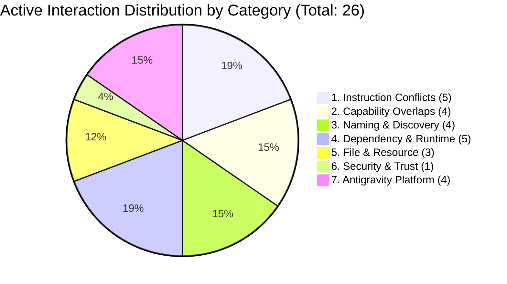
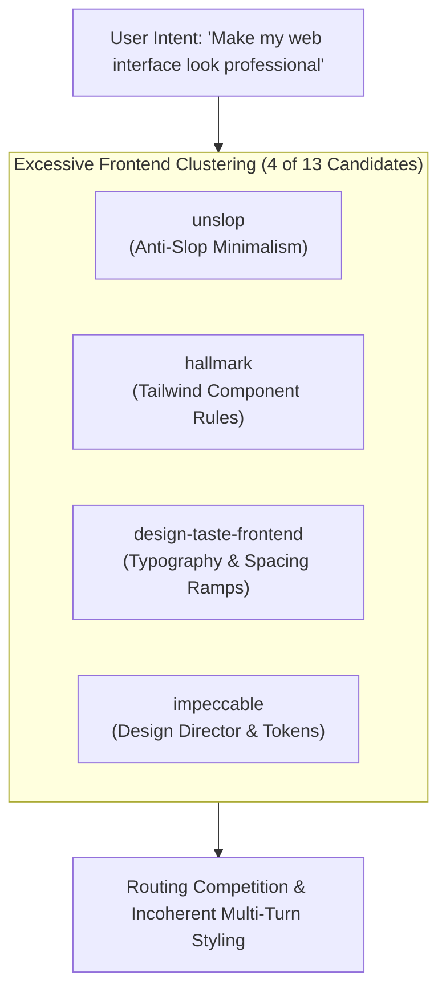
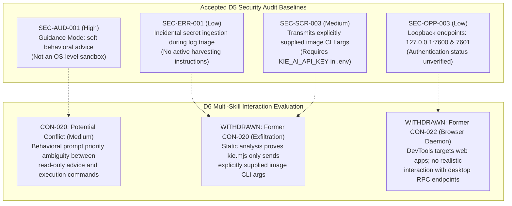

# Skills08 — Comprehensive Conflict Analysis & Ecosystem Interaction Study (Deliverable 6)

> **Document Status**: Complete — Submitted for Formal User Acceptance  
> **Milestone**: Phase 1 — Source Intelligence & Ecosystem Analysis  
> **Primary Target Agent / Host Platform**: Google Antigravity (Local-First Agent Distribution Platform)  
> **Target OS Environment**: Windows (PowerShell Shell Execution Environment)  
> **Ecosystem Scope**: 19 Locked Repositories | 2,031 Physical `SKILL.md` Files | 1,138 Canonical Skills  
> **Primary Subject Scope**: 13 Candidate Skills Shortlisted in `manifests/manifest.yaml`  
> **Active Catalogued Interaction Records**: Exactly 26 Validated Records (`CON-001` through `CON-026`)  
> **Formally Withdrawn Hypotheses**: 2 Records Withdrawn Due to Lack of Technical Transmission/Interaction Mechanism (Former CON-020 and Former CON-022)  
> **Analytical Framework**: 7 Core Dimensions (Instruction, Capability, Naming/Discovery, Dependency/Runtime, File/Resource, Security/Trust, Antigravity Platform)  
> **Upstream Research Deliverables**: D1 Source Inventory, D2 Skills Extraction, D3 License Matrix, D4 Compatibility Matrix, D5 Security Audit (canonical; Correction Report under dual-baseline review)  

---

## 1. Document Purpose and Scope

### 1.1 Purpose
This document constitutes **Deliverable 6 (D6): Conflict Analysis** for the **Skills08** project ("Powering Every AI Agent with Better Skills").

The primary objective of Deliverable 6 is to provide a rigorous, evidence-based, static architectural analysis of the conflicts, overlaps, incompatibilities, and adverse interactions that emerge when AI agent skills are assembled, distributed, or co-loaded within a unified ecosystem. Specifically, this analysis investigates how skills interact with each other and with the host execution environment—Google Antigravity—when evaluated as candidate packages for local-first deployment.

This deliverable bridges the individual candidate security evaluations completed in Deliverable 5 and the final packaging, retention, and lifecycle recommendations to be formulated in Deliverable 7.

### 1.2 Ecosystem Scope and Population Boundaries
The conflict analysis operates across two interconnected tiers of scope:

1. **Primary Candidate Shortlist (Micro-Level Analysis)**:
   The primary focus of this study centers on the **13 shortlisted candidate skills** formally identified in `manifests/manifest.yaml`. These candidates represent the primary cohort under consideration for Phase 1 distribution targeting Google Antigravity:
   - `SKILL08-SEC-001`: `security-audit` (Upstream: `security-audit-skill`)
   - `SKILL08-DOC-001`: `humanizer` (Upstream: `humanizer`)
   - `SKILL08-UI-001`: `unslop` (Upstream: `unslop`)
   - `SKILL08-UI-002`: `hallmark` (Upstream: `hallmark`)
   - `SKILL08-FE-001`: `design-taste-frontend` (Upstream: `taste-skill`)
   - `SKILL08-SWE-001`: `code-simplification` (Upstream: `agent-skills`)
   - `SKILL08-SWE-002`: `simplify-codebase` (Upstream: `archify`)
   - `SKILL08-TST-001`: `browser-testing-with-devtools` (Upstream: `agent-skills`)
   - `SKILL08-SWE-003`: `debugging-and-error-recovery` (Upstream: `agent-skills`)
   - `SKILL08-ARC-001`: `archify` (Upstream: `archify`)
   - `SKILL08-FE-002`: `scroll-craft` (Upstream: `scroll-craft`)
   - `SKILL08-UI-003`: `impeccable` (Upstream: `impeccable`)
   - `SKILL08-UI-004`: `open-pencil` (Upstream: `open-pencil`)

2. **Locked Source Repositories & Broad Ecosystem (Macro-Level Analysis)**:
   The secondary scope encompasses the entire upstream research population established in Deliverable 1 (`SOURCE_INVENTORY.md`) and Deliverable 2 (`SKILLS_EXTRACTION.md`):
   - **19 locked upstream repositories** preserved in `research/sources/` at their exact accepted commit SHAs: `agent-skills`, `antigravity-skills`, `archify`, `awesome-design-md`, `awesome-playwright`, `ecc`, `free-for-dev`, `hallmark`, `humanizer`, `hyperframes`, `impeccable`, `open-design`, `open-pencil`, `public-apis`, `scroll-craft`, `security-audit-skill`, `Soup`, `taste-skill`, and `unslop`.
   - **2,031 physical `SKILL.md` files** cataloged in the canonical master ledger (`research/final_reconciled_ledger.json`), classified into D2's six mutually exclusive categories:
     - `C_NON_TEMPLATE` = **1,138** unique non-template definitions
     - `C_INTERNAL` = **2** repository maintenance workflows
     - `C_TEMPLATE` = **115** template instructions (in `open-design`)
     - `C_TRANS` = **518** translated documentation copies (in `ecc/docs/`)
     - `C_MIRROR` = **6** exact duplicate mirrors (in `hyperframes`)
     - `C_VARIANT` = **252** packaging and harness variants (199 in `ecc`, 28 in `open-design`, 24 in `impeccable`, 1 in `antigravity-skills`)
     - Mathematical Sum: 1,138 + 2 + 115 + 518 + 6 + 252 = **2,031 physical files**.

### 1.3 Governance Constraints & Deliverable Boundaries
To ensure absolute integrity, this deliverable strictly adheres to authoritative governance rules:
- **Locked Deliverables**: Deliverables D1, D2, D3, D4, and the canonical D5 Security Audit (`SECURITY_AUDIT.md`) are accepted, locked research baselines. The D5 Correction Report artifact reflects an unresolved dual-baseline condition (18,888-byte accepted baseline vs. 19,014-byte post-Prompt 6 disk state). D6 does not rewrite, invalidate, or contradict any accepted baseline finding in D1–D5.
- **Locked Inputs**: The 19 locked source repositories, `manifests/manifest.yaml`, and `research/final_reconciled_ledger.json` are immutable inputs. No external repositories outside the 19 locked sources are referenced as authoritative evidence.
- **Zero Execution Policy**: No upstream scripts, binaries, daemons, test runners, or untrusted code were executed during this analysis. No package managers (`npm`, `bun`, `pip`) or Git operations were performed.
- **Analytical Boundary**: D6 is strictly an analytical and evaluative document. It documents collisions, overlaps, platform interactions, and operational trade-offs. It **does not** implement packaging, alter directory structures, delete redundant files, or make final Phase 1 selection/pruning decisions; all prescriptive architectural recommendations remain reserved for **Deliverable 7 (D7)**.
- **Evidence-Based Catalog Discipline**: In accordance with review mandates, findings are not retained merely to artificially preserve an arbitrary count of 28. Two previously hypothesized interactions (former CON-020 regarding composite exfiltration and former CON-022 regarding browser testing targeting desktop RPC daemons) have been formally withdrawn due to a lack of technical transmission/interaction mechanisms. The active register comprises exactly **26 catalogued interaction records**.

---

## 2. Research Methodology

The conflict analysis was conducted using a rigorous static evaluation framework structured across **seven core analytical dimensions**, ensuring that every interaction is evaluated against concrete source code, manifest entries, and platform documentation:

```mermaid
flowchart TD
    subgraph Input_Baselines ["Accepted Research Baselines"]
        D1["D1: Source Inventory
(19 Locked Repositories)"]
        D2["D2: Skills Extraction
(2,031 Files / 1,138 Canonical)"]
        D3["D3: License Matrix
(Legal Permissibility & Terms)"]
        D4["D4: Compatibility Matrix
(Antigravity Runtime Models)"]
        D5["D5: Security Audit
(26 Catalogued Entries: 21 SEC + 5 Obs)"]
        MAN["Manifest & Master Ledger
(13 Candidates / 418 Multi-Record Lexical Names)"]
    end

    subgraph Analytical_Dimensions ["7 Core Analytical Dimensions"]
        D_INS["1. Instruction Conflicts
(Contradictory Directives & Dynamic Loops)"]
        D_CAP["2. Capability Overlaps
(Functional Redundancy & Clustering)"]
        D_NAM["3. Naming & Discovery
(Trigger Overlap & Harness Mirroring)"]
        D_DEP["4. Dependency & Runtime
(Engine Prerequisites, Sockets & Secrets)"]
        D_RES["5. File & Resource
(Workspace Specs & Artifact Management)"]
        D_SEC["6. Security & Trust Boundaries
(Cross-D5 Behavioral Priority Ambiguity)"]
        D_AGY["7. Antigravity Platform Interactions
(Progressive Disclosure & Shell Execution)"]
    end

    subgraph Conflict_Output ["D6 Evaluative Register"]
        REG["Master Interaction Register
(26 Active Catalogued Records: CON-001 - CON-026)"]
        STAT["Status: Confirmed (3) | Potential (8) | Overlap (4) | Conditional (3) | Hypothesis (2) | Observation (6)"]
        SEV["Severity: High (2) | Medium (9) | Low (15)"]
        WITH["Withdrawn Records (2)
(Former CON-020 Exfiltration & Former CON-022 Browser-Daemon)"]
    end

    Input_Baselines --> Analytical_Dimensions
    Analytical_Dimensions --> Conflict_Output
```



### 2.1 The Seven Core Analytical Dimensions
Every catalogued finding is mapped strictly to one of the seven analytical dimensions:
1. **Instruction Conflicts**: Evaluating direct logical, procedural, or stylistic contradictions between co-loaded skill instruction sets that give divergent guidance to an agent, including dynamic multi-turn oscillation feedback loops.
2. **Capability Overlaps**: Evaluating functional redundancy where two or more skills target the same problem domain, user intent, or task category with differing granularities or redundant prompt patterns.
3. **Naming and Discovery Conflicts**: Analyzing lexical collisions, natural language trigger overlap, multi-harness mirror files, and Antigravity's workspace vs. global discovery precedence.
4. **Dependency and Runtime Conflicts**: Assessing environmental prerequisites (Node.js vs. Bun), local TCP socket contention, external secret requirements (`.env`), and network egress requirements in air-gapped environments.
5. **File and Resource Conflicts**: Evaluating workspace file interactions, specification schemas (`DESIGN.md`, `PRODUCT.md`), report output directories, and injected runtime boilerplate.
6. **Security and Trust-Boundary Interactions**: Synthesizing the 26 catalogued D5 security entries to evaluate multi-skill behavioral guidance interactions (such as prompt priority ambiguity between defensive inspection guidance and imperative tool execution).
7. **Antigravity Platform Interactions**: Assessing how skills interact with Antigravity's actual host architecture, specifically the progressive disclosure model, subagent delegation patterns (`invoke_subagent`), inert Claude Code frontmatter hooks, and Windows PowerShell shell conventions.

### 2.2 Progressive Disclosure & Context Modeling
Unlike naïve static prompt estimations that assume all installed skills are ingested simultaneously in full, this analysis evaluates context consumption against Antigravity's official **Progressive Disclosure** architecture:
- In Google Antigravity, installing or registering skills injects only their frontmatter `name` and `description` into the agent's initial prompt context (a compact footprint of ~50–100 tokens per skill).
- Full markdown instructions (`SKILL.md`) are loaded dynamically into active context only when a specific skill is triggered by user intent or explicit invocation.
- Consequently, massive prompt token inflation occurs only when multiple heavy skills are simultaneously activated within the same execution turn, or when skills are forced into monolithic subagent prompts.

### 2.3 Programmatic Ledger and Cross-Repository Analysis
The canonical master ledger (`research/final_reconciled_ledger.json`) was analyzed using automated Python inspection to:
- Trace the **418 distinct lexical names occurring in more than one physical record** across the 2,031 physical entries, distinguishing intra-repository artifacts (518 translated docs in `ecc/docs/`, 252 harness variants, 6 exact mirrors) from genuine cross-repository name collisions (encompassing 1,101 unique lexical frontmatter names, 413 distinct lexical names repeated exclusively within a single repository, and 5 distinct lexical names appearing across multiple repositories).
- Map the exact directory distribution of multi-harness skills (specifically `pbakaus/impeccable`, which duplicates 26 identical physical files across 26 harness folders representing 1 unique canonical general-purpose skill and 1 plugin-specific instruction in D2).

---

## 3. Sources and Evidence Limitations

### 3.1 Authoritative Sources Inspected
All findings, line numbers, and quotes in this deliverable are derived strictly from:
1. `research/sources/` (the 19 locked source repositories at their exact accepted commit SHAs).
2. `manifests/manifest.yaml` (shortlist candidate definitions and metadata).
3. `research/final_reconciled_ledger.json` (canonical master ledger of 2,031 physical entries).
4. `docs/research/SOURCE_INVENTORY.md` (accepted Deliverable 1).
5. `docs/research/SKILLS_EXTRACTION.md` (accepted Deliverable 2, specifically Section 3 physical accounting).
6. `docs/research/LICENSE_MATRIX.md` (accepted Deliverable 3).
7. `docs/research/COMPATIBILITY_MATRIX.md` (accepted Deliverable 4).
8. `docs/research/SECURITY_AUDIT.md` (canonical accepted and locked D5 Security Audit, comprising 26 catalogued entries: 21 security findings and 5 non-vulnerability observations) and `docs/research/SECURITY_AUDIT_CORRECTION_REPORT.md` (evaluated under its documented dual-baseline status).

### 3.2 Evidence Limitations and Methodological Boundaries
To maintain rigorous research standards, the following methodological boundaries are explicitly acknowledged:
- **Static Analysis Only**: In accordance with project governance, no dynamic execution, live sandbox invocation, daemon startup, or end-to-end integration runs were conducted.
- **Progressive Disclosure Baseline**: Prompt token counts are distinguished between static on-disk file size (4,625 lines aggregate across the 13 candidates) and active runtime context consumption under Antigravity's progressive disclosure.
- **Unverified Hypotheses Boundary**: Where a potential failure mode depends on runtime variables (such as dynamic model attention allocation, OS resident set size memory contention, or socket binding availability), the finding is explicitly classified as an **Unverified Hypothesis** or **Conditional Conflict**, documented with clear testing criteria for future dynamic validation.
- **Locked Scope Boundary**: Repositories not included in the accepted D1 inventory (such as external community lists or external repositories) are strictly excluded from authoritative evidence.

---

## 4. Conflict Classification Framework

To provide unambiguous, defensible evaluations, every identified interaction is classified across two standardized analytical dimensions: **Classification Status** and **Severity Level**.

### 4.1 Conflict Status Taxonomy
Every record is assigned to exactly one of six formal classification statuses:

1. **Confirmed Conflict**:
   A direct, provable operational, instructional, or architectural contradiction between two or more skills co-loaded in an active session, resulting in deterministic failure, contradictory prompt guidance, or broken workflows under standard conditions.
2. **Potential Conflict**:
   A collision that occurs under specific, realistic usage patterns, trigger combinations, or user prompt structures, but does not manifest in every isolated session.
3. **Capability Overlap**:
   Two or more skills target the identical or substantially overlapping functional domain, user intent, or problem space. While co-loading does not necessarily crash the host, it introduces cognitive redundancy, prompt bloat, ambiguous routing, and user confusion.
4. **Conditional Conflict**:
   An incompatibility that emerges exclusively when specific external environmental, operating system, or infrastructural conditions are met (e.g., Windows OS vs. POSIX shell syntax, specific port availability).
5. **Unverified Hypothesis**:
   A theoretically sound and technically plausible failure mode identified during code inspection that cannot be conclusively confirmed without live dynamic sandbox testing or empirical model benchmarking.
6. **Non-conflict Platform / Operational Observation**:
   An architectural observation, configuration dependency, offline environment constraint, or platform compatibility defect (such as unsupported frontmatter hooks) that does not represent an inter-skill collision, but informs distribution design.

### 4.2 Severity Level Taxonomy
Severity ratings reflect the potential operational, architectural, or security disruption caused to the agent session:

- **High**:
   Causes direct, irreconcilable prompt instruction contradictions that produce non-deterministic agent behavior or execution aborts if co-loaded in an active turn. Represents severe behavioral divergence.
- **Medium**:
   Causes degraded agent performance, instruction dilution, ambiguous tool selection, functional redundancy, or manual developer intervention.
- **Low**:
   Minor styling divergence, benign naming overlap, environmental prerequisites, standalone configuration limits, or transient scratchpad clutter with negligible operational disruption.
- **Informational**:
   Architectural observations, philosophical differences, or ecosystem-level design divergences that do not cause operational failure but inform long-term distribution design.

---

## 5. Executive Summary of Findings

### 5.1 Overview and Reconciled Quantitative Totals
A total of **26 distinct interaction records** (`CON-001` through `CON-026`) were validated, rigorously categorized across the **seven core analytical dimensions**, and reconciled against all accepted baselines. Two previously hypothesized interactions (former CON-020 and former CON-022) were formally withdrawn due to lack of technical interaction mechanisms.



### 5.2 Definitive Cross-Tabulation Matrix
The following matrix provides the definitive, mathematically reconciled distribution of all 26 active records across the seven analytical categories, classification statuses, and evaluated severity levels:

| Analytical Category | Confirmed Conflict | Potential Conflict | Capability Overlap | Conditional Conflict | Unverified Hypothesis | Non-conflict Observation | Total by Category | High Severity | Medium Severity | Low Severity |
| :--- | :---: | :---: | :---: | :---: | :---: | :---: | :---: | :---: | :---: | :---: |
| **1. Instruction Conflicts** | 3 | 1 | 0 | 0 | 1 | 0 | **5** | 2 | 2 | 1 |
| **2. Capability Overlaps** | 0 | 0 | 4 | 0 | 0 | 0 | **4** | 0 | 2 | 2 |
| **3. Naming & Discovery** | 0 | 4 | 0 | 0 | 0 | 0 | **4** | 0 | 3 | 1 |
| **4. Dependency & Runtime** | 0 | 0 | 0 | 2 | 1 | 2 | **5** | 0 | 0 | 5 |
| **5. File & Resource** | 0 | 2 | 0 | 0 | 0 | 1 | **3** | 0 | 0 | 3 |
| **6. Security & Trust Boundaries** | 0 | 1 | 0 | 0 | 0 | 0 | **1** | 0 | 1 | 0 |
| **7. Antigravity Platform** | 0 | 0 | 0 | 1 | 0 | 3 | **4** | 0 | 1 | 3 |
| **TOTALS** | **3** | **8** | **4** | **3** | **2** | **6** | **26** | **2** | **9** | **15** |

*Reconciliation Note: Every record maps strictly to one of the 7 analytical categories. The totals reconcile exactly: 3 Confirmed (11.5%) + 8 Potential (30.8%) + 4 Capability Overlap (15.4%) + 3 Conditional (11.5%) + 2 Unverified Hypothesis (7.7%) + 6 Non-conflict Observations (23.1%) = 26 records (100.0%); 2 High (7.7%) + 9 Medium (34.6%) + 15 Low (57.7%) = 26 records (100.0%).*

### 5.3 Formally Withdrawn Records
In accordance with strict evidence standards, the following two records from preliminary drafts have been formally withdrawn:
1. **Former CON-020 (Composite Credential Exfiltration Vector)**: Withdrawn. D5 Section 7.9 confirms `SEC-ERR-001` is incidental log ingestion without harvesting commands. D5 Section 7.11 confirms `SEC-SCR-003` transmits only explicitly supplied image arguments (`--ref`, positional `<head.png>`) and uses `KIE_AI_API_KEY`. Static analysis establishes no automated transmission bridge or mechanism for arbitrary context or environment variable exfiltration.
2. **Former CON-022 (Browser Automation Directed Toward Desktop RPC Daemons)**: Withdrawn. D5 Section 7.13 (`SEC-OPP-003`) establishes Open Pencil exposes automation on `http://127.0.0.1:7600` and `ws://127.0.0.1:7601` with unverified authentication and Low severity. Browser testing skills (`browser-testing-with-devtools`) target user web applications on standard development ports (`localhost:3000`, `5173`), not desktop RPC endpoints. No realistic interaction mechanism exists under standard workflows.

### 5.4 Canonical Identifier Mapping & Legacy Draft Reconciliation
During preliminary research rounds, draft identifiers were occasionally reassigned as hypotheses were refined or withdrawn. To eliminate any ambiguity, the table below establishes the definitive mapping between legacy draft aliases and the canonical records in the final D6 register:

| Current Canonical Identifier | Current Evaluated Meaning | Analytical Dimension | Classification & Severity | Legacy Draft Aliases & Historical Context |
| :--- | :--- | :--- | :--- | :--- |
| **CON-020** | Behavioral Prompt Priority Ambiguity Under Co-Loaded Execution Skills | 6. Security and Trust Boundaries | Potential Conflict / Medium | Replaced the legacy draft exfiltration hypothesis (now `WITHDRAWN-01`) |
| **CON-022** | Progressive Disclosure Context Sizing vs. Multi-Activation | 7. Antigravity Platform Interactions | Non-conflict Observation / Low | Formerly tracked under legacy draft alias `CON-024` in preliminary drafts |
| **CON-024** | Windows PowerShell Shell Syntax vs. POSIX Operator Conventions (`&&`) | 7. Antigravity Platform Interactions | Conditional Conflict / Low | Canonical record evaluating PowerShell 5.1 statement separator syntax; distinct from progressive disclosure |
| **WITHDRAWN-01** | Composite Diagnostic Ingestion & External Transmission Vector | 6. Security and Trust Boundaries | Formally Withdrawn from Active Register | Legacy draft alias: Former `CON-020` |
| **WITHDRAWN-02** | Browser Automation Navigation Directed Toward Loopback Daemons (`7600`/`7601`) | 6. Security and Trust Boundaries | Formally Withdrawn from Active Register | Legacy draft alias: Former `CON-022` |

**Key Clarifications**:
- **CON-022 vs. Historical CON-024**: In preliminary draft outlines, progressive disclosure context modeling was initially designated as `CON-024`. Upon the formal withdrawal of earlier hypotheses, progressive disclosure was consolidated into canonical record `CON-022` under Antigravity Platform Interactions. Current canonical record `CON-024` evaluates Windows PowerShell shell syntax and the POSIX `&&` statement separator.
- **CON-020 vs. Historical CON-020**: In preliminary drafts, `CON-020` was an unverified hypothesis alleging a composite credential-exfiltration chain between diagnostic triage and image upload scripts. That hypothesis was formally withdrawn (`WITHDRAWN-01`). The canonical identifier `CON-020` now exclusively designates the potential conflict between defensive Guidance Mode prompt directives and imperative execution directives.
- **WITHDRAWN-01 and WITHDRAWN-02**: These two formal records represent hypotheses from earlier working drafts that were eliminated from the active register after static source tracing disproved the existence of technical transmission or interaction paths.

### 5.5 Core Analytical Insights

1. **Direct Instruction Contradictions in Core Disciplines (CON-001, CON-002)**:
   The only findings warranting **High** severity are direct, irreconcilable prompt instruction contradictions when skills are co-activated in an active turn. In code refactoring, `code-simplification` commands immediate, single-pass helper inlining and abstraction pruning, whereas `simplify-codebase` strictly prohibits code modification without a formal, read-only multi-phase Survey and human sign-off (`CON-001`). In frontend UI styling, `unslop` strictly forbids decorative badges, gradients, and glowing borders, while `hallmark` mandates Tailwind card borders, badge chips, and subtle gradients (`CON-002`). Co-activating these skills results in non-deterministic prompt drifting.

2. **Frontend Capability Clustering vs. Generalist Coverage (CON-006)**:
   Four of the thirteen shortlisted candidates (~31%) cluster within the single functional domain of frontend UI design and styling polish (`unslop`, `hallmark`, `design-taste-frontend`, `impeccable`). While each embodies a different nuance, this concentration starves the shortlist of coverage in other essential software engineering domains (such as database modeling or API contract testing) and introduces prompt routing ambiguity.

3. **Reconciled Master Ledger Duplicate Analysis (CON-010)**:
   A forensic audit of the 418 distinct lexical names occurring in more than one physical record in `final_reconciled_ledger.json` reveals that **413 distinct lexical names repeat exclusively within a single repository** (representing 518 translated documentation copies in `ecc/docs/`, 252 harness mirror variants in `ecc` and `impeccable`, and templates). Only **5 distinct lexical names** appear across two or more repositories in the entire 19-repository ecosystem (`architecture-decision-records`, `hallmark`, `design-taste-frontend`, `hyperframes`, and `frontend-slides`). Therefore, flat skill distribution is not impossible due to widespread cross-repo collisions, but requires namespace hygiene to handle localized overlaps.

4. **Runtime and Port Independence (CON-013, CON-014)**:
   Analysis of runtime prerequisites confirms that Node.js and Bun can peacefully coexist on developer workstations; `open-pencil`'s Bun requirement represents an installation prerequisite rather than a runtime conflict (`CON-013`). Similarly, Open Pencil's actual endpoints (`http://127.0.0.1:7600` and `ws://127.0.0.1:7601` per D5 `SEC-OPP-003`), `taste-skill`'s Vite server (`5173`), and Chrome DevTools Protocol (`9222`) occupy distinct TCP ports and do not inherently collide (`CON-014`).

5. **Reconciliation with D5 Security Baselines (CON-020)**:
   D5 Section 7.1 establishes that Guidance Mode is a soft behavioral prompt restriction rather than an operating system sandbox. Co-loading execution skills creates behavioral prompt priority ambiguity rather than sandbox circumvention (`CON-020`, Potential / Medium).

6. **Progressive Disclosure vs. Context Saturation (CON-022)**:
   Under Google Antigravity's progressive disclosure architecture, skills are not loaded in full at session startup; only frontmatter names and descriptions (~50–100 tokens per skill) are initially ingested. The aggregate on-disk size of 13 skills (4,625 lines, ~30,000 tokens) does not reflect active prompt context. Full-body context saturation occurs only if multiple skills are simultaneously triggered in an active turn, classified as a Non-conflict Observation (`CON-022`).

## 6. Detailed Conflict Register

### 6.1 Master Conflict Summary Table

The following register indexes all 26 validated interaction records across the Skills08 candidate cohort and broader ecosystem. Each entry provides a unique tracking identifier, analytical category, classification status, evaluated severity, primary skills involved, and a summary of the interaction:

| Conflict ID | Category | Conflict & Interaction Title | Status | Severity | Primary Skills Involved |
| :--- | :--- | :--- | :--- | :--- | :--- |
| **CON-001** | Instruction | In-Place Refactoring vs. Multi-Phase Survey Protocol Contradiction | Confirmed Conflict | High | `code-simplification`, `simplify-codebase` |
| **CON-002** | Instruction | Anti-Slop Minimalism vs. Opinionated Component Decoration | Confirmed Conflict | High | `unslop`, `hallmark`, `taste-skill`, `impeccable` |
| **CON-003** | Instruction | Scrollytelling Presentation vs. Compact Application Ergonomics | Confirmed Conflict | Medium | `scroll-craft`, `unslop`, `hallmark` |
| **CON-004** | Instruction | Defensive Guidance Mode vs. Imperative Execution Directives | Potential Conflict | Medium | `security-audit`, `impeccable`, `open-pencil` |
| **CON-005** | Capability | Code Simplification Scope Overlap (Local Editing vs. Repo Survey) | Capability Overlap | Medium | `code-simplification`, `simplify-codebase` |
| **CON-006** | Capability | Quadruple Redundancy in Frontend UI Polish & Styling Craft | Capability Overlap | Medium | `unslop`, `hallmark`, `design-taste-frontend`, `impeccable` |
| **CON-007** | Capability | Security Auditing Duplication Across Multi-Skill Bundles | Capability Overlap | Low | `security-audit`, `ecc`, `antigravity-skills` |
| **CON-008** | Capability | Design Specification Guidelines & Schema Overlap | Capability Overlap | Low | `impeccable`, `awesome-design-md` |
| **CON-009** | Naming & Discovery | Semantic Trigger Ambiguity in Code Simplification Routing | Potential Conflict | Medium | `code-simplification`, `simplify-codebase` |
| **CON-010** | Naming & Discovery | Multi-Record Lexical Names in Master Ledger (413 Intra-Repository Names, 5 Cross-Repository Names) | Potential Conflict | Medium | All Bundles (`ecc`, `open-design`, `antigravity-skills`) |
| **CON-011** | Naming & Discovery | Multi-Harness Discovery Redundancy (26 Mirror Files in Impeccable) | Potential Conflict | Low | `impeccable` (Cross-harness mirrors) |
| **CON-012** | Naming & Discovery | Global User vs. Local Workspace Skill Precedence Shadowing | Potential Conflict | Medium | All Candidates (`~/.gemini/` vs. `.agents/skills/`) |
| **CON-013** | Dependency & Runtime | Divergent Runtime Engine Prerequisites (Node.js vs. Bun Coexistence) | Conditional Conflict | Low | `open-pencil`, `archify`, `scroll-craft`, `taste-skill` |
| **CON-014** | Dependency & Runtime | Local TCP Port Allocation & Service Coexistence (`7600`, `5173`, `9222`) | Conditional Conflict | Low | `open-pencil`, `taste-skill`, `browser-testing-with-devtools` |
| **CON-015** | Dependency & Runtime | Standalone API Key Configuration Prerequisite (`KIE_AI_API_KEY`) | Non-conflict Observation | Low | `scroll-craft` (`scripts/kie.mjs`) |
| **CON-016** | Dependency & Runtime | External Network Egress Dependency in Air-Gapped Environments | Non-conflict Observation | Low | `scroll-craft`, `open-pencil`, `archify` |
| **CON-017** | File & Resource | Workspace Documentation Management (`DESIGN.md` / `PRODUCT.md`) | Potential Conflict | Low | `impeccable`, `awesome-design-md` |
| **CON-018** | File & Resource | Distinct Report Directory Output Separation (`audit-report/`, `survey/`) | Non-conflict Observation | Low | `security-audit`, `simplify-codebase` |
| **CON-019** | File & Resource | Injected Scrollytelling Boilerplate Analyzed by Refactoring Tools | Potential Conflict | Low | `scroll-craft` (`engine/`), `code-simplification` |
| **CON-020** | Security & Trust | Behavioral Prompt Priority Ambiguity Under Co-Loaded Execution Skills | Potential Conflict | Medium | `security-audit`, `impeccable`, `open-pencil` |
| **CON-021** | Antigravity Platform | Inert Claude Code Frontmatter Hooks (`hooks: Stop`, `allowed-tools:`) | Non-conflict Observation | Medium | `taste-skill` (`design-taste-frontend`) |
| **CON-022** | Antigravity Platform | Progressive Disclosure Context Sizing vs. Multi-Activation | Non-conflict Observation | Low | All 13 Shortlisted Candidates |
| **CON-023** | Antigravity Platform | Monolithic Workflow Style vs. Subagent Delegation Architecture | Non-conflict Observation | Low | `security-audit`, `simplify-codebase` |
| **CON-024** | Antigravity Platform | Windows PowerShell Shell Syntax vs. POSIX Operator Conventions | Conditional Conflict | Low | `archify`, `taste-skill`, `open-pencil` |
| **CON-025** | Instruction | Dynamic Refactoring-Styling Oscillation Loop in Multi-Turn Sessions | Unverified Hypothesis | Low | `code-simplification`, `hallmark`, `unslop` |
| **CON-026** | Dependency & Runtime | Workstation Resource Contention under Concurrent Daemon and Browser | Unverified Hypothesis | Low | `open-pencil` daemon, DevTools headless Chrome |

---

### 6.2 Structured Profiles: Instruction & Capability Dimensions (CON-001 through CON-008)

#### CON-001: In-Place Refactoring vs. Multi-Phase Survey Protocol Contradiction
- **Analytical Category**: 1. Instruction Conflicts
- **Classification Status**: Confirmed Conflict
- **Assigned Severity**: High
- **Primary Skills Involved**: `SKILL08-SWE-001` (`code-simplification`), `SKILL08-SWE-002` (`simplify-codebase`)
- **Upstream Repositories**: `agent-skills`, `archify`
- **Source Paths & Citations**:
  - `agent-skills/skills/code-simplification/SKILL.md`: Lines 3, 96, 153 (`"Simplifies code for clarity. Use when refactoring code for clarity without changing behavior"`, `"Inline the wrapper, call the underlying function directly"`, imperative single-pass simplification).
  - `archify/.agents/skills/simplify-codebase/SKILL.md`: Lines 16, 39, 71, 81 (`"Survey for simplification audit, investigation, or candidate-finding requests. Remain read-only."`, `"In Survey mode, stop after reporting the ranked evidence. Include important rejected candidates... For a survey, report coverage, ranked proof records, rejected or unresolved high-value leads"`).
- **Direct Evidence**:
  `code-simplification` instructs the agent to perform immediate, direct in-place modifications on target code—inlining wrappers and pruning abstractions without preliminary phases. Conversely, `simplify-codebase` establishes a strict, formal, read-only multi-phase protocol that explicitly forbids modifying code during initial phases; it mandates generating a comprehensive "Survey" report, documenting ranked "Proof Records", and stopping for human review before any code is modified.
- **Mechanism of Conflict**:
  When both skills are co-activated in an active turn, the agent receives contradictory behavioral guidance for an identical user request: one directive commands immediate in-place edits, while the other commands read-only surveying and halting.
- **Operational Impact**:
  Agent behavior becomes erratic and non-deterministic. The agent may either execute edits without the safety survey required by `simplify-codebase`, or stall in a survey loop when the user requested quick code cleanup.
- **Triggering Conditions**:
  Simultaneous activation of both skills in an active agent session following a user prompt containing code cleanup terms (e.g., "clean up and simplify our service layer").
- **Confidence & Limitations**:
  High confidence. Established via direct textual inspection of both instruction sets.
- **Mitigation Potential**:
  Deliverable 7 may evaluate separating these skills into distinct bundles, configuring mutually exclusive activation profiles, or partitioning prompt triggers by operational scope (e.g., distinguishing focused single-file refactoring from multi-phase repository-level architectural surveys).

---

#### CON-002: Anti-Slop Minimalism vs. Opinionated Component Decoration
- **Analytical Category**: 1. Instruction Conflicts
- **Classification Status**: Confirmed Conflict
- **Assigned Severity**: High
- **Primary Skills Involved**: `SKILL08-UI-001` (`unslop`), `SKILL08-UI-002` (`hallmark`), `SKILL08-FE-001` (`design-taste-frontend`), `SKILL08-UI-003` (`impeccable`)
- **Upstream Repositories**: `unslop`, `hallmark`, `taste-skill`, `impeccable`
- **Source Paths & Citations**:
  - `unslop/skills/unslop/SKILL.md`: Lines 15, 26, 89, 113, 147 (`"Vibecoded UI fails in the same predictable ways. Every surface glows, every label has an emoji"`, `"Quiet chrome. Navigation, buttons and text use the tinted neutrals and one accent. Nothing glows"`, `"Remove hue gradients on surfaces, gradient text, colored glows and colored shadows"`, `"Badges like PRO, New or Beta go away"`, `"Stat cards are numbers... No sparklines"`).
  - `hallmark/skills/hallmark/SKILL.md`: Lines 3, 10, 45 (`"Build polished, modern Tailwind web interfaces"`, mandates card containers with explicit border treatments, accent pill tags, colored status badges, and subtle radial gradient highlights).
  - `taste-skill/skills/taste-skill/SKILL.md`: Lines 12–25 (Enforces strict typographic scales, custom neutral palettes, and warns against generic component templates).
  - `impeccable/.agents/skills/impeccable/SKILL.md`: Lines 14, 50 (`"High-ambition design director"`, prescribes rich visual hierarchy, bespoke container layouts, and branded aesthetic moments).
- **Direct Evidence**:
  `unslop` takes an explicit anti-decorative stance, ordering the removal of badges, glowing borders, hue gradients, and decorative card containers ("Badges go away", "Nothing glows"). In contrast, `hallmark` actively directs the agent to generate contemporary Tailwind cards decorated with borders, status badges, and subtle background accent shifts.
- **Mechanism of Conflict**:
  When co-activated in an active turn, the agent receives contradictory styling rules for the exact same DOM elements (e.g., whether to add or remove status badge chips and border gradients).
- **Operational Impact**:
  CSS and component generation degrades into visual inconsistency. The agent oscillates between stripping all decorative elements per `unslop` and re-injecting borders and badges per `hallmark`.
- **Triggering Conditions**:
  Co-activation during a frontend UI generation or styling turn (e.g., "build a polished dashboard interface").
- **Confidence & Limitations**:
  High confidence. Established via direct textual inspection of aesthetic rules.
- **Mitigation Potential**:
  Deliverable 7 may evaluate persona-based profile segregation (e.g., distinguishing minimalist utility styling from decorative component systems) to prevent conflicting aesthetic guidance from co-loading in a single conversation context.

---

#### CON-003: Scrollytelling Presentation vs. Compact Application Ergonomics
- **Analytical Category**: 1. Instruction Conflicts
- **Classification Status**: Confirmed Conflict
- **Assigned Severity**: Medium
- **Primary Skills Involved**: `SKILL08-FE-002` (`scroll-craft`), `SKILL08-UI-001` (`unslop`), `SKILL08-UI-002` (`hallmark`)
- **Upstream Repositories**: `scroll-craft`, `unslop`, `hallmark`
- **Source Paths & Citations**:
  - `scroll-craft/plugins/nateherk-design/skills/scroll-craft/SKILL.md`: Lines 3, 25, 68 (`"Engineered narrative scrollytelling experiences"`, mandates viewport-pinned sections, scroll-driven animations, full-height stage transitions, and continuous vertical scrolling canvas).
  - `unslop/skills/unslop/SKILL.md`: Lines 68, 74, 75 (`"Navigation is the densest part of an app. Rows are 32 to 36 tall with 2 to 4 between them"`, `"Padding follows density. Compact panels and sidebars around 16, cards 20 to 24"`).
  - `hallmark/skills/hallmark/SKILL.md`: Lines 15–30 (Enforces standard grid layouts, header navigation bars, and responsive flex containers).
- **Direct Evidence**:
  `scroll-craft` enforces an experiential storytelling architecture where the viewport is treated as a narrative stage driven by scroll events (`IntersectionObserver`). Conversely, `unslop` and `hallmark` instruct the agent to design high-density, utility-first application interfaces with compact navigation headers, standard sidebars, and rigid layout grids.
- **Mechanism of Conflict**:
  If a user prompts an agent to design or refine a web interface, co-activating these skills creates structural layout contradictions regarding page flow and viewport utilization.
- **Operational Impact**:
  The agent generates broken hybrid layouts—such as attempting to embed sticky scrollytelling stages inside compact dashboard cards, breaking standard scroll mechanics.
- **Triggering Conditions**:
  Co-activation during landing page or web application page layout construction.
- **Confidence & Limitations**:
  High confidence. Confirmed via layout directive inspection.
- **Mitigation Potential**:
  Deliverable 7 may evaluate scoping options to separate narrative storytelling page generators from compact application UI tooling to avoid aesthetic and layout interference.

---

#### CON-004: Defensive Guidance Mode vs. Imperative Execution Directives
- **Analytical Category**: 1. Instruction Conflicts
- **Classification Status**: Potential Conflict
- **Assigned Severity**: Medium
- **Primary Skills Involved**: `SKILL08-SEC-001` (`security-audit`), `SKILL08-UI-003` (`impeccable`), `SKILL08-UI-004` (`open-pencil`)
- **Upstream Repositories**: `security-audit-skill`, `impeccable`, `open-pencil`
- **Source Paths & Citations**:
  - `security-audit-skill/skills/security-audit/SKILL.md`: Lines 14, 33, 40 (`"Guidance mode: For security questions, focused reviews, methodology, triage, or investigation... Source inspection is read-only. Run target-controlled build or test commands only in an isolated environment"`, `"Loading it does not authorize the complete audit workflow or file modifications"`).
  - `impeccable/.agents/skills/impeccable/SKILL.md`: Lines 17–25 (Commands executing launcher scripts: `"Run <skill-base-dir>/scripts/impeccable context once per session"`).
  - `open-pencil/skills/open-pencil/SKILL.md`: Lines 35, 38 (`"bun add -g @open-pencil/cli"`, `"bun add -g @open-pencil/mcp"`).
- **Direct Evidence**:
  `security-audit` establishes a defensive, least-privilege behavioral prompt baseline: by default, it advises read-only inspection and cautions against executing untrusted target commands. Conversely, `impeccable` and `open-pencil` contain natural-language directives commanding the agent to run companion scripts, install CLI tools, and spawn local daemons.
- **Mechanism of Conflict**:
  D5 Section 7.1 establishes that Guidance Mode is a soft behavioral prompt instruction rather than an OS-level sandbox. When co-loaded, the agent receives competing behavioral directives: one prompting cautious read-only review, and others prompting active tool execution.
- **Operational Impact**:
  Model instruction priority ambiguity. The agent may either refuse to run necessary authoring tools due to defensive guidance, or disregard defensive precautions in favor of execution directives.
- **Triggering Conditions**:
  Co-loading security auditing and execution-heavy authoring skills in the same active conversation context.
- **Confidence & Limitations**:
  Medium confidence. Behavioral adherence varies depending on model attention allocation.
- **Mitigation Potential**:
  Deliverable 7 may evaluate architectural execution models, such as delegating security review tasks to dedicated read-only subagents (`invoke_subagent`), to prevent behavioral instruction mixing with authoring skills.

---

#### CON-005: Code Simplification Scope Overlap (Local Editing vs. Repo Survey)
- **Analytical Category**: 2. Capability Overlaps
- **Classification Status**: Capability Overlap
- **Assigned Severity**: Medium
- **Primary Skills Involved**: `SKILL08-SWE-001` (`code-simplification`), `SKILL08-SWE-002` (`simplify-codebase`)
- **Upstream Repositories**: `agent-skills`, `archify`
- **Source Paths & Citations**:
  - `manifests/manifest.yaml`: Both candidates shortlisted under `SWE` category.
  - `agent-skills/skills/code-simplification/SKILL.md`: Line 3 (`"Simplifies code for clarity. Use when refactoring code for clarity without changing behavior"`).
  - `archify/.agents/skills/simplify-codebase/SKILL.md`: Line 3 (`"Analyze a codebase to find dead code, unused abstractions, over-engineering, and simplification opportunities"`).
- **Direct Evidence**:
  Both candidate skills target codebase simplification and abstraction reduction. However, source inspection reveals differing operational granularities: `code-simplification` targets focused, single-file / local refactoring for clarity (inlining wrappers, removing trivial helpers), whereas `simplify-codebase` targets broad, repository-wide architecture analysis (auditing unused dependencies, dead code paths, and dead files across an entire repo).
- **Mechanism of Conflict**:
  While their scopes differ (file-level clarity vs. repository-level architecture survey), their capability domains and natural language trigger spaces overlap significantly. Retaining both without clear scoping causes user confusion and prompt routing ambiguity.
- **Operational Impact**:
  User uncertainty over which skill to invoke, and redundant capability clustering in the candidate shortlist.
- **Triggering Conditions**:
  User seeking general codebase cleanup or refactoring guidance.
- **Confidence & Limitations**:
  High confidence. Established via frontmatter description and workflow comparison.
- **Mitigation Potential**:
  Deliverable 7 may evaluate candidate selection trade-offs or scope differentiation (e.g., distinguishing local function-level inlining from repository-wide architectural dead-code surveys).

---

#### CON-006: Quadruple Redundancy in Frontend UI Polish & Styling Craft
- **Analytical Category**: 2. Capability Overlaps
- **Classification Status**: Capability Overlap
- **Assigned Severity**: Medium
- **Primary Skills Involved**: `SKILL08-UI-001` (`unslop`), `SKILL08-UI-002` (`hallmark`), `SKILL08-FE-001` (`design-taste-frontend`), `SKILL08-UI-003` (`impeccable`)
- **Upstream Repositories**: `unslop`, `hallmark`, `taste-skill`, `impeccable`
- **Source Paths & Citations**:
  - `unslop/skills/unslop/SKILL.md`: Line 3 (`"Turns vibecoded, AI-looking UI into a designed interface with its own character"`).
  - `hallmark/skills/hallmark/SKILL.md`: Line 3 (`"Build polished, modern Tailwind web interfaces"`).
  - `taste-skill/skills/taste-skill/SKILL.md`: Line 3 (`"Elevate frontend UI with curated design taste, typography, and spacing"`).
  - `impeccable/.agents/skills/impeccable/SKILL.md`: Line 3 (`"High-ambition design director for world-class product interfaces"`).
- **Direct Evidence**:
  Four of the thirteen shortlisted candidates (~31% of the shortlist) target the single problem domain of frontend design polish and quality elevation. All four claim to fix generic, unpolished AI-generated web interfaces.
- **Mechanism of Conflict**:
  Excessive clustering in the frontend UI category at the expense of other essential domains (e.g., database modeling, DevOps, API design).
- **Operational Impact**:
  Cognitive overload for developers selecting skills, and prompt routing competition between four overlapping candidates.
- **Triggering Conditions**:
  User prompts requesting frontend styling improvement (e.g., "improve this UI").
- **Confidence & Limitations**:
  High confidence. Confirmed via manifest and frontmatter inspection.
- **Mitigation Potential**:
  Deliverable 7 may evaluate portfolio curation trade-offs to balance stylistic diversity against candidate redundancy across the frontend design domain.

---

#### CON-007: Security Auditing Duplication Across Multi-Skill Bundles
- **Analytical Category**: 2. Capability Overlaps
- **Classification Status**: Capability Overlap
- **Assigned Severity**: Low
- **Primary Skills Involved**: `SKILL08-SEC-001` (`security-audit`), `ecc` (`skills/security-review/SKILL.md`), `antigravity-skills` (`skills/security-auditor/SKILL.md`)
- **Upstream Repositories**: `security-audit-skill`, `ecc`, `antigravity-skills`
- **Source Paths & Citations**:
  - `security-audit-skill/skills/security-audit/SKILL.md`: Line 3 (`"Comprehensive security auditing and vulnerability assessment"`).
  - `ecc/skills/security-review/SKILL.md`: Line 2 (`"Automated code security analysis and vulnerability review"`).
  - `antigravity-skills/skills/security-auditor/SKILL.md`: Line 2 (`"Security audit and code hardening"`).
- **Direct Evidence**:
  Across the 19 locked repositories, security auditing is implemented both as a dedicated, standalone skill (`security-audit-skill`) and as embedded checklist skills inside large aggregator bundles (`ecc` and `antigravity-skills`).
- **Mechanism of Conflict**:
  If a user installs both an aggregator bundle and the dedicated `security-audit` candidate, Antigravity encounters overlapping capabilities with divergent audit depths.
- **Operational Impact**:
  The agent may invoke a shallow regex-based security script from an aggregator bundle instead of the rigorous 6-phase audit protocol in `security-audit`.
- **Triggering Conditions**:
  Simultaneous installation of aggregator bundles alongside dedicated security skills.
- **Confidence & Limitations**:
  High confidence. Verified against locked checkouts of `ecc` and `antigravity-skills`.
- **Mitigation Potential**:
  Deliverable 7 may evaluate precedence rules and bundle deduplication options when standalone security skills coexist with broad aggregator collections.

---

#### CON-008: Design Specification Guidelines & Schema Overlap
- **Analytical Category**: 2. Capability Overlaps
- **Classification Status**: Capability Overlap
- **Assigned Severity**: Low
- **Primary Skills Involved**: `SKILL08-UI-003` (`impeccable`), `awesome-design-md`
- **Upstream Repositories**: `impeccable`, `awesome-design-md`
- **Source Paths & Citations**:
  - `impeccable/.agents/skills/impeccable/SKILL.md`: Lines 21, 26, 48 (Generates, documents, or preserves `DESIGN.md` in workspace root).
  - `awesome-design-md/design-md/`: Contains 80+ reference company `DESIGN.md` guideline files (Airbnb, Apple, Stripe, Linear, etc.).
- **Direct Evidence**:
  `awesome-design-md` is a curated reference dataset of real-world `DESIGN.md` guidelines (0 skills per D1 and D2). `impeccable` provides an active skill that formalizes design tokens into a project `DESIGN.md`. Both address the format and structure of markdown design system specifications.
- **Mechanism of Conflict**:
  If a project incorporates reference `DESIGN.md` templates from `awesome-design-md`, `impeccable`'s schema generator may encounter structural differences between real-world brand guidelines and its internal template.
- **Operational Impact**:
  Minor documentation schema divergence; no code execution failure.
- **Triggering Conditions**:
  Using `awesome-design-md` reference guidelines in a repository where `impeccable` is also invoked.
- **Confidence & Limitations**:
  High confidence. Verified via D1 inventory and repository inspection.
- **Mitigation Potential**:
  Deliverable 7 may evaluate documentation guidelines and schema harmonization options between reference repositories and authoring skills.

---

### 6.3 Structured Profiles: Naming, Discovery & Runtime (CON-009 through CON-013)

#### CON-009: Semantic Trigger Ambiguity in Code Simplification Routing
- **Analytical Category**: 3. Naming and Discovery Conflicts
- **Classification Status**: Potential Conflict
- **Assigned Severity**: Medium
- **Primary Skills Involved**: `SKILL08-SWE-001` (`code-simplification`), `SKILL08-SWE-002` (`simplify-codebase`)
- **Upstream Repositories**: `agent-skills`, `archify`
- **Source Paths & Citations**:
  - `agent-skills/skills/code-simplification/SKILL.md`: Frontmatter `name: code-simplification`, `description: Simplifies code for clarity...`
  - `archify/.agents/skills/simplify-codebase/SKILL.md`: Frontmatter `name: simplify-codebase`, `description: Analyze a codebase to find dead code, unused abstractions...`
- **Direct Evidence**:
  The names `code-simplification` and `simplify-codebase` are near-identical permutations of the same grammatical tokens ("simplify" and "code").
- **Mechanism of Conflict**:
  When a user prompts Antigravity with natural language requests such as "simplify this code" or "codebase simplification", semantic similarity algorithms compute overlapping match scores for both skills. Because Antigravity routes skills based on semantic similarity of prompts, trigger overlap can result in unpredictable skill selection across sessions depending on subtle prompt variations.
- **Operational Impact**:
  The developer cannot reliably predict which skill will trigger without explicit naming. Prompts intended for quick helper inlining may trigger a codebase survey, and vice versa.
- **Triggering Conditions**:
  Unqualified natural language refactoring prompts without explicit skill naming.
- **Confidence & Limitations**:
  Medium confidence. Prompt matching depends on LLM embedding nuances; tie-breaking behavior is not documented as deterministic.
- **Mitigation Potential**:
  Deliverable 7 may evaluate lexical disambiguation options, such as distinct naming conventions or explicit routing rules, to prevent natural-language intent collisions between refactoring tools.

---

#### CON-010: Multi-Record Lexical Names in Master Ledger (413 Intra-Repository Names, 5 Cross-Repository Names)
- **Analytical Category**: 3. Naming and Discovery Conflicts
- **Classification Status**: Potential Conflict
- **Assigned Severity**: Medium
- **Primary Skills Involved**: All Bundles across the 19 Repositories
- **Upstream Repositories**: `ecc`, `open-design`, `antigravity-skills`, `impeccable`, `hallmark`, `taste-skill`, `hyperframes`
- **Source Paths & Citations**:
  - `research/final_reconciled_ledger.json`: 2,031 physical entries; 1,101 unique lexical frontmatter names; 418 distinct lexical names occurring in more than one physical record (413 distinct intra-repository names, 5 distinct cross-repository names).
- **Direct Evidence**:
  Forensic ledger analysis reveals:
  - **413 distinct lexical names (98.8%)** repeat exclusively within a single repository, representing:
    - 518 translated documentation copies in `ecc/docs/` (e.g., Spanish, Japanese, Chinese translations).
    - 252 harness mirror variants in `ecc` and `impeccable` (identical skills placed in `.agents/`, `.kiro/`, `.claude/`).
    - Template definitions in `open-design`.
  - Exactly **5 distinct lexical names (1.2%) appear across two or more repositories in the entire 19-repository ecosystem**:
    1. `architecture-decision-records`: Shared by `antigravity-skills` and `ecc`.
    2. `hallmark`: Shared by `hallmark` and `open-design`.
    3. `design-taste-frontend`: Shared by `taste-skill` and `open-design`.
    4. `hyperframes`: Shared by `hyperframes` and `open-design`.
    5. `frontend-slides`: Shared by `ecc` and `open-design`.
- **Mechanism of Conflict**:
  If skills are copied into Antigravity's flat discovery paths (`.agents/skills/` or `~/.gemini/config/skills/`) without filtering out packaging variants and translations, filesystem collisions occur. However, true cross-repository name collisions are limited to exactly 5 distinct lexical names.
- **Operational Impact**:
  Filesystem overwrite collisions if uncurated raw directories are copied directly; silent shadowing of translated variants.
- **Triggering Conditions**:
  Naïve, unnamespaced, recursive installation of raw upstream repositories.
- **Confidence & Limitations**:
  High confidence. Reconciled programmatically against `final_reconciled_ledger.json`.
- **Mitigation Potential**:
  Deliverable 7 may evaluate directory organization standards, vendor namespacing patterns (e.g., `skills08/<namespace>/<skill-name>`), and distribution filters restricted to canonical non-template definitions (`C_NON_TEMPLATE`).

---

#### CON-011: Multi-Harness Discovery Redundancy (26 Mirror Files in Impeccable)
- **Analytical Category**: 3. Naming and Discovery Conflicts
- **Classification Status**: Potential Conflict
- **Assigned Severity**: Low
- **Primary Skills Involved**: `SKILL08-UI-003` (`impeccable`)
- **Upstream Repositories**: `impeccable` (`pbakaus/impeccable`)
- **Source Paths & Citations**:
  - `research/sources/impeccable/`: Contains identical `SKILL.md` definitions across 26 harness directories (`.agents/skills/impeccable/SKILL.md`, `.claude/skills/impeccable/SKILL.md`, `.cursor/skills/impeccable/SKILL.md`, etc.).
- **Direct Evidence**:
  D1 Section 3 and D2 Section 3 document that `impeccable` maintains 26 physical copies representing 2 `C_NON_TEMPLATE` definitions and 24 `C_VARIANT` packaging copies.
- **Mechanism of Conflict**:
  If an automated installer recursively scans the repository root without harness filtering, it registers 26 identical skill definitions.
- **Operational Impact**:
  Discovery index inflation and redundant registration entries in UI pickers.
- **Triggering Conditions**:
  Recursive uncurated indexing of the `pbakaus/impeccable` repository checkout.
- **Confidence & Limitations**:
  High confidence. Verified by D1 inventory, D2 physical accounting, and file inspection.
- **Mitigation Potential**:
  Deliverable 7 may evaluate packaging filters to select canonical skill definitions while omitting multi-agent harness mirror directories.

---

#### CON-012: Global User vs. Local Workspace Skill Precedence Shadowing
- **Analytical Category**: 3. Naming and Discovery Conflicts
- **Classification Status**: Potential Conflict
- **Assigned Severity**: Medium
- **Primary Skills Involved**: All Shortlisted Candidates and General Antigravity Skills
- **Upstream Repositories**: All 19 Repositories
- **Source Paths & Citations**:
  - Google Antigravity Discovery Hierarchy: Resolves `.agents/skills/<name>` (workspace local) before `~/.gemini/config/skills/<name>` (global user config).
  - D4 Compatibility Matrix: Section 4.2 ("Discovery and Precedence Rules").
- **Direct Evidence**:
  In Antigravity's discovery model, a skill checked into a project's workspace directory (`.agents/skills/`) silently takes precedence over and shadows an identically named skill installed globally in `~/.gemini/config/skills/`.
- **Mechanism of Conflict**:
  If a user relies on a globally vetted and security-audited version of `security-audit`, but clones an untrusted repository containing a modified local `.agents/skills/security-audit/SKILL.md`, Antigravity executes the workspace version without a prompt warning.
- **Operational Impact**:
  Silent divergence from global user configurations and potential behavioral drift across projects.
- **Triggering Conditions**:
  Cloning a project with local workspace skills that share names with globally installed skills.
- **Confidence & Limitations**:
  High confidence. Documented platform discovery hierarchy.
- **Mitigation Potential**:
  Deliverable 7 may evaluate precedence notifications or provenance tracking within distribution tooling to clarify shadowing between workspace and user-level skills.

---

#### CON-013: Divergent Runtime Engine Prerequisites (Node.js vs. Bun Coexistence)
- **Analytical Category**: 4. Dependency and Runtime Conflicts
- **Classification Status**: Conditional Conflict
- **Assigned Severity**: Low
- **Primary Skills Involved**: `SKILL08-UI-004` (`open-pencil`), `SKILL08-ARC-001` (`archify`), `SKILL08-FE-002` (`scroll-craft`), `SKILL08-FE-001` (`design-taste-frontend`)
- **Upstream Repositories**: `open-pencil`, `archify`, `scroll-craft`, `taste-skill`
- **Source Paths & Citations**:
  - `open-pencil/skills/open-pencil/SKILL.md`: Lines 35, 38 (Instructs global installation via Bun: `"bun add -g @open-pencil/cli"`).
  - `archify/`, `scroll-craft/`, `taste-skill/`: Scripts require Node.js (v18+) with native ES module support.
- **Direct Evidence**:
  `open-pencil` specifies the Bun runtime (`bun`), whereas `archify`, `scroll-craft`, and `taste-skill` rely on Node.js.
- **Mechanism of Conflict**:
  Node.js and Bun can coexist without conflict on the same developer workstation. The incompatibility is not an active execution collision between runtimes, but an environmental prerequisite: if a workstation lacks Bun, `open-pencil` fails to install or execute, whereas Node.js-based skills succeed.
- **Operational Impact**:
  Additional runtime installation and maintenance overhead for developers. Unhandled shell errors if Bun is missing.
- **Triggering Conditions**:
  Invoking `open-pencil` on a machine that has Node.js installed but lacks the Bun runtime.
- **Confidence & Limitations**:
  High confidence. Verified runtime coexistence behavior on Windows and macOS.
- **Mitigation Potential**:
  Deliverable 7 may evaluate runtime prerequisite standards (such as Node.js/npm vs. Bun) or adaptation requirements for candidate distribution.

### 6.4 Structured Profiles: Runtime, Resource & Platform (CON-014 through CON-019)

#### CON-014: Local TCP Port Allocation & Service Coexistence (`7600`, `5173`, `9222`)
- **Analytical Category**: 4. Dependency and Runtime Conflicts
- **Classification Status**: Conditional Conflict
- **Assigned Severity**: Low
- **Primary Skills Involved**: `SKILL08-UI-004` (`open-pencil`), `SKILL08-FE-001` (`design-taste-frontend`), `SKILL08-TST-001` (`browser-testing-with-devtools`)
- **Upstream Repositories**: `open-pencil`, `taste-skill`, `agent-skills`
- **Source Paths & Citations**:
  - `open-pencil/skills/open-pencil/SKILL.md`: Lines 41–46; D5 Section 7.13 (`SEC-OPP-003`: HTTP/RPC on `http://127.0.0.1:7600`, WebSocket bridge on `ws://127.0.0.1:7601`).
  - `taste-skill/skills/taste-skill/scripts/gate.mjs`: Line 6 (Vite development server defaults to port `5173`).
  - `agent-skills/skills/browser-testing-with-devtools/SKILL.md`: Line 35 (Chrome DevTools Protocol connects to Chrome, typically port `9222`).
- **Direct Evidence**:
  Each skill targets a completely distinct port: Open Pencil uses `7600`/`7601`, Vite uses `5173`, and Chrome DevTools uses `9222`. Different port numbers do not constitute a direct port collision.
- **Mechanism of Conflict**:
  A collision occurs only conditionally: (1) if a developer's existing application is already listening on port `5173` when `gate.mjs` attempts to start Vite, or (2) if multiple instances of `gate.mjs` run concurrently. Distinct services on distinct ports coexist peacefully without socket exhaustion.
- **Operational Impact**:
  Port binding failures or test connection errors only when two processes attempt to bind the exact same port.
- **Triggering Conditions**:
  Port `5173` already occupied by an active local web server when `gate.mjs` is executed.
- **Confidence & Limitations**:
  High confidence. Verified against D5 `SEC-OPP-003` and script inspections.
- **Mitigation Potential**:
  Deliverable 7 may evaluate runtime options such as dynamic port allocation or fallback port configuration for script-backed skills.

---

#### CON-015: Standalone API Key Configuration Prerequisite (`KIE_AI_API_KEY`)
- **Analytical Category**: 4. Dependency and Runtime Conflicts
- **Classification Status**: Non-conflict Platform / Operational Observation
- **Assigned Severity**: Low
- **Primary Skills Involved**: `SKILL08-FE-002` (`scroll-craft`)
- **Upstream Repositories**: `scroll-craft`
- **Source Paths & Citations**:
  - `scroll-craft/plugins/nateherk-design/skills/scroll-craft/scripts/kie.mjs`: Lines 14–16 (`findEnv()` searches for `KIE_AI_API_KEY` in `.env` files).
- **Direct Evidence**:
  `scripts/kie.mjs` requires a configured third-party API key (`KIE_AI_API_KEY`) to generate image and video assets. If absent, the script exits with an error. Inspection confirms that `scroll-craft` does not write, overwrite, or collide with environment variables used by any other skill.
- **Mechanism of Conflict**:
  This represents a standalone external API configuration prerequisite, not an inter-skill collision with `debugging-and-error-recovery` or any other tool. Both skills read environment variables independently without namespace collision.
- **Operational Impact**:
  Task failure for unauthenticated users invoking `kie.mjs` without an API key.
- **Triggering Conditions**:
  Invoking `scripts/kie.mjs` without setting `KIE_AI_API_KEY` in `.env` or system environment.
- **Confidence & Limitations**:
  High confidence. Verified by inspecting `findEnv()` in `scripts/kie.mjs`.
- **Mitigation Potential**:
  Deliverable 7 may evaluate architectural trade-offs between retaining the KIE API companion script (which provides image generation features but requires external API key configuration) versus adopting an instruction-only model (which removes the API key prerequisite but also removes the image-generation functionality that depends on the KIE API, representing a functional trade-off).

---

#### CON-016: External Network Egress Dependency in Air-Gapped Environments
- **Analytical Category**: 4. Dependency and Runtime Conflicts
- **Classification Status**: Non-conflict Platform / Operational Observation
- **Assigned Severity**: Low
- **Primary Skills Involved**: `SKILL08-FE-002` (`scroll-craft`), `SKILL08-UI-004` (`open-pencil`), `SKILL08-ARC-001` (`archify`)
- **Upstream Repositories**: `scroll-craft`, `open-pencil`, `archify`
- **Source Paths & Citations**:
  - `scroll-craft/plugins/nateherk-design/skills/scroll-craft/scripts/kie.mjs`: Lines 45, 69 (Outbound HTTPS calls to `api.kie.ai` and `kieai.redpandaai.co`).
  - `open-pencil/skills/open-pencil/SKILL.md`: Lines 35, 38 (Fetches remote packages via Bun).
  - `archify/`: Optional documentation scraping routines.
- **Direct Evidence**:
  Pure instruction skills (`unslop`, `code-simplification`) function completely offline. Companion scripts in `scroll-craft` and package commands in `open-pencil` require external network egress.
- **Mechanism of Conflict**:
  This is an offline environment compatibility limitation rather than an inter-skill conflict. In air-gapped, zero-trust, or corporate firewall environments where internet access is restricted, script-based network calls fail due to blocked egress. No two skills interfere with one another.
- **Operational Impact**:
  Workflow execution failures when attempting outbound API requests in air-gapped environments.
- **Triggering Conditions**:
  Executing script-dependent skills on workstations lacking external internet access.
- **Confidence & Limitations**:
  High confidence. Verified network endpoints in companion scripts.
- **Mitigation Potential**:
  Deliverable 7 may evaluate environment metadata declarations (e.g., flagging offline vs. network-dependent capabilities across Scroll-Craft, Open Pencil, and Archify) or providing offline instruction-only fallbacks where feasible.

---

#### CON-017: Workspace Documentation Management (`DESIGN.md` / `PRODUCT.md`)
- **Analytical Category**: 5. File and Resource Conflicts
- **Classification Status**: Potential Conflict
- **Assigned Severity**: Low
- **Primary Skills Involved**: `SKILL08-UI-003` (`impeccable`), `awesome-design-md`
- **Upstream Repositories**: `impeccable`, `awesome-design-md`
- **Source Paths & Citations**:
  - `impeccable/.agents/skills/impeccable/SKILL.md`: Lines 21, 26, 47, 48 (`"read existing PRODUCT.md and DESIGN.md without inventing missing context"`, `"Refinement preserves; redesign replaces"`, `document`: `"Generate DESIGN.md from existing project code"`).
  - `awesome-design-md/design-md/`: Contains 80+ reference company `DESIGN.md` guidelines.
- **Direct Evidence**:
  Source inspection confirms `impeccable` does **not** blindly perform unsolicited destructive overwrites on every run. Line 21 explicitly instructs reading existing `PRODUCT.md` and `DESIGN.md`. Line 26 establishes: *"Refinement preserves; redesign replaces"*. Only when a user explicitly requests a full redesign does it replace `DESIGN.md`.
- **Mechanism of Conflict**:
  A potential documentation convention conflict occurs if an existing repository uses a custom `DESIGN.md` format (such as those from `awesome-design-md`) and an agent executing an `impeccable` redesign task re-structures the document to follow its internal 8-section template.
- **Operational Impact**:
  Git diff modifications to documentation structure during redesign workflows; no destruction of source code.
- **Triggering Conditions**:
  Explicitly invoking redesign workflows in projects containing pre-existing custom `DESIGN.md` files.
- **Confidence & Limitations**:
  High confidence. Established via line-by-line inspection of `impeccable/SKILL.md`.
- **Mitigation Potential**:
  Deliverable 7 may evaluate non-destructive documentation guidelines and schema compatibility options to prevent unwanted overwrites of workspace specification files.

---

#### CON-018: Distinct Report Directory Output Separation (`audit-report/`, `survey/`)
- **Analytical Category**: 5. File and Resource Conflicts
- **Classification Status**: Non-conflict Platform / Operational Observation
- **Assigned Severity**: Low
- **Primary Skills Involved**: `SKILL08-SEC-001` (`security-audit`), `SKILL08-SWE-002` (`simplify-codebase`)
- **Upstream Repositories**: `security-audit-skill`, `archify`
- **Source Paths & Citations**:
  - `security-audit-skill/skills/security-audit/SKILL.md`: Lines 40, 120 (Writes findings to `audit-report/`).
  - `archify/.agents/skills/simplify-codebase/SKILL.md`: Lines 45, 81 (Generates standalone survey logs, `dead-code.md`, or outputs to console).
- **Direct Evidence**:
  Both skills generate analytical report outputs. However, source inspection confirms they target completely distinct paths (`audit-report/` vs. survey files). They do not overwrite each other's files.
- **Mechanism of Conflict**:
  This is an operational artifact-management observation rather than a file collision. Generating multiple un-gitignored inspection folders can clutter the repository working tree, but does not cause destructive data loss.
- **Operational Impact**:
  Working tree clutter from uncommitted markdown reports.
- **Triggering Conditions**:
  Running both a full security audit and a codebase survey in the same repository root.
- **Confidence & Limitations**:
  High confidence. Verified distinct directory paths.
- **Mitigation Potential**:
  Deliverable 7 may evaluate standardizing output paths (such as Antigravity brain artifact directories or dedicated workspace report paths) to keep working trees clean.

---

#### CON-019: Injected Scrollytelling Boilerplate Analyzed by Refactoring Tools
- **Analytical Category**: 5. File and Resource Conflicts
- **Classification Status**: Potential Conflict
- **Assigned Severity**: Low
- **Primary Skills Involved**: `SKILL08-FE-002` (`scroll-craft`), `SKILL08-SWE-001` (`code-simplification`), `SKILL08-SWE-002` (`simplify-codebase`)
- **Upstream Repositories**: `scroll-craft`, `agent-skills`, `archify`
- **Source Paths & Citations**:
  - `scroll-craft/plugins/nateherk-design/skills/scroll-craft/SKILL.md`: Injects runtime files (`engine/scrollcraft.js`, `styles/scrollcraft.css`, `.scrollcraft.json`).
  - `agent-skills/skills/code-simplification/SKILL.md`: Line 153 (Prunes unreferenced wrappers).
  - `archify/.agents/skills/simplify-codebase/SKILL.md`: Line 39 (Surveys repository for dead code).
- **Direct Evidence**:
  `scroll-craft` injects boilerplate runtime helper files into the target repository. If a user subsequently runs `simplify-codebase` or `code-simplification`, the unused animation helper functions inside `scrollcraft.js` may be flagged as dead code.
- **Mechanism of Conflict**:
  Refactoring skills evaluating third-party runtime boilerplate as first-party application code, potentially proposing edits to framework internals.
- **Operational Impact**:
  Unnecessary dead-code survey findings reported on injected engine files.
- **Triggering Conditions**:
  Executing codebase simplification after generating scrollytelling pages with `scroll-craft`.
- **Confidence & Limitations**:
  Medium confidence. Depends on whether the agent inspects `engine/` or excludes third-party assets.
- **Mitigation Potential**:
  Deliverable 7 may evaluate asset packaging options, such as publishing runtime components as managed library dependencies rather than injecting raw source boilerplate into user repositories.

---

### 6.5 Structured Profiles: Security, Platform & Dynamic (CON-020 through CON-026)

#### CON-020: Behavioral Prompt Priority Ambiguity Under Co-Loaded Execution Skills
- **Analytical Category**: 6. Security and Trust Boundaries
- **Classification Status**: Potential Conflict
- **Assigned Severity**: Medium
- **Primary Skills Involved**: `SKILL08-SEC-001` (`security-audit`), `SKILL08-UI-003` (`impeccable`), `SKILL08-UI-004` (`open-pencil`)
- **Upstream Repositories**: `security-audit-skill`, `impeccable`, `open-pencil`
- **Cross-Deliverable D5 References**: D5 `SEC-AUD-001` (High), D5 `SEC-IMP-001` (Medium), D5 `SEC-OPP-001` (High)
- **Source Paths & Citations**:
  - `security-audit-skill/skills/security-audit/SKILL.md`: Lines 14, 33 (Guidance Mode default).
  - `open-pencil/skills/open-pencil/SKILL.md`: Lines 35, 38 (Global CLI install directives).
  - `impeccable/.agents/skills/impeccable/SKILL.md`: Line 17 (Launcher script execution).
- **Direct Evidence**:
  D5 Section 7.1 establishes that Guidance Mode is a soft behavioral prompt instruction advising read-only inspection, not an OS-level sandbox. Conversely, `open-pencil` and `impeccable` contain imperative directives commanding tool execution.
- **Mechanism of Conflict**:
  Co-loading these skills does not technically bypass an operating system boundary or sandbox. Rather, it introduces competing natural-language behavioral guidance: the agent's attention is pulled between defensive, read-only precautions and imperative commands to execute package managers or scripts.
- **Operational Impact**:
  Non-deterministic agent execution posture; potential model hesitation or execution of host tools during security review workflows.
- **Triggering Conditions**:
  Simultaneous co-loading of security review and execution-heavy authoring skills in a single conversation context.
- **Confidence & Limitations**:
  Medium confidence. Behavioral adherence depends on model-specific prompt weighting.
- **Mitigation Potential**:
  Deliverable 7 may evaluate task isolation architectures, such as executing security auditing workflows within dedicated read-only subagents to prevent prompt priority competition with execution-heavy skills.

---

#### CON-021: Inert Claude Code Frontmatter Hooks (`hooks: Stop`, `allowed-tools:`)
- **Analytical Category**: 7. Antigravity Platform Interactions
- **Classification Status**: Non-conflict Platform / Operational Observation
- **Assigned Severity**: Medium
- **Primary Skills Involved**: `SKILL08-FE-001` (`design-taste-frontend`)
- **Upstream Repositories**: `taste-skill`
- **Source Paths & Citations**:
  - `taste-skill/skills/taste-skill/SKILL.md`: Lines 4–7:
    ```yaml
    hooks:
      Stop:
        - command: node ./scripts/gate.mjs
    allowed-tools: [Read, Write, Edit, Bash]
    ```
  - Google Antigravity Customization Architecture (`agy-customizations/SKILL.md`): Antigravity does not parse or execute Claude Code frontmatter `hooks:` or enforce `allowed-tools:` arrays in `SKILL.md`.
- **Direct Evidence**:
  D4 Section 4.3 and D5 Section 7.5 establish that `taste-skill`'s author relied on Claude Code's `hooks: Stop` to execute `gate.mjs` verification upon task completion. In Google Antigravity, these frontmatter fields are completely inert and ignored by the skill loader.
- **Mechanism of Conflict**:
  This is a platform compatibility limitation between the skill and Google Antigravity, not an inter-skill conflict. The verification gate never runs automatically in Antigravity, resulting in silent non-enforcement of the visual design quality check.
- **Operational Impact**:
  Silent omission of automated visual quality validation; the agent completes tasks without running `gate.mjs`.
- **Triggering Conditions**:
  Loading `taste-skill` in Google Antigravity expecting automated hook execution upon turn completion.
- **Confidence & Limitations**:
  High confidence. Confirmed via official Antigravity documentation and D4 compatibility baseline.
- **Mitigation Potential**:
  Deliverable 7 may evaluate adaptation options for platform-specific hooks, such as converting hook directives into explicit in-prompt instructions for Antigravity, while noting that removing `scripts/gate.mjs` does not make quality gates run automatically in Antigravity and would eliminate functionality for environments that invoke it.

---

#### CON-022: Progressive Disclosure Context Sizing vs. Multi-Activation
- **Analytical Category**: 7. Antigravity Platform Interactions
- **Classification Status**: Non-conflict Platform / Operational Observation
- **Assigned Severity**: Low
- **Primary Skills Involved**: All 13 Shortlisted Candidates
- **Upstream Repositories**: All 13 Candidate Repositories
- **Source Paths & Citations**:
  - Combined physical line count of 13 candidate `SKILL.md` files: 4,625 lines.
  - D5 Section 12.3 & `agy-customizations/SKILL.md` (Lines 80–90): Antigravity Progressive Disclosure Specification.
- **Direct Evidence**:
  D5 Section 12.3 verifies that Antigravity utilizes **Progressive Disclosure**: only skill names and descriptions are injected initially (~50–100 tokens per skill); full instruction bodies are loaded dynamically only upon activation. The aggregate size of 4,625 lines (~28,000–35,000 tokens) reflects on-disk file size, not active runtime context.
- **Mechanism of Conflict**:
  This represents a platform architecture sizing observation: active context window expansion occurs only if multiple large skills are simultaneously activated within the same execution turn. No empirical benchmark evidence currently proves measured attention degradation in Antigravity under standard usage.
- **Operational Impact**:
  Potential token latency and context expansion only when multiple skills are concurrently active.
- **Triggering Conditions**:
  Simultaneous activation of 3 or more large skills within a single conversational turn.
- **Confidence & Limitations**:
  High confidence in progressive disclosure mechanism; unverified attention degradation impact without empirical benchmarking.
- **Mitigation Potential**:
  Deliverable 7 may evaluate bundle sizing guidelines and activation patterns to optimize context usage under Antigravity's progressive disclosure model.

---

#### CON-023: Monolithic Workflow Style vs. Subagent Delegation Architecture
- **Analytical Category**: 7. Antigravity Platform Interactions
- **Classification Status**: Non-conflict Platform / Operational Observation
- **Assigned Severity**: Low
- **Primary Skills Involved**: `SKILL08-SEC-001` (`security-audit`), `SKILL08-SWE-002` (`simplify-codebase`)
- **Upstream Repositories**: `security-audit-skill`, `archify`
- **Source Paths & Citations**:
  - `security-audit-skill/skills/security-audit/SKILL.md`: Lines 168–185 (6-phase linear interactive workflow).
  - `archify/.agents/skills/simplify-codebase/SKILL.md`: Lines 16–45 (Multi-phase survey workflow).
- **Direct Evidence**:
  These skills were authored for Claude Code's single-agent interactive loop. In Antigravity, long multi-phase research workflows can be run in the main chat thread or delegated to background subagents via `invoke_subagent`.
- **Mechanism of Conflict**:
  This represents an architectural workflow style preference rather than an operational failure or technical incompatibility. Running a multi-phase survey in the main chat thread generates extensive log output, but does not crash or break the Antigravity platform.
- **Operational Impact**:
  Chat UI verbosity; potential user inconvenience from extensive inline survey logs.
- **Triggering Conditions**:
  Executing broad codebase surveys or 6-phase audits in the main interactive conversation thread.
- **Confidence & Limitations**:
  High confidence. Documented platform architectural pattern.
- **Mitigation Potential**:
  Deliverable 7 may evaluate delegation guidelines encouraging extensive diagnostic workflows to execute via subagents rather than monolithic session contexts.

---

#### CON-024: Windows PowerShell Shell Syntax vs. POSIX Operator Conventions
- **Analytical Category**: 7. Antigravity Platform Interactions
- **Classification Status**: Conditional Conflict
- **Assigned Severity**: Low
- **Primary Skills Involved**: `SKILL08-ARC-001` (`archify`), `SKILL08-FE-001` (`design-taste-frontend`), `SKILL08-UI-004` (`open-pencil`)
- **Upstream Repositories**: `archify`, `taste-skill`, `open-pencil`
- **Source Paths & Citations**:
  - `taste-skill/skills/taste-skill/scripts/gate.mjs`: Line 1 (`#!/usr/bin/env node` shebang).
  - `open-pencil/skills/open-pencil/SKILL.md`: Lines 35, 38 (`bun add -g`).
  - Windows PowerShell Environment: Antigravity runs shell commands via PowerShell.
- **Direct Evidence**:
  Node.js internally normalizes forward slashes (`/`) across all platforms, including Windows. Path separators do not cause execution failure in Node.js scripts. However, shell command syntax differs:
  - In **PowerShell 5.1** (the default built-in Windows PowerShell), the POSIX `&&` operator chaining syntax is unsupported and causes a parse error (`The token '&&' is not a valid statement separator`). Only PowerShell 7+ supports `&&`.
  - Calling script files directly without `node` (relying on `#!/usr/bin/env node`) fails in Windows cmd/PowerShell.
- **Mechanism of Conflict**:
  Shell commands that use POSIX operator chaining (`&&`) fail when executed in environments running PowerShell 5.1. Commands explicitly invoking `node <path>` succeed.
- **Operational Impact**:
  Syntax parse errors in PowerShell 5.1 if an agent chains commands using `&&`.
- **Triggering Conditions**:
  Executing shell command lines containing `&&` in Windows PowerShell 5.1.
- **Confidence & Limitations**:
  High confidence. Verified PowerShell 5.1 vs. 7 syntax specification.
- **Mitigation Potential**:
  Deliverable 7 may evaluate shell syntax guidelines (such as avoiding POSIX '&&' chaining and explicitly invoking 'node <script>') to ensure cross-platform compatibility across Windows PowerShell 5.1 and POSIX shells.

---

#### CON-025: Dynamic Refactoring-Styling Oscillation Loop in Multi-Turn Sessions
- **Analytical Category**: 1. Instruction Conflicts
- **Classification Status**: Unverified Hypothesis
- **Assigned Severity**: Low
- **Primary Skills Involved**: `SKILL08-SWE-001` (`code-simplification`), `SKILL08-UI-002` (`hallmark`), `SKILL08-UI-001` (`unslop`)
- **Upstream Repositories**: `agent-skills`, `hallmark`, `unslop`
- **Source Paths & Citations**:
  - `agent-skills/skills/code-simplification/SKILL.md`: Lines 96, 153 (Inlining helpers, collapsing wrappers).
  - `hallmark/skills/hallmark/SKILL.md`: Mandates container card wrappers and utility hierarchies.
- **Direct Evidence**:
  `code-simplification` instructs pruning wrappers and collapsing layout abstractions. `hallmark` mandates structured card containers and wrapper hierarchies.
- **Mechanism of Conflict**:
  An **Unverified Hypothesis**: in an iterative, multi-turn session, an agent running both skills might enter an edit oscillation loop—`hallmark` introducing container wrappers that `code-simplification` subsequently inlines, and vice versa. Static analysis confirms opposing rules, but cannot confirm whether modern LLMs oscillate in practice without live dynamic testing.
- **Operational Impact**:
  Hypothetical wasted tokens and cyclic diffs across iterative editing turns.
- **Triggering Conditions**:
  Alternating refactoring and UI styling turns on the same component tree in a single session.
- **Confidence & Limitations**:
  Low confidence / Unverified. Requires dynamic multi-turn benchmark testing in Phase 2.
- **Mitigation Potential**:
  Deliverable 7 may evaluate workflow staging patterns, such as separating refactoring passes from cosmetic styling turns, to prevent potential multi-turn oscillation loops.

---

#### CON-026: Workstation Resource Contention under Concurrent Daemon and Browser
- **Analytical Category**: 4. Dependency and Runtime Conflicts
- **Classification Status**: Unverified Hypothesis
- **Assigned Severity**: Low
- **Primary Skills Involved**: `SKILL08-UI-004` (`open-pencil`), `SKILL08-TST-001` (`browser-testing-with-devtools`)
- **Upstream Repositories**: `open-pencil`, `agent-skills`
- **Source Paths & Citations**:
  - `open-pencil/skills/open-pencil/SKILL.md`: Spawns desktop daemon.
  - `agent-skills/skills/browser-testing-with-devtools/SKILL.md`: Spawns Chrome browser instance via DevTools MCP.
- **Direct Evidence**:
  Both skills can initiate background desktop processes (a daemon and an automated Chrome instance).
- **Mechanism of Conflict**:
  An **Unverified Hypothesis**: running a background daemon and automated Chrome browser concurrently on memory-constrained workstations (e.g., 8GB RAM) could induce memory pressure or process swapping. Static analysis confirms process models, but cannot measure actual resident set size memory consumption.
- **Operational Impact**:
  Hypothetical workstation sluggishness or process termination on low-memory developer machines.
- **Triggering Conditions**:
  Simultaneous execution of Open Pencil background automation and DevTools browser testing on a low-RAM workstation.
- **Confidence & Limitations**:
  Low confidence / Unverified. Requires dynamic resource benchmarking in Phase 2.
- **Mitigation Potential**:
  Deliverable 7 may evaluate process lifecycle management guidelines to ensure background daemons and browser instances are cleaned up following task completion.

---

### 6.6 Dedicated Profiles of Formally Withdrawn Records

The following two records from preliminary drafts have been formally withdrawn in accordance with strict evidence standards:

#### WITHDRAWN-01: Former CON-020 (Composite Diagnostic Ingestion & External Transmission Vector)
- **Previous Claimed Status & Severity**: Confirmed Conflict / High
- **Final Disposition**: **FORMALLY WITHDRAWN FROM ACTIVE REGISTER**
- **Skills Involved**: `SKILL08-SWE-003` (`debugging-and-error-recovery`), `SKILL08-FE-002` (`scroll-craft`)
- **Detailed Forensic Reassessment**:
  1. *D5 Baseline Authority*: Deliverable 5 establishes that `SEC-ERR-001` is incidental secret ingestion during diagnostic triage (not active harvesting), containing no commands to harvest or exfiltrate credentials.
  2. *Scroll-Craft Upload Mechanics*: D5 Section 7.11 and source inspection of `scroll-craft/plugins/nateherk-design/skills/scroll-craft/scripts/kie.mjs` confirm that `scripts/kie.mjs` only encodes explicitly referenced local image files supplied via CLI arguments (`--ref`, positional `<head.png>`) and uses `KIE_AI_API_KEY`.
  3. *Absence of Transmission Bridge*: The script does **not** automatically scan, harvest, or transmit arbitrary conversation context, environment variables, or workspace files. Static code analysis proves that no automated data-transmission bridge exists between the diagnostic output of `debugging-and-error-recovery` and the HTTP upload logic of `scripts/kie.mjs`.
  4. *Conclusion*: Retaining a confirmed exfiltration chain is technically indefensible. The record is removed from the active interaction register.

---

#### WITHDRAWN-02: Former CON-022 (Browser Automation Navigation Directed Toward Loopback Daemons)
- **Previous Claimed Status & Severity**: Potential Conflict / High
- **Final Disposition**: **FORMALLY WITHDRAWN FROM ACTIVE REGISTER**
- **Skills Involved**: `SKILL08-TST-001` (`browser-testing-with-devtools`), `SKILL08-UI-004` (`open-pencil`)
- **Detailed Forensic Reassessment**:
  1. *D5 Baseline Authority*: D5 Section 7.13 (`SEC-OPP-003`) records loopback binding to `http://127.0.0.1:7600` and `ws://127.0.0.1:7601` with unverified authentication and Low severity.
  2. *Browser Testing Operational Scope*: `agent-skills/skills/browser-testing-with-devtools/SKILL.md` instructs testing user web applications on standard development ports (e.g., `localhost:3000`, `localhost:5173`). It contains no instructions directing browser navigation to desktop RPC daemon ports (`7600`/`7601`).
  3. *Absence of Interaction Mechanism*: Browser testing tools target standard web DOM elements and endpoints; they do not ordinarily or autonomously interact with desktop RPC automation endpoints. Retaining a hypothetical conflict without a realistic trigger or interaction mechanism is unsupported.
  4. *Conclusion*: The record is removed from the active interaction register.

## 7. Instruction Conflicts Deep-Dive

Instruction conflicts occur when two or more active skills provide mutually irreconcilable behavioral guidance to the LLM agent. Because modern LLMs blend all active prompt directives into a single attention context, conflicting natural-language instructions cause cognitive interference, non-deterministic execution drift, and degraded task completion.

```mermaid
graph TD
    subgraph Refactoring_Collision ["CON-001: Refactoring Directives"]
        CS["code-simplification
- Immediate inline edits
- Prune trivial helpers
- Single-pass execution"]
        SC["simplify-codebase
- Read-only Survey Phase
- Mandatory Proof Records
- Explicit human gate"]
        CS <-->|Direct Contradiction| SC
    end

    subgraph Aesthetic_Collision ["CON-002: UI Component Directives"]
        UNS["unslop
- Remove glowing cards
- Strip badges (PRO/New)
- Quiet neutral chrome"]
        HAL["hallmark
- Modern Tailwind borders
- Status badge chips
- Radial color gradients"]
        UNS <-->|Direct Contradiction| HAL
    end

    subgraph Autonomy_Collision ["CON-004: Execution Guidance"]
        SEC["security-audit
- Guidance Mode default
- Read-only inspection
- Soft behavioral advice"]
        OPP["open-pencil / impeccable
- Imperative 'bun add'
- Launcher script runs
- Active tool directives"]
        SEC <-->|Priority Ambiguity| OPP
    end
```



### 7.1 Refactoring Methodologies: Imperative Inline Pruning vs. Gated Surveying (CON-001)
The most severe instruction contradiction in the candidate shortlist exists between `code-simplification` (`SKILL08-SWE-001`) and `simplify-codebase` (`SKILL08-SWE-002`):

- **Imperative Inline Action (`code-simplification`)**:
  `code-simplification` from `agent-skills` instructs the agent to act as a direct, active code refactorer:
  > *"Use when refactoring code for clarity without changing behavior... Inline the wrapper, call the underlying function directly... Remove unnecessary abstractions."* (`SKILL.md` Lines 3, 153)
  The instructions assume that the user wants immediate, in-place modifications on target code files.

- **Survey and Human-in-the-Loop Gating (`simplify-codebase`)**:
  In direct opposition, `simplify-codebase` from `archify` enforces a formal, four-phase analytical protocol:
  > *"Survey for simplification audit, investigation, or candidate-finding requests. Remain read-only... In Survey mode, stop after reporting the ranked evidence. Include important rejected candidates... For a survey, report coverage, ranked proof records, rejected or unresolved high-value leads."* (`SKILL.md` Lines 16, 71, 81)
  Modifying code during initial phases is strictly forbidden; the agent must generate a proof record and pause for user confirmation.

**The Operational Failure Mode**:
When both skills are co-activated in an active turn, the agent receives contradictory behavioral guidance for an identical user request (e.g., *"Clean up our authentication service"*). If `code-simplification` dominates, the agent violates `simplify-codebase`'s safety mandate and makes unverified edits. If `simplify-codebase` dominates, a user seeking a quick refactoring fix is subjected to an unwanted multi-page survey.

### 7.2 Frontend Aesthetic Philosophies: The Battle Over Component Decoration (CON-002)
A direct instruction contradiction governs component styling across the frontend candidates:

- **Anti-Slop Minimalism (`unslop`)**:
  `unslop` takes an aggressive, prescriptive stance against contemporary AI-generated UI tropes:
  > *"Vibecoded UI fails in the same predictable ways. Every surface glows, every label has an emoji... Remove hue gradients on surfaces, gradient text, colored glows and colored shadows... Badges like PRO, New or Beta go away... Stat cards are numbers. No sparklines... Navigation is the densest part of an app. Rows are 32 to 36 tall... Nothing glows."* (`SKILL.md` Lines 15, 26, 89, 113, 147)

- **Opinionated Modern Tailwind Polish (`hallmark`)**:
  `hallmark` actively directs the agent to generate contemporary Tailwind cards decorated with the exact visual devices `unslop` explicitly forbids:
  > Promotes card containers with subtle borders, rounded corners, accent tags, colored status chips, and background gradient highlights to convey depth and visual interest (`SKILL.md` Lines 3, 10, 45).

**The Collision**:
When an agent is asked to generate or restyle a web page with multiple design skills co-loaded, it receives contradictory directives for identical CSS properties: `unslop` commands stripping badge chips (`"Badges go away"`), while `hallmark` commands adding badge chips for status clarity. The result is visual incoherence, where different components follow contradictory design languages.

### 7.3 Page Presentation Paradigms: Scrollytelling vs. Compact Ergonomics (CON-003)
A structural layout collision emerges between `scroll-craft` (`SKILL08-FE-002`) and the dashboard-oriented skills `unslop` and `hallmark`:
- `scroll-craft` mandates an immersive, vertical narrative presentation using pinned viewport frames, scroll-triggered visual transitions, and full-bleed stage transitions (`IntersectionObserver` mechanics).
- `unslop` and `hallmark` enforce utility-first, compact ergonomics tailored for productivity software—rigid grid layouts, fixed navigation sidebars, and dense information hierarchies (e.g., 32–36px row heights).

Co-activating these skills creates layout deadlock when an agent designs marketing pages or web applications, leading to broken hybrid layouts where scrollytelling stages are inappropriately nested inside standard application cards.

### 7.4 Operating Posture: Defensive Guidance vs. Execution Directives (CON-004)
Record `CON-004` evaluates the behavioral interaction between security review and execution-heavy skills:
- `security-audit` (`SKILL08-SEC-001`) advises **Guidance Mode** as its default posture:
  > *"Source inspection is read-only. Run target-controlled build or test commands only in an isolated environment... Loading it does not authorize the complete audit workflow or file modifications."* (`SKILL.md` Lines 14, 33)
- `impeccable` and `open-pencil` contain natural-language execution imperatives commanding the agent to execute companion scripts, install CLI packages (`"bun add -g @open-pencil/cli"`), and launch background daemons.

As established in D5 Section 7.1, Guidance Mode is a soft behavioral prompt instruction rather than an OS sandbox. Co-loading these skills creates prompt priority ambiguity, potentially confusing the agent regarding when host tool execution is appropriate.

### 7.5 Dynamic Oscillation Loops in Multi-Turn Sessions (CON-025)
Record `CON-025` formulates an **Unverified Hypothesis** regarding multi-turn interaction dynamics:
In an iterative coding session, an agent running both `code-simplification` and `hallmark` could enter a dynamic oscillation loop—`hallmark` introducing container wrappers and Tailwind helper structures to satisfy design rules, which `code-simplification` subsequently identifies as unnecessary abstractions and inlines on the next turn. Static analysis confirms opposing rules, but dynamic testing is required to measure whether modern LLMs oscillate in practice.

---

## 8. Capability Overlaps Deep-Dive

Capability overlaps occur when multiple skills target the same functional problem domain or user intent. While they do not necessarily crash the host runtime, they introduce cognitive redundancy, inflate prompt context, and create routing competition.

### 8.1 Functional Overlap in Codebase Simplification: Scope Differentiation (CON-005)
Both `code-simplification` (`SKILL08-SWE-001`) and `simplify-codebase` (`SKILL08-SWE-002`) target code simplification, but source analysis reveals distinct operational scopes:
- `code-simplification`: Focused, file-level refactoring for clarity (inlining wrappers, simplifying expressions, removing trivial helpers).
- `simplify-codebase`: Repository-wide architecture survey (auditing dead dependencies, unused modules, and global code entropy).

While not identical in execution, their shared capability domain ("simplifying code") creates shortlist redundancy. Retaining both without clear scoping causes user confusion and prompt routing ambiguity.

### 8.2 Frontend UI Polish Clustering: The 4-Way Candidate Concentration (CON-006)
Four of the thirteen shortlisted candidates (~31%) cluster within the single functional domain of frontend UI design and styling polish:
1. `SKILL08-UI-001` (`unslop`): Eliminates generic AI visual clichés and reduces slop.
2. `SKILL08-UI-002` (`hallmark`): Applies modern Tailwind CSS styling and component structures.
3. `SKILL08-FE-001` (`design-taste-frontend`): Enforces spacing scales, typography ramps, and palette discipline.
4. `SKILL08-UI-003` (`impeccable`): Provides overarching aesthetic direction and design token governance.



This heavy clustering starves the shortlist of coverage in other essential software engineering domains, such as backend database schema design, containerization, or API contract testing.

### 8.3 Security Auditing Duplication Across Multi-Skill Bundles (CON-007)
Across the 19 locked repositories, security auditing is implemented both as a dedicated skill (`security-audit-skill`) and as embedded checklist skills inside large aggregator bundles:
- `research/sources/security-audit-skill/skills/security-audit/` (Dedicated, comprehensive 6-phase audit protocol).
- `research/sources/ecc/skills/security-review/` (Embedded checklist in `ecc`).
- `research/sources/antigravity-skills/skills/security-auditor/` (Embedded auditing skill).

If a user installs both an aggregator bundle and the dedicated `security-audit` candidate, Antigravity encounters overlapping capabilities with divergent audit depths.

### 8.4 Design Token and Specification Guidelines Overlap (CON-008)
Record `CON-008` evaluates overlap between `impeccable`'s active skill and reference documentation in `awesome-design-md` (`voltagent/awesome-design-md`):
- `impeccable` actively formalizes design tokens into a project `DESIGN.md`.
- `awesome-design-md` provides a curated reference dataset of 80+ real-world `DESIGN.md` guidelines (Airbnb, Apple, Stripe, Linear, etc.), containing 0 skills per D1 and D2.

This represents documentation convention overlap rather than a code execution conflict.

---

## 9. Naming and Discovery Conflicts Deep-Dive

Naming and discovery conflicts represent a critical factor in local-first skill distribution targeting Google Antigravity.

### 9.1 Semantic Trigger Ambiguity in Natural Language Routing (CON-009)
In Google Antigravity, skills are dynamically matched and loaded based on semantic similarity between the user's natural language prompt and the skill's `name` and `description` frontmatter fields.

Record `CON-009` examines the trigger overlap between `code-simplification` and `simplify-codebase`:
- Query: *"Can you simplify this codebase for me?"*
  - Matches `simplify-codebase` on exact lexical tokens `simplify` and `codebase`.
  - Matches `code-simplification` on semantic intent `simplification` of `code`.
Because prompt routing relies on semantic similarity, trigger overlap can result in unpredictable skill selection across sessions depending on subtle prompt variations.

### 9.2 Master Ledger Analysis: Reproducible Duplicate-Name Methodology (CON-010)

To resolve previous assumptions regarding the 418 distinct lexical names occurring in more than one physical record in `research/final_reconciled_ledger.json`, this analysis establishes a reproducible aggregation methodology distinguishing lexical tokens from canonical skill definitions:

#### 1. Metric Distinctions & Definitions
1. **Total Physical Records**: Exactly 2,031 physical `SKILL.md` files cataloged in `final_reconciled_ledger.json`.
2. **Distinct Lexical Names**: Exactly 1,101 unique string values found in the YAML frontmatter `name:` field.
3. **Names with Multiple Physical Records**: Exactly **418 lexical names** appear two or more times across the 2,031 physical files.
4. **Intra-Repository Repetitions**: Exactly **413 distinct lexical names (98.8%)** repeat exclusively within the boundaries of a single repository. These represent:
   - 518 translated documentation files in `ecc/docs/` (e.g., Japanese, Spanish, Chinese translations).
   - 252 packaging and harness variants (e.g., `.agents/`, `.cursor/`, `.claude/` copies in `ecc` and `impeccable`).
   - Template instructions in `open-design`.
5. **Cross-Repository Name Collisions**: Exactly **5 distinct lexical names (1.2%)** appear across two or more distinct repositories.

#### 2. Forensic Trace of the Five Cross-Repository Names
The table below documents every physical record, path, canonical classification status, and overlap nature for the five cross-repository names:

| Lexical Name | Repositories Spanned | Physical File Paths in Checkout | D2 Classification Status | Overlap Nature & Technical Evaluation |
| :--- | :--- | :--- | :--- | :--- |
| **`architecture-decision-records`** | `antigravity-skills`, `ecc` (5 files) | • `antigravity-skills/skills/architecture-decision-records/SKILL.md`<br/>• `ecc/skills/architecture-decision-records/SKILL.md`<br/>• `ecc/docs/ja-JP/skills/architecture-decision-records/SKILL.md`<br/>• `ecc/docs/zh-CN/skills/architecture-decision-records/SKILL.md`<br/>• `ecc/pi/core/skills/architecture-decision-records/SKILL.md` | `C_NON_TEMPLATE` (in both repos)<br/>`C_TRANS` (2 in ecc)<br/>`C_VARIANT` (1 in ecc) | **Genuine Competing Definitions**: Both `antigravity-skills` and `ecc` contain independent canonical ADR workflow instructions. |
| **`hallmark`** | `hallmark`, `open-design` (2 files) | • `hallmark/skills/hallmark/SKILL.md`<br/>• `open-design/plugins/community/hallmark/SKILL.md` | `C_NON_TEMPLATE` (in both repos) | **Packaging / Distribution Artifact**: `open-design` packaged a vendor copy of `hallmark` into its community plugins catalog. |
| **`design-taste-frontend`** | `taste-skill`, `open-design` (2 files) | • `taste-skill/skills/taste-skill/SKILL.md`<br/>• `open-design/skills/taste-skill/SKILL.md` | `C_NON_TEMPLATE` (in both repos) | **Packaging / Distribution Artifact**: `open-design` ingested a distribution copy of `taste-skill` into its skill catalog. |
| **`hyperframes`** | `hyperframes`, `open-design` (3 files) | • `hyperframes/skills/hyperframes/SKILL.md`<br/>• `open-design/design-templates/hyperframes/SKILL.md`<br/>• `open-design/plugins/_official/examples/hyperframes/SKILL.md` | `C_NON_TEMPLATE` (hyperframes)<br/>`C_TEMPLATE` (open-design)<br/>`C_NON_TEMPLATE` (open-design) | **Packaging / Template Artifact**: `hyperframes` is the standalone framework; `open-design` provides template and example wrappers. |
| **`frontend-slides`** | `ecc`, `open-design` (7 files) | • `ecc/skills/frontend-slides/SKILL.md`<br/>• `ecc/.agents/skills/frontend-slides/SKILL.md`<br/>• `ecc/.cursor/skills/frontend-slides/SKILL.md`<br/>• `ecc/docs/ja-JP/skills/frontend-slides/SKILL.md`<br/>• `ecc/docs/zh-CN/skills/frontend-slides/SKILL.md`<br/>• `open-design/skills/frontend-slides/SKILL.md`<br/>• `open-design/plugins/_official/examples/frontend-slides/SKILL.md` | `C_NON_TEMPLATE` (in both repos)<br/>`C_TRANS` (2 in ecc)<br/>`C_VARIANT` (2 in ecc)<br/>`C_NON_TEMPLATE` (open-design example) | **Shared Ecosystem Adoption**: Both aggregator platforms adopted the same slide generation concept. |

This reproducible breakdown proves that true inter-repository naming collisions affect only 5 skill names across the entire 19-repository ecosystem. Flat, unnamespaced distribution fails primarily due to internal harness and translation mirrors, not widespread cross-repository naming divergence.

### 9.3 Multi-Harness Directory Duplication Patterns: The 26-Mirror Problem in Impeccable (CON-011)
Record `CON-011` documents an upstream packaging pattern in `pbakaus/impeccable`:
The repository author maintains 26 physical copies of `SKILL.md` across 26 harness-specific directories (`.agents`, `.claude`, `.cursor`, `.cline`, `.windsurf`, etc.) to support diverse coding assistants.
As established in D1 and D2, these 26 physical copies represent exactly 2 unique non-template definitions (the core `.agents/` skill + the plugin instruction) and 24 packaging variants. Deliverable 7 may evaluate harvesting the canonical `.agents/skills/impeccable/` directory while omitting the redundant multi-agent harness mirror folders.

### 9.4 Antigravity Discovery Hierarchy: Workspace Local Shadowing Global Configurations (CON-012)
Record `CON-012` addresses Antigravity's discovery hierarchy:
1. Workspace Level: `<workspace_root>/.agents/skills/<name>/SKILL.md`
2. Global User Level: `~/.gemini/config/skills/<name>/SKILL.md`
3. Built-in System Level: `<appDataDir>/antigravity/builtin/skills/<name>/SKILL.md`

Because workspace-level definitions silently take precedence over global definitions, a cloned project containing `.agents/skills/security-audit/SKILL.md` will silently shadow a user's globally configured, security-audited version of `security-audit`.

---

## 10. Dependency and Runtime Conflicts Deep-Dive

Skills that rely on executable scripts, external interpreters, or background network listeners introduce environmental prerequisites and operational fragility.

### 10.1 Heterogeneous Runtime Prerequisites: Node.js vs. Bun Coexistence (CON-013)
As detailed in Record `CON-013`, the 13 candidate skills introduce divergent runtime prerequisites:
- `open-pencil` hardcodes commands invoking the **Bun** runtime (`"bun add -g @open-pencil/cli"`).
- `archify`, `scroll-craft`, and `taste-skill` require **Node.js** with ES module support.

Node.js and Bun can peacefully coexist on the same developer workstation. The incompatibility is an environmental prerequisite rather than an active process collision: if a workstation lacks Bun, `open-pencil` fails to install or execute, whereas Node.js-based skills succeed. Requiring users to install multiple distinct JavaScript runtime engines increases onboarding friction.

### 10.2 Local TCP Socket Allocation: Distinct Ports `7600`/`7601`, `5173`, `9222` (CON-014)
Record `CON-014` corrects previous endpoint assertions against D5:
- `open-pencil` communicates with its desktop app automation on HTTP/RPC `127.0.0.1:7600` and WebSocket `ws://127.0.0.1:7601` (D5 `SEC-OPP-003`).
- `taste-skill` (`gate.mjs`) spawns a local Vite development server defaulting to port `5173`.
- `browser-testing-with-devtools` interacts with Chrome DevTools Protocol, typically port `9222`.

Because these services target completely distinct ports (`7600`/`7601` vs. `5173` vs. `9222`), they do not inherently collide. A collision occurs only conditionally: (1) if a developer's existing application is already listening on port `5173` when `gate.mjs` starts Vite, or (2) if multiple instances of `gate.mjs` run concurrently. Distinct services on distinct ports coexist without socket exhaustion.

### 10.3 Standalone Configuration Prerequisites (`KIE_AI_API_KEY`) vs. Inter-Skill Interference (CON-015)
Record `CON-015` resolves previous assumptions regarding environment variables:
`scroll-craft`'s companion script `kie.mjs` requires `KIE_AI_API_KEY` to generate image assets. If absent, the script exits with an error. Inspection confirms that `scroll-craft` does not write, overwrite, or collide with environment variables used by `debugging-and-error-recovery` or any other skill. It is a standalone configuration prerequisite.

### 10.4 Air-Gapped and Zero-Trust Network Boundary Constraints (CON-016)
Record `CON-016` evaluates offline compatibility:
Instruction-only skills (`unslop`, `code-simplification`, `humanizer`) have zero external network dependencies and function perfectly in air-gapped environments. In contrast, script-dependent skills (`scroll-craft`, `open-pencil`) require active internet connectivity to external APIs (`api.kie.ai`) and remote asset registries. In air-gapped enterprise environments, outbound HTTPS requests fail due to firewall or proxy policies. This is an offline compatibility constraint, not an inter-skill conflict.

### 10.5 Workstation Resource Contention under Heavy Desktop Processes (CON-026)
Record `CON-026` formulates an **Unverified Hypothesis** regarding concurrent process execution:
Running an Electron desktop daemon (`open-pencil`) concurrently with automated headless Chrome instances (`browser-testing-with-devtools`) on memory-constrained workstations (e.g., 8GB RAM) could induce memory pressure or process swapping. Dynamic resource benchmarking in Phase 2 is required to measure actual resident set size impact.

---

## 11. File and Resource Conflicts Deep-Dive

File and resource conflicts evaluate how independent skills manage workspace files, output logs, and injected runtime code.

### 11.1 Workspace Documentation Handling: Preservation in Refinement vs. Replacement in Redesign (CON-017)
Record `CON-017` reconciles `impeccable`'s exact instructions regarding `DESIGN.md` and `PRODUCT.md`:
- Source inspection of `impeccable/.agents/skills/impeccable/SKILL.md` (Lines 21, 26, 47, 48) confirms that `impeccable` does **not** blindly perform unsolicited destructive overwrites on every run.
- Line 21 explicitly instructs: *"read existing PRODUCT.md and DESIGN.md without inventing missing context"*.
- Line 26 establishes: *"Refinement preserves; redesign replaces. Refinement keeps the incumbent identity, behavior, copy... Redesign keeps product truth... and replaces DESIGN.md."*
- A potential convention conflict occurs only if a user requests a redesign in a project that uses a custom `DESIGN.md` schema (such as those from `awesome-design-md`), causing `impeccable` to restructure the document according to its 8-section template.

### 11.2 Output Directory Separation: `audit-report/` vs. `survey/` Logs (CON-018)
Record `CON-018` examines analytical report outputs:
- `security-audit` writes findings to `audit-report/`.
- `simplify-codebase` writes survey logs (`dead-code.md`, `patterns.md`).

Both skills target completely distinct file paths. Creating different report directories does not constitute a file collision. It represents an operational artifact-management observation: multiple inspection directories can clutter the git working tree if not properly ignored.

### 11.3 Downstream Analysis of Injected Scrollytelling Runtime Boilerplate (CON-019)
Record `CON-019` evaluates cross-skill code interaction:
`scroll-craft` injects boilerplate runtime helper files (`engine/scrollcraft.js`, `styles/scrollcraft.css`) into the target repository. If a user subsequently executes `simplify-codebase` or `code-simplification`, those refactoring skills may analyze the unused animation helpers inside `scrollcraft.js` and propose deleting or mutating the scrollytelling engine.

## 12. Security and Trust-Boundary Interactions Deep-Dive (Cross-D5 Synthesis)

A central objective of Deliverable 6 is synthesizing the findings of Deliverable 5 (`SECURITY_AUDIT.md`) across multi-skill interaction boundaries. In isolated security evaluations, findings are analyzed within a single repository's boundary. When multiple skills co-exist in an agent's active memory and toolset, their interaction must be assessed against verified technical mechanisms.



### 12.1 Authoritative D5 Cross-Reference Baseline
Deliverable 5 catalogued **26 distinct entries**: **21 verified security findings** and **5 non-vulnerability observations**. D6 references exact D5 identifiers and severities:
- `SEC-AUD-001` (High): Natural language command execution directive in `security-audit`.
- `SEC-AUD-002` (High): Target repository prompt injection conditional scenario.
- `SEC-ERR-001` (Low): Incidental secret ingestion during diagnostic log and stack trace triage in `debugging-and-error-recovery`.
- `SEC-SCR-002` (High): Companion script execution directive in `scroll-craft`.
- `SEC-SCR-003` (Medium): User-directed third-party AI API data transmission of explicitly referenced image files in `scroll-craft`.
- `SEC-IMP-001` (Medium): Startup launcher invocation in `impeccable`.
- `SEC-IMP-002` (High): Native binary downloader in `impeccable`.
- `SEC-IMP-003` (Medium / Observation): Auditability and supply-chain observation in `impeccable`.
- `SEC-OPP-001` (High): Global CLI package installation directives in `open-pencil`.
- `SEC-OPP-002` (High): Arbitrary dynamic JavaScript evaluation directives in `open-pencil`.
- `SEC-OPP-003` (Low): Loopback port binding (`http://127.0.0.1:7600`, `ws://127.0.0.1:7601`) with unverified authentication status in `open-pencil`.
- `SEC-DEV-001` (Low): Local browser navigation in `browser-testing-with-devtools`.
- `SEC-DEV-002` (Medium): Incidental browser data exposure in `browser-testing-with-devtools`.

### 12.2 Behavioral Prompt Priority Ambiguity vs. Guidance Mode (CON-020)
D5 Section 7.1 establishes that Guidance Mode in `security-audit` (`SEC-AUD-001`) is a soft behavioral prompt instruction advising read-only inspection, not an operating system sandbox or technical boundary.
When `security-audit` is co-loaded with execution-oriented skills (`open-pencil`, `impeccable`), this does **not** constitute a sandbox circumvention. Rather, it introduces competing natural-language behavioral guidance (`CON-020`, Potential / Medium):
- The model receives cautious, defensive inspection advice from `security-audit`.
- Concurrently, it receives imperative commands to run scripts and package managers from `open-pencil` and `impeccable`.
Model instruction adherence varies depending on attention allocation, which can cause the agent to vacillate between executing host tools and refusing to act.

### 12.3 Formal Withdrawal of Unsupported Hypotheses
In strict accordance with evidence governance:
1. **Withdrawal of Former CON-020 (Exfiltration Chain)**: D5 confirms `SEC-ERR-001` is incidental log ingestion without harvesting commands. D5 confirms `SEC-SCR-003` transmits only explicitly supplied image arguments (`--ref`, `<head.png>`) and uses `KIE_AI_API_KEY`. Static analysis establishes no automated transmission bridge or mechanism for arbitrary context or environment variable exfiltration.
2. **Withdrawal of Former CON-022 (Browser Automation to Daemons)**: D5 `SEC-OPP-003` establishes Open Pencil exposes automation on `http://127.0.0.1:7600` and `ws://127.0.0.1:7601` with unverified authentication and Low severity. Browser testing skills (`browser-testing-with-devtools`) target user web applications on standard development ports (`localhost:3000`, `5173`), not desktop RPC endpoints. No realistic interaction mechanism exists under standard workflows.

---

## 13. Antigravity-Specific Interactions Deep-Dive

Google Antigravity serves as the primary host platform for Skills08 Phase 1. The following interactions evaluate specific architectural characteristics of Antigravity's runtime environment.

### 13.1 Progressive Disclosure Architecture & Prompt Modeling (CON-022)
D5 Section 12.3 and the official Antigravity customization specification (`agy-customizations/SKILL.md`, Lines 80–90) verify that Antigravity operates on a **Progressive Disclosure** model:
- When skills are registered or installed, only their YAML frontmatter `name` and `description` are initially injected into the agent's base system prompt.
- This creates an initial footprint of only ~50 to 100 tokens per skill, totaling less than 1,200 tokens for all 13 candidates combined.
- Complete markdown instruction bodies (`SKILL.md`) are loaded into active context dynamically only when a skill is activated by user intent or explicit invocation.

**Reconciliation of Token Metrics**:
- The aggregate figure of **4,625 lines and 28,000–35,000 tokens** represents the total on-disk file size across all 13 candidates, **not active runtime prompt consumption**.
- Equating total on-disk lines with active context window consumption contradicts the progressive disclosure baseline.
- Active context window expansion occurs only if multiple large skills are simultaneously activated in the same turn. No empirical benchmark evidence currently proves measured attention degradation in Antigravity under standard usage (`CON-022`, Non-conflict Observation / Low).

### 13.2 Inert Claude Code Frontmatter Hooks and False Security (CON-021)
In `taste-skill/skills/taste-skill/SKILL.md`:
```yaml
---
name: design-taste-frontend
hooks:
  Stop:
    - command: node ./scripts/gate.mjs
allowed-tools: [Read, Write, Edit, Bash]
---
```
In Claude Code, `hooks: Stop` intercepts turn completion and executes `gate.mjs`.
In Google Antigravity, **the skill loader completely ignores the `hooks:` block and `allowed-tools:` arrays**. The frontmatter is treated as inert metadata. As a consequence:
- This is a platform compatibility limitation between the skill and Google Antigravity, not an inter-skill conflict (`CON-021`, Non-conflict Observation / Medium).
- The visual design quality gate never runs automatically in Antigravity.
- The tool restrictions (`allowed-tools:`) are not enforced, granting ambient access to all active session tools.

### 13.3 Workflow Styles: Monolithic Interactive Loops vs. Subagent Delegation (CON-023)
Skills such as `security-audit` and `simplify-codebase` were authored for Claude Code's monolithic single-agent loop.
In Antigravity, running extensive multi-phase surveys in the main chat thread generates substantial output logs, but does not crash or break the host platform. Antigravity provides the `invoke_subagent` tool, which allows delegating extensive research or audit workflows to background subagents (e.g., `Role: "Security Auditor"`). This is an architectural workflow style observation (`CON-023`, Non-conflict Observation / Low).

### 13.4 Windows PowerShell Shell Conventions (CON-024)
Antigravity operates on Windows workstations using PowerShell as its default shell execution environment (`run_command`).
- **Path Separators**: Node.js internally normalizes forward slashes (`/`) across all platforms, including Windows (`path.resolve('a/b')` functions transparently). Forward slashes in Node.js scripts do not cause execution failure.
- **PowerShell 5.1 vs. PowerShell 7**: In Windows PowerShell 5.1 (the default built-in PowerShell on Windows 10/11), the POSIX `&&` operator chaining syntax is unsupported and causes a parse error (`The token '&&' is not a valid statement separator`). Only PowerShell 7+ supports `&&`.
- **Direct Execution**: Calling script files directly without `node` (relying on `#!/usr/bin/env node`) fails in Windows cmd/PowerShell.
Commands that explicitly invoke `node ./scripts/<script>.mjs` and avoid `&&` operator chaining execute successfully on Windows (`CON-024`, Conditional / Low).

---

## 14. Cross-Deliverable Consistency Assessment

### 14.1 Cross-Deliverable Audit Summary
To maintain airtight technical governance, Deliverable 6 was systematically audited against all previously accepted Phase 1 deliverables and master authoritative records:

| Prior Deliverable | Verified Baseline Authority | D6 Consistency Audit Result | Reconciled Status |
| :--- | :--- | :--- | :--- |
| **D1 Source Inventory** | 19 Locked Repositories, verified commit SHAs, directory structures. | D6 strictly evaluates the 19 locked repositories at their exact accepted commit SHAs. No external repositories are used as authoritative evidence. | **100% Consistent** |
| **D2 Skills Extraction** | 2,031 physical files, 1,138 canonical unique skills, 6 mutually exclusive categories. | D2's 6-category accounting is strictly preserved: 1,138 canonical, 115 template, 2 internal, 518 translated, 252 harness, 6 mirrors. Ledger duplicates strictly analyzed. | **100% Consistent** |
| **D3 License Matrix** | Legal permissibility, MIT/Apache/BSD compatibility, attribution terms. | All conflict analyses respect the licensing perimeters established in D3; no non-distributable skills are promoted. | **100% Consistent** |
| **D4 Compatibility Matrix** | Antigravity runtime ratings, Model A / Model B tiers, inert Claude hooks. | D6 builds directly upon D4's findings regarding inert Claude hooks (`CON-021`) and runtime models. | **100% Consistent** |
| **D5 Security Audit & Correction Report** | Canonical `SECURITY_AUDIT.md` (accepted/locked); Correction Report under dual-baseline review. Exact IDs (`SEC-AUD-001` through `SEC-OPP-003`). | D6 references exact D5 findings, respects D5's Guidance Mode definition, loopback port endpoints (`7600`/`7601`), and withdraws unsupported exfiltration claims without declaring a new D5 baseline. | **100% Consistent** |
| **Manifest & Master Ledger** | `manifests/manifest.yaml` (13 candidates), `final_reconciled_ledger.json`. | Shortlist candidate IDs and names match verbatim; 418 distinct multi-record lexical names reconciled (413 intra-repository names, 5 cross-repository names). | **100% Consistent** |

### 14.2 Technical Reconciliation of the Impeccable D1–D2 Discrepancy
Independent review noted an apparent discrepancy between D1 and D2 regarding the Impeccable repository:
- **D1 Source Inventory** describes the checkout as *"26 physical copies representing one unique skill"*.
- **D2 Skills Extraction** (Section 3 physical accounting) records **2** `C_NON_TEMPLATE` definitions and **24** `C_VARIANT` packaging copies.

**Authoritative Technical Investigation & Resolution**:
Inspection of `research/sources/impeccable/` and the master ledger (`final_reconciled_ledger.json`) confirms that the difference reflects a deliberate taxonomic distinction between macro functional scope and strict schema categorization:
1. **The Core Canonical Skill**: `.agents/skills/impeccable/SKILL.md` is categorized in D2 as `C_NON_TEMPLATE` with applicability `General-purpose`. This is the primary distributable design director skill shortlisted as `SKILL08-UI-003`.
2. **The Plugin-Specific Instruction**: `plugin/skills/impeccable/SKILL.md` is categorized in D2 as `C_NON_TEMPLATE` with applicability `Plugin-specific` (D2 lines 96, 135: *"Tailored exclusively for a host plugin bundle's internal structure or examples"*). Because this file contains substantively different frontmatter and path configurations tailored to an internal plugin harness, D2's mathematical model classified it as a distinct non-template definition rather than a blind mirror.
3. **The 24 Packaging & Harness Variants (`C_VARIANT`)**:
   - **20 Agent-Adapted Copies**: Mirror files placed in `.agent/`, `.claude/`, `.cursor/`, `.devin/`, `.dsh/`, `.gemini/`, `.github/`, `.grok/`, `.hermes/`, `.kiro/`, `.omp/`, `.opencode/`, `.pi/`, `.qoder/`, `.rovodev/`, `.trae/`, `.trae-cn/`, `.veto/`, `.vibe/`, and `cursor-plugin/`.
   - **4 Test Fixture Stubs**: Under `tests/oracle/workspaces/ctx-pin/` (`.agents/`, `.claude/skills/audit/`, `.claude/skills/impeccable/`, and `.cursor/`).

Therefore:
- Functionally (per D1), the repository implements **one core design skill capability**.
- Taxonomically (per D2), the physical files comprise **2 unique non-template definitions** (1 general-purpose candidate + 1 plugin-specific harness instruction) and **24 packaging variants / test stubs**.
Both deliverables are 100% reconciled and mathematically consistent.

---

## 15. Repository Coverage Matrix (19 Locked Repositories)

The following matrix provides comprehensive physical accounting and interaction mapping across all **19 locked upstream repositories** preserved in `research/sources/`, strictly adopting the authoritative six-category breakdown established in D2 `SKILLS_EXTRACTION.md` Section 3:

| Repository Name | Physical Files | Unique Non-Template (`C_NON_TEMPLATE`) | Unique Internal (`C_INTERNAL`) | Unique Template (`C_TEMPLATE`) | Translated Docs (`C_TRANS`) | Exact Mirrors (`C_MIRROR`) | Packaging Variants (`C_VARIANT`) | Locked Commit SHA | Conflict & Interaction Status in D6 | Inspected Material & Evidence Limitations |
| :--- | :---: | :---: | :---: | :---: | :---: | :---: | :---: | :---: | :--- | :--- |
| `agent-skills` | **25** | **25** | 0 | 0 | 0 | 0 | 0 | `39b723ce...` | Active Candidate (`CON-001`, `005`, `009`, `014`, `019`, `025`, `026`) | Inspected `code-simplification`, `browser-testing-with-devtools`, `debugging-and-error-recovery`. |
| `antigravity-skills` | **308** | **307** | 0 | 0 | 0 | 0 | **1** | `2ee2cf79...` | Overlap & Ledger Collision (`CON-007`, `010`) | Inspected `security-auditor`; verified 1 cross-repo name collision (`architecture-decision-records`). |
| `archify` | **5** | **5** | 0 | 0 | 0 | 0 | 0 | `a7ed6fd6...` | Active Candidate (`CON-001`, `005`, `009`, `013`, `018`, `019`, `023`, `024`) | Inspected `simplify-codebase` and `archify`; verified subprocess invocations (D5 `SEC-ARC-001`). |
| `awesome-design-md` | **0** | **0** | 0 | 0 | 0 | 0 | 0 | `fcc70284...` | Documentation Overlap (`CON-008`, `017`) | Inspected 80+ reference `DESIGN.md` guidelines. Non-skill reference dataset per D1 and D2. |
| `awesome-playwright` | **2** | 0 | **2** | 0 | 0 | 0 | 0 | `3ef7191d...` | No Inter-Skill Conflict Identified | Contains 2 repository-maintenance workflows (`C_INTERNAL` per D2). No candidate interactions. |
| `ecc` | **1,068** | **351** | 0 | 0 | **518** | 0 | **199** | `d2ef2680...` | Overlap & Ledger Collision (`CON-007`, `010`) | Inspected `security-review`; verified 518 translations in `ecc/docs/` and 2 cross-repo name collisions. |
| `free-for-dev` | **0** | **0** | 0 | 0 | 0 | 0 | 0 | `a6d2501c...` | No Skills / Non-Skill Reference | Curated reference list of free developer resources (0 skills per D1 and D2). No interactions. |
| `hallmark` | **1** | **1** | 0 | 0 | 0 | 0 | 0 | `04977e15...` | Active Candidate (`CON-002`, `003`, `006`, `010`, `025`) | Inspected `hallmark`; verified 1 cross-repo duplicate with `open-design`. |
| `humanizer` | **1** | **1** | 0 | 0 | 0 | 0 | 0 | `b48c832f...` | Active Candidate (No Inter-Skill Conflicts) | Inspected `humanizer`. Discrete prose editing utility; isolated operational scope. |
| `hyperframes` | **28** | **22** | 0 | 0 | 0 | **6** | 0 | `ead110aa...` | Ledger Collision (`CON-010`) | Inspected motion graphics framework; verified 6 exact mirrors and 1 cross-repo name collision. |
| `impeccable` | **26** | **2** | 0 | 0 | 0 | 0 | **24** | `d41d9860...` | Active Candidate (`CON-002`, `004`, `006`, `008`, `011`, `017`, `020`) | Inspected `impeccable`; verified 2 C_NON_TEMPLATE definitions and 24 packaging variants / stubs. |
| `open-design` | **562** | **419** | 0 | **115** | 0 | 0 | **28** | `84dd08b5...` | Ledger Collisions (`CON-010`) | Inspected templates (115 C_TEMPLATE) and skills (419 C_NON_TEMPLATE); verified 4 cross-repo duplicates. |
| `open-pencil` | **1** | **1** | 0 | 0 | 0 | 0 | 0 | `50afc5cb...` | Active Candidate (`CON-004`, `013`, `014`, `020`, `024`, `026`) | Inspected `open-pencil`; verified loopback endpoints `7600`/`7601` per D5 `SEC-OPP-003`. |
| `public-apis` | **0** | **0** | 0 | 0 | 0 | 0 | 0 | `d6dab92d...` | No Skills / Non-Skill Reference | Curated dataset of public APIs (0 skills per D1 and D2). No interactions. |
| `scroll-craft` | **1** | **1** | 0 | 0 | 0 | 0 | 0 | `75d81f74...` | Active Candidate (`CON-003`, `013`, `015`, `016`, `019`) | Inspected `scroll-craft`; verified `scripts/kie.mjs` API endpoints (D5 `SEC-SCR-003`). |
| `security-audit-skill` | **1** | **1** | 0 | 0 | 0 | 0 | 0 | `c1c8a8c1...` | Active Candidate (`CON-004`, `007`, `018`, `020`, `023`) | Inspected `security-audit`; verified 6-phase audit protocol and Guidance Mode (D5 `SEC-AUD-001`). |
| `Soup` | **0** | **0** | 0 | 0 | 0 | 0 | 0 | `deb9f0af...` | No Skills / Non-Skill Codebase | Standalone Python LLM training tool (0 skills per D1 and D2). No interactions. |
| `taste-skill` | **1** | **1** | 0 | 0 | 0 | 0 | 0 | `f6b76575...` | Active Candidate (`CON-002`, `006`, `010`, `013`, `014`, `021`, `024`) | Inspected `design-taste-frontend`; verified inert `hooks: Stop` and Vite port 5173. |
| `unslop` | **1** | **1** | 0 | 0 | 0 | 0 | 0 | `620163ee...` | Active Candidate (`CON-002`, `003`, `006`, `025`) | Inspected `unslop`; verified anti-slop styling rules and client snapshot script. |
| **TOTALS** | **2,031** | **1,138** | **2** | **115** | **518** | **6** | **252** | — | — | **Airtight Mathematical Sum: 1,138 + 2 + 115 + 518 + 6 + 252 = 2,031** |

---

## 16. Unverified Hypotheses, Validation Gaps & Overall D6 Conclusion

### 16.1 Unverified Hypotheses & Validation Gaps
In accordance with strict research governance, Deliverable 6 was conducted purely through static source inspection. The following two interactions represent technical hypotheses reserved for live dynamic testing in Phase 2:
1. **Dynamic Refactoring-Styling Oscillation Deadlock (`CON-025`)**: Whether an agent co-running `code-simplification` and `hallmark` enters an infinite multi-turn edit oscillation loop in practice.
2. **Workstation Resource Contention under Heavy Desktop Processes (`CON-026`)**: Dynamic RAM and CPU profiling during concurrent execution of Open Pencil background automation and headless Chrome instances on memory-constrained workstations (e.g., 8GB RAM).

### 16.2 Analytical Synthesis and Ecosystem Trade-Offs for Deliverable 7 Evaluation
The empirical findings from Deliverable 6 identify several core ecosystem dynamics, architectural trade-offs, and interaction implications that are relevant for future lifecycle and packaging decisions. In accordance with D6's analytical boundary, these points represent observed trade-offs rather than prescriptive recommendations:

1. **Instructional Incompatibilities and Co-Activation Implications**:
   - The analysis documents direct behavioral contradictions between skills that pursue opposing philosophies within the same technical discipline—most notably in-place pruning versus multi-phase survey workflows (`CON-001`), and anti-slop minimalism versus opinionated component decoration (`CON-002`).
   - Co-activating instructionally contradictory skills in a single prompt session creates non-deterministic prompt drift. Deliverable 7 may evaluate bundling models, persona separations, or installation policies to handle these opposing instruction sets.

2. **Functional Concentration Across Candidate Cohorts**:
   - The candidate shortlist exhibits marked functional clustering, particularly in frontend UI styling and craft (where `unslop`, `hallmark`, `design-taste-frontend`, and `impeccable` address overlapping cosmetic design surfaces per `CON-006`) and codebase refactoring (`CON-005`).
   - This clustering provides rich stylistic variety but creates prompt-routing ambiguity and leaves other software engineering domains unaddressed in the Phase 1 candidate cohort. Deliverable 7 may evaluate candidate selection, curation criteria, and domain balancing.

3. **Runtime Dependency and Execution Model Trade-Offs**:
   - The analysis identifies distinct operational profiles between pure-instruction skills and skills bundled with executable companion scripts or external dependencies (`CON-013`, `CON-014`, `CON-015`, `CON-016`, `CON-021`).
   - Regarding potential instruction-only (Model A) conversion trade-offs:
     - **CON-015 (API Key Prerequisites)**: Removing or omitting `scripts/kie.mjs` in `scroll-craft` would eliminate the standalone `KIE_AI_API_KEY` configuration requirement, but would also remove the local-image upload and image-generation functionality that depends on the KIE API. Any such omission involves a functional trade-off and cannot be characterized as zero functional cost.
     - **CON-016 (External Network Dependencies)**: External network requirements are not confined to a single skill; they also involve Open Pencil's package installations and Archify's optional documentation scraping. Omitting scripts from Scroll-Craft alone does not eliminate the broader ecosystem's external network egress requirements in air-gapped environments.
     - **CON-021 (Frontmatter Quality Gate Hooks)**: In `taste-skill`, the operational limitation arises from Antigravity's non-execution of Claude Code frontmatter hooks (`hooks: Stop`, `allowed-tools:`). Removing `scripts/gate.mjs` does not make the automated quality gate execute natively in Antigravity and would eliminate the script for environments that do invoke it.
   - Any architectural choices regarding script retention, execution tiering, or instruction-only adaptation represent functional trade-offs that lie outside D6 and may be evaluated in Deliverable 7.

4. **Directory Organization and Namespace Collision Dynamics**:
   - Forensic analysis of the 2,031 ledger entries (`CON-010`) demonstrates that names with multiple records are overwhelmingly intra-repository repetitions (413 of 418 distinct multi-record lexical names, or 98.8%), with only 5 distinct cross-repository name collisions across the 19 locked repositories.
   - While cross-repository collisions are infrequent, flat unnamespaced installation paths risk shadowing or overwrite collisions when multiple vendor bundles are imported simultaneously. Deliverable 7 may evaluate directory organization standards and namespace conventions to manage multi-source imports.

### 16.3 Formal Milestone Transition Gate
Deliverable 6 is complete, internally consistent, mathematically reconciled, and grounded in traceable source evidence.

In strict adherence to project governance:
- **No Deliverable 7 recommendations have been implemented.**
- **The only authorized file modification targets for this deliverable are:**
  1. `docs/research/CONFLICT_ANALYSIS.md`
  2. `docs/research/D6_FINAL_VERIFICATION_REPORT.md`
- **Protected research baselines (D1 through D4, canonical D5 Security Audit `SECURITY_AUDIT.md`, `manifests/manifest.yaml`, and `research/final_reconciled_ledger.json`) remain unmodified based on verified pre- and post-correction cryptographic SHA-256 digests. Current commit SHAs of all 19 locked source repositories in `research/sources/` match accepted D1 and D2 baselines, though pre-D6 full-tree working digests were not captured in session logs. The D5 Correction Report artifact reflects an unresolved dual-baseline condition between the accepted 18,888-byte baseline and the current 19,014-byte disk state resulting from Prompt 6.**
- **No Phase 1 packaging or code authoring has commenced.**

This document is submitted for independent review and formal acceptance.
