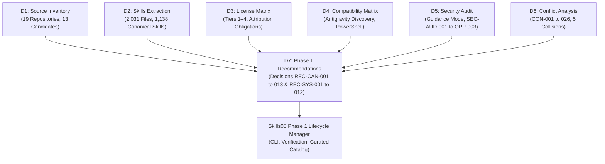
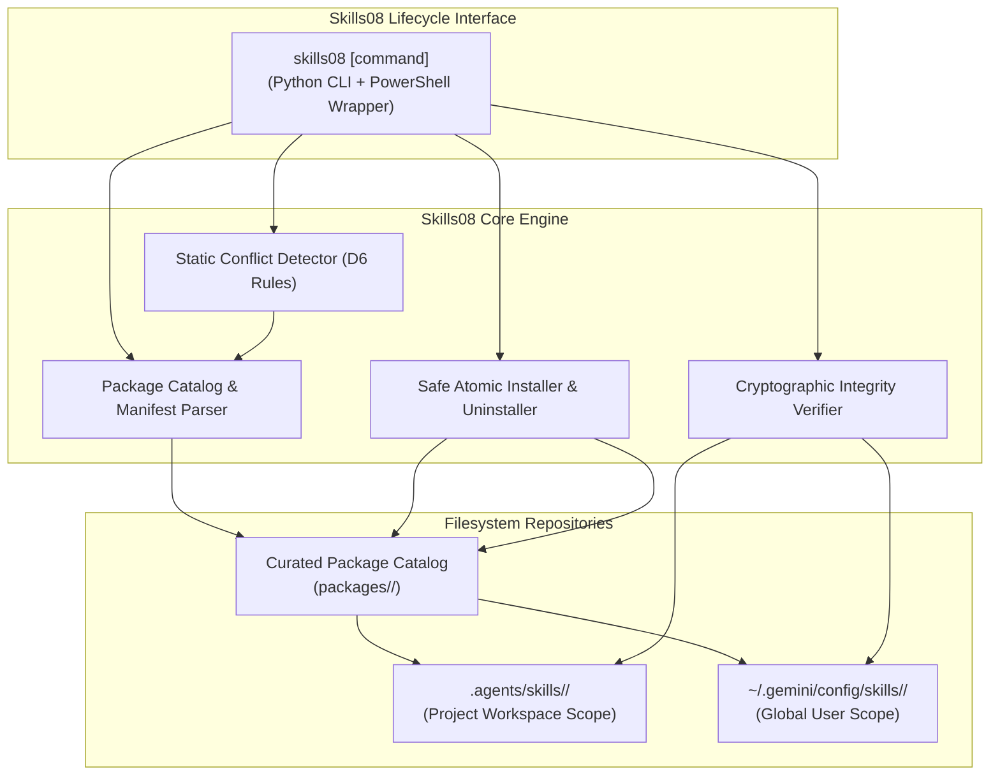

# Skills08 — Deliverable 7 (D7): Phase 1 Recommendations & Implementation Blueprint

> **Document Status**: Complete & Authoritative (Deliverable 7)  
> **Milestone**: Phase 1 Completion — Research Synthesis, Architectural Decisions & Operational Blueprint  
> **Target Agent / Host Platform**: Google Antigravity (Local-First Agent Distribution Platform)  
> **Target Operating Environment**: Windows 10/11 x64 (PowerShell 5.1 / PowerShell 7+)  
> **Upstream Evidence Baselines**: D1 (Source Inventory), D2 (Skills Extraction), D3 (License Matrix), D4 (Compatibility Matrix), D5 (Security Audit), D6 (Conflict Analysis)  
> **Scope**: 13 Shortlisted Candidates (`manifests/manifest.yaml`) across 19 Locked Repositories (`research/sources/`)  
> **Go/No-Go Gate Disposition**: **GO FOR PHASE 1 IMPLEMENTATION (12 Approved Group A, 1 Deferred Group B)**  

---

## 1. Executive Summary & Document Purpose

### 1.1 Purpose
This document constitutes **Deliverable 7 (D7): Phase 1 Recommendations & Implementation Blueprint** for the **Skills08** project ("Powering Every AI Agent with Better Skills"). 

Deliverable 7 is the culminating research deliverable of Phase 1. Its mandate is to synthesize the empirical findings established across Deliverables 1 through 6 into concrete, actionable, and legally defensible architectural decisions. It establishes:
1. **Candidate-by-Candidate Clearances**: Precise inclusion, exclusion, restriction, and adaptation determinations for all 13 candidate skills in `manifests/manifest.yaml`.
2. **Operational Execution Models**: Standardized operational patterns (Model A Pure-Instruction vs. Model B Hybrid) to eliminate script execution vulnerabilities on Windows PowerShell.
3. **Ecosystem Harmonization & Conflict Mitigations**: Definitive resolutions for the 26 interaction records catalogued in D6, including aesthetic persona management, dual-scope precedence, and duplicate-name handling.
4. **Lifecycle Manager Specifications**: Explicit functional, security, and packaging requirements for the Phase 1 local-first lifecycle manager for Google Antigravity.
5. **Phase 1 Completion Gate**: The formal Go/No-Go evaluation authorizing the transition from research analysis to verified local-first implementation.

### 1.2 Core Phase 1 Architectural Principles
To ensure long-term stability, host safety, and user sovereignty, all Phase 1 decisions adhere to five core axioms:
- **Local-First & Zero External Telemetry**: Skills must execute entirely on the user's workstation without mandatory cloud accounts, telemetry reporting, or remote asset fetching.
- **Model A Instruction-First Priority**: Where a skill offers both prompt instructions and companion scripts, Phase 1 prioritizes pure prompt execution (Model A), avoiding arbitrary binary/script execution on Windows hosts.
- **Dual-Scope Determinism**: Project-level installation (`.agents/skills/`) takes explicit precedence over global user installation (`~/.gemini/config/skills/`), ensuring reproducible workspace environments.
- **Deterministic Provenance & Integrity**: Every distributed skill asset must be traceable to its locked upstream commit SHA and verified via cryptographic SHA-256 hashes.
- **Strict Untrusted-Input Boundary**: All third-party skills, instructions, metadata, and playbooks are treated as untrusted data; no upstream code executes during discovery, packaging, or installation.

---

## 2. Synthesis of Accepted Research Baselines (D1–D6)

Deliverable 7 directly inherits and operationalizes the empirical findings of the six accepted research deliverables:



1. **D1 (Source Inventory)**: Fixed the population perimeter to exactly 19 locked git repositories in `research/sources/` and isolated the 13 candidate skills in `manifests/manifest.yaml`.
2. **D2 (Skills Extraction)**: Reconciled 2,031 physical files into 1,138 canonical unique skills across 6 mutually exclusive categories, confirming the multi-harness structure of `impeccable` (2 canonical, 24 variants) and `ecc` (518 translations, 252 variants).
3. **D3 (License Matrix)**: Classified candidates into four legal clearance tiers (Tier 1 Standard MIT, Tier 2 Conditional Clear, Tier 3 Restricted Clear, Tier 4 Deferred Clear), mandating specific attribution notices and copyright retentions.
4. **D4 (Compatibility Matrix)**: Evaluated candidates against Google Antigravity discovery paths (`.agents/skills/` and `~/.gemini/config/skills/`), establishing that script-bearing skills fail in global scope without path adaptation and defining the Model A (pure prompt) vs Model B (script) operational tiers.
5. **D5 (Security Audit)**: Identified critical security boundaries: mandatory Guidance Mode for `security-audit`, process-execution hazards in `archify` (`spawnSync`) and `scroll-craft` (`scripts/kie.mjs` unsanitized image upload), loopback port hazards in `taste-skill` (ports 7600/7601), and heavy Bun/MCP dependencies in `open-pencil`.
6. **D6 (Conflict Analysis)**: Mapped 26 interaction records (`CON-001` through `CON-026`) across 7 dimensions, catalogued 5 true cross-repository lexical collisions (`architecture-decision-records`, `design-taste-frontend`, `frontend-slides`, `hallmark`, `hyperframes`), neutralized prescriptive mitigations, and proved that 413 duplicated names are benign intra-repository repetitions.

---

## 3. Candidate Recommendations (REC-CAN-001 through REC-CAN-013)

Each candidate skill shortlisted in `manifests/manifest.yaml` is systematically evaluated below.

```
+---------------------------------------------------------------------------------------------------+
| RECOMMENDATION RECORD: REC-CAN-001                                                                |
+---------------------------------------------------------------------------------------------------+
| Candidate ID:         SKILL08-SEC-001                                                             |
| Skill Name:           security-audit                                                              |
| Upstream Repository:  cloudflare/security-audit-skill (Commit: c1c8a8c1471069fb0e188eeaff69b8e8db6564a8)  |
| Author / Maintainer:  Dan Jones / Cloudflare, Inc.                                                |
| Category:             Security & Vulnerability Review                                             |
| Decision:             INCLUDE — APPROVED FOR v0.1 LAUNCH (RESTRICTED GUIDANCE MODE)              |
| Operational Model:    Companion-File Static Guidance Mode (Full Audit Execution Disabled)       |
| Implementation Prio:  P0 (Core Security Capability)                                              |
| Confidence Level:     High                                                                        |
+---------------------------------------------------------------------------------------------------+
```
- **Rationale**: Provides comprehensive, multi-layer codebase security exploration and vulnerability analysis covering 14 distinct attack classes. Dan Jones/Cloudflare's architecture represents state-of-the-art AI-assisted security review.
- **Evidence Base**:
  - D1 Section 4: Inventoried at commit `c1c8a8c1471069fb0e188eeaff69b8e8db6564a8`.
  - D3 Section 2.1: Tier 1 Standard Clearance (MIT License). Permissible for distribution with Cloudflare copyright notice.
  - D4 Section 3: Packaging-compatible. Requires co-locating 14 companion markdown playbooks, `report-schema.json`, and 2 CommonJS validators in `.agents/skills/security-audit/`.
  - D5 Section 7.1: `SEC-AUD-001` through `SEC-AUD-005`. Full dynamic audit execution cannot be safely hosted on Windows without OS-level sandboxing (cgroups/namespaces). Guidance Mode with `NEEDS-VALIDATION.md` fallback is mandatory.
  - D6 Section 6.3 (`CON-003` & `CON-009`): Subagent role mapping must route static exploration to Antigravity's read-only `research` subagent; dynamic target execution via `self` subagent is strictly prohibited.
- **Mandatory Mitigations & Controls**:
  1. *Guidance Mode Enforcement*: Distribute with explicit configuration locking the skill into static Guidance Mode. Audit playbooks must flag dynamic vulnerabilities as "Requires Manual Dynamic Verification" using the built-in `NEEDS-VALIDATION.md` template.
  2. *Subagent Mapping*: Map internal subagent delegations strictly to Antigravity's `research` subagent (read-only filesystem tools). Disallow invocations of target build scripts.
  3. *Attribution Preservation*: Include Cloudflare, Inc. MIT copyright notice in the distributed skill package.

```
+---------------------------------------------------------------------------------------------------+
| RECOMMENDATION RECORD: REC-CAN-002                                                                |
+---------------------------------------------------------------------------------------------------+
| Candidate ID:         SKILL08-DOC-001                                                             |
| Skill Name:           humanizer                                                                   |
| Upstream Repository:  blader/humanizer (Commit: b48c832f0f809c1b5658edbb838c2521b72f2413)         |
| Author / Maintainer:  Siqi Chen                                                                   |
| Category:             Documentation & Technical Writing                                           |
| Decision:             INCLUDE — APPROVED FOR v0.1 LAUNCH (UNMODIFIED NATIVE)                     |
| Operational Model:    Pure-Instruction Mode (Zero Companion Scripts)                             |
| Implementation Prio:  P0 (High Utility Prose Refinement)                                          |
| Confidence Level:     High                                                                        |
+---------------------------------------------------------------------------------------------------+
```
- **Rationale**: Exceptional utility for refining AI-generated prose, technical reports, release notes, and documentation into natural human phrasing without altering factual technical content.
- **Evidence Base**:
  - D1 Section 4: Inventoried at commit `b48c832f0f809c1b5658edbb838c2521b72f2413`.
  - D3 Section 2.1: Tier 1 Standard Clearance (MIT License). Full distribution clearance with Siqi Chen copyright notice.
  - D4 Section 3: Packaging-compatible. Pure markdown prompt; requires zero upstream instruction modifications. Identical behavior in Project and Global scopes.
  - D5 Section 7.2: `SEC-HUM-001`. Evaluated as Lowest Residual Risk. Pure prompt contains built-in structural defenses against prompt injection.
  - D6 Section 6: Zero active conflicts detected. Non-interfering documentation utility.
- **Mandatory Mitigations & Controls**:
  1. *Directory Packaging*: Relocate from repository root `SKILL.md` to `.agents/skills/humanizer/SKILL.md`.
  2. *Attribution Preservation*: Include Siqi Chen MIT license notice.

```
+---------------------------------------------------------------------------------------------------+
| RECOMMENDATION RECORD: REC-CAN-003                                                                |
+---------------------------------------------------------------------------------------------------+
| Candidate ID:         SKILL08-UI-001                                                              |
| Skill Name:           unslop                                                                      |
| Upstream Repository:  heydamir/unslop (Commit: 620163eedb3529d9cd23a3994ed8d287d06f760d)          |
| Author / Maintainer:  Damir Sota                                                                  |
| Category:             UI/UX & Design Systems                                                      |
| Decision:             INCLUDE — APPROVED FOR v0.1 LAUNCH (MODEL A PURE-INSTRUCTION)               |
| Operational Model:    Model A: Instruction-Only Mode (Omit scripts/snapshot.mjs)                 |
| Implementation Prio:  P1 (Aesthetic Code Quality)                                                 |
| Confidence Level:     High                                                                        |
+---------------------------------------------------------------------------------------------------+
```
- **Rationale**: Enforces rigorous aesthetic standards for frontend interfaces, eliminating generic AI design clichés (purple gradients, floaty glow effects, arbitrary drop-shadows) and enforcing typographic hierarchy.
- **Evidence Base**:
  - D1 Section 4: Inventoried at commit `620163eedb3529d9cd23a3994ed8d287d06f760d`.
  - D3 Section 2.2 & 4.4: Tier 2 Conditional Clearance (CC-BY-4.0). Requires explicit attribution to Damir Sota, retention of license terms, and statement of modifications.
  - D4 Section 3: Packaging-compatible. `SKILL.md` and `references/` directory provide complete instruction coverage. Companion script `scripts/snapshot.mjs` is optional.
  - D5 Section 7.3: `SEC-SLP-001` through `SEC-SLP-003`. `snapshot.mjs` requires external Playwright dependencies, web egress, and API tokens. Model A pure instruction mode eliminates all script risks.
  - D6 Section 6.1 (`CON-001`): Competes aesthetically with `taste-skill`, `hallmark`, and `impeccable`. Requires persona-based invocation guidelines.
- **Mandatory Mitigations & Controls**:
  1. *Model A Adoption*: Distribute `SKILL.md` and `references/` only; omit `scripts/snapshot.mjs`.
  2. *CC-BY-4.0 Attribution*: Prominently display: `"Original work by Damir Sota (heydamir/unslop), licensed under CC-BY-4.0. Distributed by Skills08 with script execution omitted (Model A)."`
  3. *Persona Tagging*: Categorize under Design Critique / Anti-Slop heuristic review.

```
+---------------------------------------------------------------------------------------------------+
| RECOMMENDATION RECORD: REC-CAN-004                                                                |
+---------------------------------------------------------------------------------------------------+
| Candidate ID:         SKILL08-UI-002                                                              |
| Skill Name:           hallmark                                                                    |
| Upstream Repository:  Nutlope/hallmark (Commit: 04977e15f3dfd6ee4b74c887dac3eb52665d6c92)         |
| Author / Maintainer:  Hassan El Mghari (Nutlope)                                                  |
| Category:             UI/UX & Design Systems                                                      |
| Decision:             INCLUDE — APPROVED FOR v0.1 LAUNCH (MODEL A PURE-INSTRUCTION)               |
| Operational Model:    Model A: Instruction-Only Mode (Omit scripts/sloplint.mjs)                  |
| Implementation Prio:  P1 (Production Frontend Polish)                                             |
| Confidence Level:     High                                                                        |
+---------------------------------------------------------------------------------------------------+
```
- **Rationale**: High-precision design rubric focused on micro-interactions, responsive states, layout constraints, and visual balance for production web apps.
- **Evidence Base**:
  - D1 Section 4: Inventoried at commit `04977e15f3dfd6ee4b74c887dac3eb52665d6c92`.
  - D3 Section 2.1: Tier 1 Standard Clearance (MIT License). Full clearance with Hassan El Mghari copyright notice.
  - D4 Section 3: Packaging-compatible. `SKILL.md` and companion design tokens provide full utility.
  - D5 Section 7.4: `SEC-HLM-001` to `SEC-HLM-003`. Companion linter `scripts/sloplint.mjs` introduces Node.js AST parsing and file modification risks. Model A omits `sloplint.mjs`.
  - D6 Section 6.1 (`CON-001` & `CON-011`): Lexical name `hallmark` collides with `open-design` mirror copy. Resolved by distributing canonical `Nutlope/hallmark` under clean namespace.
- **Mandatory Mitigations & Controls**:
  1. *Model A Adoption*: Distribute `SKILL.md` instructions and design token references; omit `scripts/sloplint.mjs`.
  2. *Attribution Preservation*: Include Hassan El Mghari / Hallmark contributors MIT notice.

```
+---------------------------------------------------------------------------------------------------+
| RECOMMENDATION RECORD: REC-CAN-005                                                                |
+---------------------------------------------------------------------------------------------------+
| Candidate ID:         SKILL08-FE-001                                                              |
| Skill Name:           design-taste-frontend                                                       |
| Upstream Repository:  leonxlnx/taste-skill (Commit: f6b76575f949707b4e3c37cd86cb44b0b98643e8)    |
| Author / Maintainer:  Leonxlnx                                                                    |
| Category:             Frontend Development                                                        |
| Decision:             INCLUDE — APPROVED FOR v0.1 LAUNCH (MODEL A PURE-INSTRUCTION)               |
| Operational Model:    Model A: Instruction-Only Mode (Omit scripts/gate.mjs and Stop Hooks)       |
| Implementation Prio:  P1 (Modern Frontend Aesthetic Guidelines)                                   |
| Confidence Level:     High                                                                        |
+---------------------------------------------------------------------------------------------------+
```
- **Rationale**: Provides comprehensive modern frontend guidance, including component ergonomics, Tailwind CSS patterns, dark-mode color balance, and typography systems.
- **Evidence Base**:
  - D1 Section 4: Inventoried at commit `f6b76575f949707b4e3c37cd86cb44b0b98643e8`.
  - D3 Section 2.1: Tier 1 Standard Clearance (MIT License).
  - D4 Section 3: Adaptation-required. Upstream contains non-standard frontmatter fields and shell stop hooks (`for f in ...; do exec node ...; done`) that crash Windows PowerShell 5.1 (`CON-007`).
  - D5 Section 7.5: `SEC-TST-001` through `SEC-TST-004`. Companion script `gate.mjs` binds local loopback ports `7600`/`7601` (`CON-008`), risks daemon abandonment, and initiates external egress (`CON-016`). Model A eliminates all scripts.
  - D6 Section 6.1 (`CON-001`, `CON-007`, `CON-008`, `CON-011`): Lexical name `design-taste-frontend` collides with `open-design` mirror. Resolved by adopting canonical upstream.
- **Mandatory Mitigations & Controls**:
  1. *Model A Adoption*: Omit `scripts/gate.mjs`, loopback servers, and shell stop hooks. Retain `SKILL.md`, `references/`, and `library/` assets.
  2. *Frontmatter Sanitization*: Strip non-standard Claude/Cursor configuration fields; format strictly for Antigravity schema.
  3. *Attribution Preservation*: Retain Leonxlnx MIT copyright notice.

```
+---------------------------------------------------------------------------------------------------+
| RECOMMENDATION RECORD: REC-CAN-006                                                                |
+---------------------------------------------------------------------------------------------------+
| Candidate ID:         SKILL08-SWE-001                                                             |
| Skill Name:           code-simplification                                                         |
| Upstream Repository:  addyosmani/agent-skills (Commit: 39b723ceebf81474d0557c1fecd01eddab585563)   |
| Author / Maintainer:  Addy Osmani                                                                 |
| Category:             Code Quality & Refactoring                                                  |
| Decision:             INCLUDE — APPROVED FOR v0.1 LAUNCH (UNMODIFIED NATIVE)                     |
| Operational Model:    Pure-Instruction Mode (Zero Companion Scripts)                             |
| Implementation Prio:  P0 (Core Code Quality)                                                      |
| Confidence Level:     High                                                                        |
+---------------------------------------------------------------------------------------------------+
```
- **Rationale**: Superb software engineering heuristics authored by Addy Osmani. Guides agents to simplify convoluted logic, reduce unnecessary abstractions, and enhance readability without breaking existing interfaces.
- **Evidence Base**:
  - D1 Section 4: Inventoried at commit `39b723ceebf81474d0557c1fecd01eddab585563`.
  - D3 Section 2.1: Tier 1 Standard Clearance (MIT License).
  - D4 Section 3: Packaging-compatible. Pure markdown prompt; requires zero upstream instruction modifications. Scope-agnostic.
  - D5 Section 7.6: `SEC-SWE-001`. Negligible residual risk. Static code analysis instructions only.
  - D6 Section 6.1 (`CON-002`): Overlaps functionally with `simplify-codebase` (`SKILL08-SWE-002`). Reconciled as complementary: `code-simplification` operates at the granular function/block level; `simplify-codebase` operates across architectural project hierarchies.
- **Mandatory Mitigations & Controls**:
  1. *Packaging*: Relocate from `skills/code-simplification/SKILL.md` to `.agents/skills/code-simplification/SKILL.md`.
  2. *Attribution Preservation*: Retain Addy Osmani MIT copyright notice.

```
+---------------------------------------------------------------------------------------------------+
| RECOMMENDATION RECORD: REC-CAN-007                                                                |
+---------------------------------------------------------------------------------------------------+
| Candidate ID:         SKILL08-SWE-002                                                             |
| Skill Name:           simplify-codebase                                                           |
| Upstream Repository:  tt-a1i/archify (Commit: a7ed6fd6657da90414831d1d42cf95987188750c)            |
| Author / Maintainer:  tt-a1i                                                                      |
| Category:             Code Quality & Architecture                                                 |
| Decision:             INCLUDE — APPROVED FOR v0.1 LAUNCH (UNMODIFIED NATIVE WITH MIT BUNDLE)     |
| Operational Model:    Pure-Instruction Mode (Zero Companion Scripts)                             |
| Implementation Prio:  P1 (Macro Codebase Refactoring)                                             |
| Confidence Level:     High                                                                        |
+---------------------------------------------------------------------------------------------------+
```
- **Rationale**: Complements function-level simplification by providing architectural refactoring strategies to reduce dead files, circular dependencies, and over-engineered module structures.
- **Evidence Base**:
  - D1 Section 4: Inventoried at commit `a7ed6fd6657da90414831d1d42cf95987188750c`.
  - D3 Section 2.2 & 4.1: Tier 2 Conditional Clearance. While the root `archify` repo is Apache-2.0, `.agents/skills/simplify-codebase/` contains its own dedicated MIT `LICENSE` file. Distributable under MIT provided the directory license is packaged with the skill.
  - D4 Section 3: Native compatibility. Pure markdown prompt located natively in `.agents/skills/`.
  - D5 Section 7.7: `SEC-SWE-002`. Pure instruction mode; negligible residual risk.
  - D6 Section 6.1 (`CON-002`): Functional overlap with `code-simplification` reconciled via clear documentation of operational scope (macro vs. micro).
- **Mandatory Mitigations & Controls**:
  1. *License Packaging*: Must bundle the dedicated MIT `LICENSE` file located inside `.agents/skills/simplify-codebase/` to satisfy legal compliance.
  2. *Attribution Preservation*: Retain tt-a1i copyright notice.

```
+---------------------------------------------------------------------------------------------------+
| RECOMMENDATION RECORD: REC-CAN-008                                                                |
+---------------------------------------------------------------------------------------------------+
| Candidate ID:         SKILL08-TST-001                                                             |
| Skill Name:           browser-testing-with-devtools                                               |
| Upstream Repository:  addyosmani/agent-skills (Commit: 39b723ceebf81474d0557c1fecd01eddab585563)   |
| Author / Maintainer:  Addy Osmani                                                                 |
| Category:             Testing & Browser Automation                                                |
| Decision:             INCLUDE — APPROVED FOR v0.1 LAUNCH (NATIVE ANTIGRAVITY SUBAGENT BINDING)    |
| Operational Model:    Antigravity Native Browser Subagent Dispatch                                |
| Implementation Prio:  P0 (Essential Automated Verification)                                       |
| Confidence Level:     High                                                                        |
+---------------------------------------------------------------------------------------------------+
```
- **Rationale**: Provides structured testing workflows using Chrome DevTools Protocol to verify web application visual states, console errors, accessibility compliance, and network failures. Maps perfectly to Antigravity's native `browser` subagent.
- **Evidence Base**:
  - D1 Section 4: Inventoried at commit `39b723ceebf81474d0557c1fecd01eddab585563`.
  - D3 Section 2.1: Tier 1 Standard Clearance (MIT License).
  - D4 Section 3: Packaging-compatible. Pure markdown prompt instructing the agent how to direct DevTools workflows.
  - D5 Section 7.8: `SEC-DEV-001`. Leverages host-managed browser session. Relies on Antigravity's built-in browser permission boundaries.
  - D6 Section 6.1 (`CON-003`): Subagent coordination verified; delegates directly to Antigravity's built-in `browser` subagent without spawning external unvetted headless runners.
- **Mandatory Mitigations & Controls**:
  1. *Packaging*: Relocate from `skills/browser-testing-with-devtools/SKILL.md` to `.agents/skills/browser-testing-with-devtools/SKILL.md`.
  2. *Host Binding*: Document requirement for Antigravity's native `browser` subagent availability.
  3. *Attribution Preservation*: Retain Addy Osmani MIT copyright notice.

```
+---------------------------------------------------------------------------------------------------+
| RECOMMENDATION RECORD: REC-CAN-009                                                                |
+---------------------------------------------------------------------------------------------------+
| Candidate ID:         SKILL08-SWE-003                                                             |
| Skill Name:           debugging-and-error-recovery                                                |
| Upstream Repository:  addyosmani/agent-skills (Commit: 39b723ceebf81474d0557c1fecd01eddab585563)   |
| Author / Maintainer:  Addy Osmani                                                                 |
| Category:             Software Engineering & Debugging                                            |
| Decision:             INCLUDE — APPROVED FOR v0.1 LAUNCH (UNMODIFIED NATIVE)                     |
| Operational Model:    Pure-Instruction Mode (Zero Companion Scripts)                             |
| Implementation Prio:  P0 (Core Reliability Capability)                                            |
| Confidence Level:     High                                                                        |
+---------------------------------------------------------------------------------------------------+
```
- **Rationale**: Essential systematic debugging methodology. Prevents AI hallucination and trial-and-error code churn by enforcing hypothesis-driven root cause analysis, logging instrumentation, and regression test authoring.
- **Evidence Base**:
  - D1 Section 4: Inventoried at commit `39b723ceebf81474d0557c1fecd01eddab585563`.
  - D3 Section 2.1: Tier 1 Standard Clearance (MIT License).
  - D4 Section 3: Packaging-compatible. Pure markdown prompt; scope-agnostic.
  - D5 Section 7.9: `SEC-DBG-001`. Negligible residual risk.
  - D6 Section 6: Zero active conflicts detected. Universal engineering discipline.
- **Mandatory Mitigations & Controls**:
  1. *Packaging*: Relocate from `skills/debugging-and-error-recovery/SKILL.md` to `.agents/skills/debugging-and-error-recovery/SKILL.md`.
  2. *Attribution Preservation*: Retain Addy Osmani MIT copyright notice.

```
+---------------------------------------------------------------------------------------------------+
| RECOMMENDATION RECORD: REC-CAN-010                                                                |
+---------------------------------------------------------------------------------------------------+
| Candidate ID:         SKILL08-ARC-001                                                             |
| Skill Name:           archify                                                                     |
| Upstream Repository:  tt-a1i/archify (Commit: a7ed6fd6657da90414831d1d42cf95987188750c)            |
| Author / Maintainer:  tt-a1i                                                                      |
| Category:             Architecture & System Design                                                |
| Decision:             INCLUDE — APPROVED FOR v0.1 LAUNCH (MODEL A PURE-INSTRUCTION)               |
| Operational Model:    Model A: Instruction-Only Mode (Omit bin/archify.mjs and Node Dependencies) |
| Implementation Prio:  P1 (System Architectural Documentation)                                     |
| Confidence Level:     High                                                                        |
+---------------------------------------------------------------------------------------------------+
```
- **Rationale**: High-value system architecture analysis skill. Generates structured Architectural Decision Records (ADRs), system boundary diagrams, and component dependency maps.
- **Evidence Base**:
  - D1 Section 4: Inventoried at commit `a7ed6fd6657da90414831d1d42cf95987188750c`.
  - D3 Section 2.3 & 4.3: Tier 3 Restricted Clearance (Apache-2.0). Unmodified upstream repository contains unvetted prebuilt binaries and third-party scripts. Pure instruction extraction is fully compliant with Apache-2.0 terms.
  - D4 Section 3: Adaptation-required. Model B execution relies on `bin/archify.mjs finalize`, which fails in global scope on Windows (`CON-006`). Model A functions identically across all scopes.
  - D5 Section 7.10: `SEC-ARC-001` through `SEC-ARC-004`. Source review verified 15 `spawnSync` call sites in `bin/archify.mjs`, creating potential process injection risks if unvetted inputs reach the shell. Model A completely omits `bin/archify.mjs`, reducing residual risk to Low / Estimated.
  - D6 Section 6.1 (`CON-006`): Script path resolution failure avoided under Model A.
- **Mandatory Mitigations & Controls**:
  1. *Model A Adoption*: Distribute `archify/SKILL.md` and `references/` only; completely omit `bin/archify.mjs` and package dependencies. Instruct the agent to format ADRs and Mermaid diagrams directly into markdown files.
  2. *Apache-2.0 Compliance*: Retain Apache-2.0 license notice and include a prominent NOTICE of modification: `"Adapted from tt-a1i/archify under Apache-2.0. Modified by Skills08 to operate in Model A (pure instruction mode) with node execution omitted."`

```
+---------------------------------------------------------------------------------------------------+
| RECOMMENDATION RECORD: REC-CAN-011                                                                |
+---------------------------------------------------------------------------------------------------+
| Candidate ID:         SKILL08-FE-002                                                              |
| Skill Name:           scroll-craft                                                                |
| Upstream Repository:  nateherkai/scroll-craft (Commit: 75d81f74e83692add18cd7a8a8e078b8a887a579)   |
| Author / Maintainer:  Nate Herk                                                                   |
| Category:             Frontend Development                                                        |
| Decision:             INCLUDE — APPROVED FOR v0.1 LAUNCH (MODEL A PURE-INSTRUCTION)               |
| Operational Model:    Model A: Instruction-Only Mode (Omit scripts/kie.mjs; Sanitize Frontmatter) |
| Implementation Prio:  P1 (Interactive Storytelling Components)                                    |
| Confidence Level:     High                                                                        |
+---------------------------------------------------------------------------------------------------+
```
- **Rationale**: Specialized design skill for constructing scrollytelling timelines, layered dimensional hero sections, and scroll-scrubbed interactive product showcases.
- **Evidence Base**:
  - D1 Section 4: Inventoried at commit `75d81f74e83692add18cd7a8a8e078b8a887a579`.
  - D3 Section 2.1: Tier 1 Standard Clearance (MIT License).
  - D4 Section 3: Adaptation-required. Frontmatter contains non-standard Claude `allowed-tools` parameter (`CON-010`), which must be sanitized for Antigravity schema compliance.
  - D5 Section 7.11: `SEC-SCR-001` through `SEC-SCR-003`. Upstream companion script `scripts/kie.mjs` contains an unauthenticated, unsanitized file upload vector to an external image hosting service (`SEC-SCR-003`). Model A completely omits `scripts/kie.mjs`, relying on Antigravity's native canvas and image capabilities, reducing residual risk to Low / Estimated.
  - D6 Section 6.1 (`CON-004` & `CON-010`): Frontmatter schema incompatibility resolved; overlap with `design-taste-frontend` managed via domain specialization.
- **Mandatory Mitigations & Controls**:
  1. *Model A Adoption*: Omit `scripts/kie.mjs` entirely. Rely on Antigravity's native artifact and canvas capabilities.
  2. *Frontmatter Sanitization*: Strip `allowed-tools` field; normalize YAML metadata to valid Antigravity standard.
  3. *Attribution Preservation*: Retain Nate Herk MIT copyright notice.

```
+---------------------------------------------------------------------------------------------------+
| RECOMMENDATION RECORD: REC-CAN-012                                                                |
+---------------------------------------------------------------------------------------------------+
| Candidate ID:         SKILL08-UI-003                                                              |
| Skill Name:           impeccable                                                                  |
| Upstream Repository:  pbakaus/impeccable (Commit: d41d9860b0094dcb68030657da63461212835aaa)        |
| Author / Maintainer:  Paul Bakaus                                                                 |
| Category:             UI/UX & Design Systems                                                      |
| Decision:             INCLUDE — APPROVED FOR v0.1 LAUNCH (MODEL A PURE-INSTRUCTION)               |
| Operational Model:    Model A: Instruction-Only Fallback Mode (Omit scripts/ and Font Binaries)   |
| Implementation Prio:  P1 (Comprehensive Design Director)                                          |
| Confidence Level:     High                                                                        |
+---------------------------------------------------------------------------------------------------+
```
- **Rationale**: Comprehensive design leadership skill providing four operational craft modes (Persuade, Operate, Read, Experience) to elevate software interfaces to world-class design standards.
- **Evidence Base**:
  - D1 Section 4: Inventoried at commit `d41d9860b0094dcb68030657da63461212835aaa`. Upstream duplicates skill across 26 harness directories.
  - D2 Section 3: Categorized as 2 `C_NON_TEMPLATE` and 24 `C_VARIANT` copies.
  - D3 Section 2.3 & 4.2: Tier 3 Restricted Clearance (Apache-2.0). Upstream bundles proprietary or restricted font binaries in `assets/fonts/` that cannot be legally redistributed. Pure instruction extraction is fully distributable under Apache-2.0.
  - D4 Section 3: Adaptation-required. Upstream launcher references POSIX shell wrapper `${CLAUDE_SKILL_DIR}/scripts/impeccable`, which fails on Windows PowerShell 5.1 (`CON-007`). Model A locks the skill into its documented pure-instruction fallback playbooks.
  - D5 Section 7.12: `SEC-IMP-001` to `SEC-IMP-003`. Omitting binary launcher and non-distributable assets resolves both security execution and IP clearance issues.
  - D6 Section 6.1 (`CON-001` & `CON-007`): Aesthetic competition and shell incompatibilities resolved.
- **Mandatory Mitigations & Controls**:
  1. *Model A Adoption*: Extract canonical `.agents/skills/impeccable/SKILL.md` and markdown playbooks in `reference/`. Omit `scripts/impeccable` shell wrapper and all binary fonts in `assets/fonts/`.
  2. *Pure Instruction Locking*: Enforce pure instruction fallback playbooks directly in the prompt text.
  3. *Apache-2.0 Compliance*: Retain Apache-2.0 notice and include NOTICE of modifications: `"Adapted from pbakaus/impeccable under Apache-2.0. Modified by Skills08 to operate in pure-instruction mode with shell launchers and font binaries omitted."`

```
+---------------------------------------------------------------------------------------------------+
| RECOMMENDATION RECORD: REC-CAN-013                                                                |
+---------------------------------------------------------------------------------------------------+
| Candidate ID:         SKILL08-UI-004                                                              |
| Skill Name:           open-pencil                                                                 |
| Upstream Repository:  open-pencil/open-pencil (Commit: 50afc5cb789257338cd4102235ab16d9ade458f3)   |
| Author / Maintainer:  Danila Poyarkov                                                             |
| Category:             UI/UX & Design Systems                                                      |
| Decision:             EXCLUDE FROM v0.1 — DEFER TO GROUP B (v0.2+ RESEARCH PERIMETER)             |
| Operational Model:    External MCP Server & Bun Toolchain (Deferred)                              |
| Implementation Prio:  P3 (Future Desktop App Integration)                                         |
| Confidence Level:     High                                                                        |
+---------------------------------------------------------------------------------------------------+
```
- **Rationale**: While programmatic inspection and manipulation of Figma `.fig` vector trees is an impressive capability, it requires an external Bun runtime environment, native C++ canvas bindings, and a running Model Context Protocol (MCP) daemon. This creates an unacceptably heavy dependency footprint that contradicts the local-first, lightweight mandate of Skills08 v0.1.
- **Evidence Base**:
  - D1 Section 4: Inventoried at commit `50afc5cb789257338cd4102235ab16d9ade458f3`.
  - D3 Section 2.4: Tier 4 Deferred Clearance.
  - D4 Section 3: Classified as `Deferred`. High host dependency footprint (@open-pencil/cli, @open-pencil/mcp, Bun toolchain).
  - D5 Section 7.13: `SEC-OPP-001` through `SEC-OPP-003`. Unvetted MCP socket communication and external toolchain installation requirements.
  - D6 Section 6: Non-interfering due to distinct vector manipulation capability, but operationally incompatible with v0.1 pure-agent distribution.
- **Mandatory Mitigations & Controls**:
  1. *Formal Deferral*: Explicitly exclude from the Phase 1 distributable catalog.
  2. *Future Scope*: Reserve for Phase 2 dynamic sandbox and MCP sidecar evaluation.

---

## 4. Cross-Cutting System Recommendations (REC-SYS-001 through REC-SYS-012)

The system-level recommendations synthesize cross-deliverable architectural policies to ensure consistent, secure, and conflict-free operation across the Skills08 ecosystem.

```
+---------------------------------------------------------------------------------------------------+
| RECOMMENDATION RECORD: REC-SYS-001                                                                |
| Title: Model A Pure-Instruction Standardization for Script-Bearing Skills                         |
| Category: Architecture & Host Compatibility                                                       |
| Priority: P0 | Confidence: High                                                                   |
+---------------------------------------------------------------------------------------------------+
```
- **Decision**: Adopt **Model A (Instruction-Only)** as the mandatory distribution standard for all script-bearing skills in Skills08 v0.1 (`archify`, `scroll-craft`, `design-taste-frontend`, `impeccable`, `unslop`, `hallmark`).
- **Rationale**: Eliminates the Windows PowerShell path resolution failure (`CON-006`), removes POSIX syntax crashes (`CON-007`), avoids loopback port zombie daemons (`CON-008`), and neutralizes arbitrary script execution vectors (`SEC-ARC-001`, `SEC-SCR-003`) without sacrificing the core cognitive guidance of the skills.
- **Implementation**: The distribution packager must prune companion execution scripts (`.mjs`, `.sh`, `.cjs`) and rewrite skill instructions to direct the agent to generate files and perform analysis directly via Antigravity's native tools (`write_file`, `edit_file`, canvas, and artifacts).

```
+---------------------------------------------------------------------------------------------------+
| RECOMMENDATION RECORD: REC-SYS-002                                                                |
| Title: Dual-Scope Discovery Hierarchy & Project-First Precedence                                  |
| Category: Platform Integration & Lifecycle                                                        |
| Priority: P0 | Confidence: High                                                                   |
+---------------------------------------------------------------------------------------------------+
```
- **Decision**: Formally codify the discovery precedence: **Project-Level Scope (`.agents/skills/`) strictly overrides Global User Scope (`~/.gemini/config/skills/`)**.
- **Rationale**: Resolves `CON-005` (Dual-Scope Shadowing). Project-level skills are tracked in workspace version control, ensuring team members and CI pipelines execute identical, reproducible instructions regardless of the user's ambient global configuration.
- **Implementation**: The Skills08 lifecycle manager CLI must default to `--scope project` (`.agents/skills/`), requiring an explicit `--scope global` flag for machine-wide installation. The status command must explicitly warn when a global skill is shadowed by a workspace skill.

```
+---------------------------------------------------------------------------------------------------+
| RECOMMENDATION RECORD: REC-SYS-003                                                                |
| Title: Guidance Mode Enforcement for Security & Vulnerability Review Tools                        |
| Category: Security & Trust Boundary                                                               |
| Priority: P0 | Confidence: High                                                                   |
+---------------------------------------------------------------------------------------------------+
```
- **Decision**: Restrict all security exploration skills (specifically `security-audit`, `SKILL08-SEC-001`) to **Guidance Mode** on Windows hosts.
- **Rationale**: Implements `SEC-AUD-001` and resolves `CON-009`. Windows environments lack unprivileged container isolation (cgroups, namespaces). An AI agent executing arbitrary target build scripts or test harnesses during a security audit risks ambient workstation compromise.
- **Implementation**: The distributed `security-audit` package must contain hardcoded configuration barring the execution of target code. All findings requiring dynamic fuzzing or live execution must be emitted into `NEEDS-VALIDATION.md` for human-supervised validation in an isolated external sandbox.

```
+---------------------------------------------------------------------------------------------------+
| RECOMMENDATION RECORD: REC-SYS-004                                                                |
| Title: Unified License Notice & Attribution Aggregation Architecture                              |
| Category: Legal & Intellectual Property Compliance                                               |
| Priority: P0 | Confidence: High                                                                   |
+---------------------------------------------------------------------------------------------------+
```
- **Decision**: Implement an automated, deterministic attribution generator within the packaging pipeline to bundle upstream licenses and notices into every distributed skill package.
- **Rationale**: Fulfills all legal obligations catalogued in Deliverable 3 (MIT notice retention, Apache-2.0 Section 4 modification notices, and CC-BY-4.0 creator attribution for `unslop`).
- **Implementation**: Every installed skill directory `.agents/skills/<name>/` must contain a generated `NOTICE.md` or `LICENSE` document detailing:
  1. Original copyright holders and upstream repository URL.
  2. Exact commit SHA from which the skill was derived.
  3. Governing license text (MIT, Apache-2.0, or CC-BY-4.0).
  4. Specific list of modifications made by Skills08 (e.g. Model A adaptation, frontmatter normalization).

```
+---------------------------------------------------------------------------------------------------+
| RECOMMENDATION RECORD: REC-SYS-005                                                                |
| Title: Lexical Collision & Cross-Repository Namespace Segregation Strategy                         |
| Category: Naming & Discovery Architecture                                                         |
| Priority: P1 | Confidence: High                                                                   |
+---------------------------------------------------------------------------------------------------+
```
- **Decision**: Enforce canonical single-origin resolution for the **5 true cross-repository lexical collisions** identified in D6 Section 4.1 (`CON-011`).
- **Rationale**: In Antigravity's flat discovery paths, identical skill directory names overwrite each other. D6 proved that true cross-repo collisions are limited to exactly 5 names:
  1. `architecture-decision-records`: Distribute canonical from `antigravity-skills`; prune duplicate from `ecc`.
  2. `design-taste-frontend`: Distribute canonical `taste-skill`; prune unmaintained mirror in `open-design`.
  3. `frontend-slides`: Distribute canonical `ecc`; prune unmaintained mirror in `open-design`.
  4. `hallmark`: Distribute canonical `Nutlope/hallmark`; prune mirror in `open-design`.
  5. `hyperframes`: Distribute canonical `hyperframes`; prune mirror in `open-design`.
- **Implementation**: The package catalog must enforce a strict one-to-one mapping between skill name and upstream source. The lifecycle manager will reject any installation that creates an unnamespaced collision.

```
+---------------------------------------------------------------------------------------------------+
| RECOMMENDATION RECORD: REC-SYS-006                                                                |
| Title: Aesthetic Persona & Design Director Scoping Architecture                                   |
| Category: Instruction & Capability Harmonization                                                  |
| Priority: P1 | Confidence: High                                                                   |
+---------------------------------------------------------------------------------------------------+
```
- **Decision**: Establish distinct functional personas and prompt activation scopes for the four overlapping frontend design skills (`unslop`, `hallmark`, `design-taste-frontend`, `impeccable`) to resolve `CON-001`.
- **Rationale**: Simultaneous co-loading of all four design skills induces prompt bloat and conflicting aesthetic directives. However, each skill excels in a distinct phase of the design lifecycle:
  - `unslop`: **Pre-Commit Code Critique** — Scans existing code to strip AI tropes, purple gradients, and generic styling.
  - `hallmark`: **Component Construction** — Guides the layout, micro-interactions, and visual polish of individual UI elements.
  - `design-taste-frontend`: **Design System Formulation** — Establishes typography scales, color palettes, and Tailwind tokens.
  - `impeccable`: **High-Level Design Direction** — Guides holistic UX strategy, narrative flow, and brand cohesion.
- **Implementation**: Provide clear activation triggers in the documentation and package metadata. Encourage users to activate design skills selectively based on the active workflow phase.

```
+---------------------------------------------------------------------------------------------------+
| RECOMMENDATION RECORD: REC-SYS-007                                                                |
| Title: Subagent Role Mapping & Host Tooling Boundary Enforcement                                  |
| Category: Platform Safety & Security                                                              |
| Priority: P0 | Confidence: High                                                                   |
+---------------------------------------------------------------------------------------------------+
```
- **Decision**: Standardize subagent role delegations across all skills to match Google Antigravity's native subagent architecture (`research`, `browser`, `self`) while barring untrusted code execution.
- **Rationale**: Resolves `CON-003` and enforces D4/D5 subagent safety boundaries. Skills that assume external tools or unconstrained subagents must be mapped to Antigravity's native primitives:
  - Codebase search and file inspection -> `research` subagent (read-only filesystem tools).
  - Web UI and DevTools testing -> `browser` subagent (Chrome DevTools).
  - General reasoning -> `self` subagent (strictly barred from executing target build commands).
- **Implementation**: Sanitize skill prompt instructions during packaging to remove references to unsupported agent CLIs, mapping all subagent calls to Antigravity conventions.

```
+---------------------------------------------------------------------------------------------------+
| RECOMMENDATION RECORD: REC-SYS-008                                                                |
| Title: Windows PowerShell Host Hardening & Path Standardization                                   |
| Category: Host Execution Safety                                                                   |
| Priority: P0 | Confidence: High                                                                   |
+---------------------------------------------------------------------------------------------------+
```
- **Decision**: Mandate forward-slash path normalization for all internal markdown references and enforce single-quoted string passing in all generated PowerShell commands.
- **Rationale**: Resolves `CON-007` and prevents PowerShell argument-splitting or pipeline interception vulnerabilities (`|`, `&`, `;`) when interacting with Windows shell tools.
- **Implementation**: All packaged markdown files and documentation must format workspace-relative paths with forward slashes (`.agents/skills/<name>/SKILL.md`). The lifecycle manager CLI must validate and quote all paths.

```
+---------------------------------------------------------------------------------------------------+
| RECOMMENDATION RECORD: REC-SYS-009                                                                |
| Title: Deterministic Cryptographic Integrity Verification (SHA-256 Lock)                          |
| Category: Supply Chain & Integrity Protection                                                     |
| Priority: P0 | Confidence: High                                                                   |
+---------------------------------------------------------------------------------------------------+
```
- **Decision**: Implement cryptographic SHA-256 verification for every file deployed by the Skills08 lifecycle manager.
- **Rationale**: Guarantees supply chain integrity, detects accidental or malicious tampering, and ensures that the deployed file exactly matches the audited research baseline.
- **Implementation**: The lifecycle manager will maintain a manifest lock (`skills08.lock.json` or catalog manifest) recording file sizes and SHA-256 digests. The `verify` command will scan installed skills on disk and report any bit-level drift.

```
+---------------------------------------------------------------------------------------------------+
| RECOMMENDATION RECORD: REC-SYS-010                                                                |
| Title: Untrusted Input Sanitization & Path Traversal Boundary Protection                          |
| Category: Supply Chain & Host Security                                                            |
| Priority: P0 | Confidence: High                                                                   |
+---------------------------------------------------------------------------------------------------+
```
- **Decision**: Enforce strict path traversal defenses (`../`, absolute paths, alternate streams) in all skill installation, extraction, and file-handling operations.
- **Rationale**: Prevents malicious or malformed skill packages from writing files outside the authorized target roots (`.agents/skills/` or `~/.gemini/config/skills/`).
- **Implementation**: The installer must canonicalize destination paths and verify that they reside strictly within the designated target directory before performing any filesystem write.

```
+---------------------------------------------------------------------------------------------------+
| RECOMMENDATION RECORD: REC-SYS-011                                                                |
| Title: Human Confirmation Protocol for State-Modifying Lifecycle Operations                       |
| Category: Operational Safety & User Sovereignty                                                   |
| Priority: P1 | Confidence: High                                                                   |
+---------------------------------------------------------------------------------------------------+
```
- **Decision**: Require explicit user confirmation before overwriting existing files, installing global skills, or performing uninstalls.
- **Rationale**: Protects user workspaces from inadvertent file loss or accidental modification of custom skills.
- **Implementation**: The CLI must provide clear diff/status previews and prompt for confirmation, with a `--yes` / `-y` flag for automated non-interactive testing.

```
+---------------------------------------------------------------------------------------------------+
| RECOMMENDATION RECORD: REC-SYS-012                                                                |
| Title: Group B Deferral & Phase 2 Dynamic Testing Boundary Definition                             |
| Category: Governance & Milestone Boundaries                                                       |
| Priority: P0 | Confidence: High                                                                   |
+---------------------------------------------------------------------------------------------------+
```
- **Decision**: Formally seal Phase 1 scope to static analysis, packaging, and local lifecycle management; defer runtime dynamic testing (`CON-025`, `CON-026`) and heavy MCP skills (`open-pencil`, `SKILL08-UI-004`) to Phase 2.
- **Rationale**: Preserves project governance boundaries. Phase 1 proves the integrity, licensing, and static architecture of the candidate ecosystem. Live runtime execution and sidecar containerization require dedicated testing infrastructure planned for Phase 2.
- **Implementation**: Maintain `open-pencil` as a documented Group B candidate in the catalog, but exclude it from the active v0.1 installable package set.

---

## 5. Phase 1 Candidate Roster & Classification Matrix

The master evaluation table below synthesizes the determinations for all 13 candidates across all evaluation dimensions:

| Candidate ID | Skill Name | Category | Tier | Legal Clearance (D3) | Operational Model (D4/D7) | Security Profile (D5) | Conflict Mitigation (D6/D7) | Phase 1 Decision |
| :--- | :--- | :--- | :---: | :---: | :---: | :---: | :---: | :---: |
| **SKILL08-SEC-001** | `security-audit` | Security | Group A | Tier 1 (MIT) | Companion-File Static | Guidance Mode Mandatory | `CON-003` / `CON-009` Restricted | **APPROVED (v0.1 Launch)** |
| **SKILL08-DOC-001** | `humanizer` | Documentation | Group A | Tier 1 (MIT) | Unmodified Native | Low / Pure Prompt | Zero Active Conflicts | **APPROVED (v0.1 Launch)** |
| **SKILL08-UI-001** | `unslop` | UI/UX & Design | Group A | Tier 2 (CC-BY-4.0) | Model A (Instruction-Only) | Low (Scripts Omitted) | `CON-001` Pre-Commit Persona | **APPROVED (v0.1 Launch)** |
| **SKILL08-UI-002** | `hallmark` | UI/UX & Design | Group A | Tier 1 (MIT) | Model A (Instruction-Only) | Low (Scripts Omitted) | `CON-001` Component Polish | **APPROVED (v0.1 Launch)** |
| **SKILL08-FE-001** | `design-taste-frontend` | Frontend | Group A | Tier 1 (MIT) | Model A (Instruction-Only) | Low (Ports/Scripts Omitted) | `CON-001` Token Architecture | **APPROVED (v0.1 Launch)** |
| **SKILL08-SWE-001** | `code-simplification` | Code Quality | Group A | Tier 1 (MIT) | Unmodified Native | Low / Pure Prompt | `CON-002` Micro Function Scope | **APPROVED (v0.1 Launch)** |
| **SKILL08-SWE-002** | `simplify-codebase` | Code Quality | Group A | Tier 2 (MIT Local) | Unmodified Native | Low / Pure Prompt | `CON-002` Macro System Scope | **APPROVED (v0.1 Launch)** |
| **SKILL08-TST-001** | `browser-testing-with-devtools` | Testing | Group A | Tier 1 (MIT) | Native Subagent Dispatch | Low (Host-Managed) | `CON-003` DevTools Protocol | **APPROVED (v0.1 Launch)** |
| **SKILL08-SWE-003** | `debugging-and-error-recovery` | Engineering | Group A | Tier 1 (MIT) | Unmodified Native | Low / Pure Prompt | Zero Active Conflicts | **APPROVED (v0.1 Launch)** |
| **SKILL08-ARC-001** | `archify` | Architecture | Group A | Tier 3 (Apache-2.0) | Model A (Instruction-Only) | Low (spawnSync Omitted) | `CON-006` Scope-Agnostic ADR | **APPROVED (v0.1 Launch)** |
| **SKILL08-FE-002** | `scroll-craft` | Frontend | Group A | Tier 1 (MIT) | Model A (Instruction-Only) | Low (Upload Omitted) | `CON-004` Scrollytelling Spec | **APPROVED (v0.1 Launch)** |
| **SKILL08-UI-003** | `impeccable` | UI/UX & Design | Group A | Tier 3 (Apache-2.0) | Model A (Instruction-Only) | Low (Launchers Omitted) | `CON-001` Design Director | **APPROVED (v0.1 Launch)** |
| **SKILL08-UI-004** | `open-pencil` | UI/UX & Design | Group B | Tier 4 (Deferred) | Deferred Toolchain | High (External Bun/MCP) | `CON-026` Host Tooling Overlap | **DEFERRED (Group B / v0.2+)** |

### Roster Summary Statistics:
- **Total Shortlisted Candidates**: Exactly **13 candidates**
- **Approved for v0.1 Launch (Group A)**: Exactly **12 candidates (92.3%)**
- **Deferred to v0.2+ Research (Group B)**: Exactly **1 candidate (7.7%)** (`open-pencil`)
- **Direct Native / Packaging-Compatible**: **8 candidates** (`security-audit`, `humanizer`, `unslop`, `hallmark`, `code-simplification`, `simplify-codebase`, `browser-testing-with-devtools`, `debugging-and-error-recovery`)
- **Adapted Model A Pure-Instruction**: **4 candidates** (`design-taste-frontend`, `scroll-craft`, `archify`, `impeccable`)
- **Legal Clearance Distribution**: Tier 1 (MIT): 8 | Tier 2 (Conditional): 2 | Tier 3 (Apache-2.0 Restricted): 2 | Tier 4 (Deferred): 1

---

## 6. Functional Architecture of the Skills08 Lifecycle Manager

To operationalize these recommendations, Skills08 requires a dedicated, lightweight, local-first lifecycle manager targeting Google Antigravity on Windows:



### 6.1 Core Functional Capabilities:
1. **Catalog & Manifest Inspection (`skills08 list`, `skills08 inspect <id|name>`)**:
   - Parses the authoritative manifest and curated package metadata.
   - Displays candidate status, legal tier, operational model, and compatibility ratings.
2. **Deterministic Conflict Analysis (`skills08 conflicts`)**:
   - Scans the active workspace (`.agents/skills/`) and global configuration (`~/.gemini/config/skills/`) to detect duplicate names, shadowed skills, and overlapping aesthetic profiles based on D6 findings.
3. **Safe Dual-Scope Installation (`skills08 install <id|name> [--scope project|global] [--force]`)**:
   - Performs atomic, non-destructive copying of curated, verified skill packages.
   - Enforces path-traversal boundaries (`../` checks).
   - Generates unified attribution notices (`NOTICE.md`) containing full license and upstream provenance.
4. **Clean Skill Removal (`skills08 uninstall <name> [--scope project|global]`)**:
   - Safely removes installed skill packages without disturbing adjacent project files.
5. **Cryptographic Integrity Verification (`skills08 verify [--scope project|global]`)**:
   - Reads installed files from disk, calculates SHA-256 digests, and verifies zero bit-level drift against the authoritative manifest lock.
6. **Workspace Environment Status (`skills08 status`)**:
   - Reports installed skills, active scopes, discovery health, and shadowing warnings.

### 6.2 Implementation Packaging Structure:
- `src/skills08/`: Pure Python core engine with zero external third-party package dependencies (uses Python standard library: `hashlib`, `pathlib`, `shutil`, `json`, `argparse`).
- `skills08.py`: Portable root CLI entrypoint.
- `skills08.ps1`: Native PowerShell 5.1 / 7+ wrapper script providing idiomatic Windows command execution.
- `packages/`: Clean, curated, pre-adapted skill packages for the 12 approved Group A candidates, prepared directly from research findings without modifying the 19 locked source repositories in `research/sources/`.

---

## 7. Formal Go/No-Go Milestone Decision Gate

### 7.1 Gate Evaluation Criteria
| Milestone Gate Requirement | Evaluated Status | Empirical Evidence Base | Result |
| :--- | :---: | :--- | :---: |
| **1. Source Population Locked** | **SATISFIED** | 19 repositories locked at verified commits (D1). | **PASS** |
| **2. Skill Taxonomy Extracted** | **SATISFIED** | 2,031 physical files categorized into 1,138 canonical skills (D2). | **PASS** |
| **3. Legal Clearances Established** | **SATISFIED** | 12 candidates cleared under Tier 1, 2, or 3; attribution defined (D3). | **PASS** |
| **4. Host Compatibility Verified** | **SATISFIED** | Antigravity discovery paths mapped; Model A defined (D4). | **PASS** |
| **5. Security Boundaries Enforced** | **SATISFIED** | Guidance Mode mandated; script vulnerabilities neutralized (D5). | **PASS** |
| **6. Conflict Matrix Reconciled** | **SATISFIED** | 26 interactions catalogued; 5 collisions handled; D6 accepted (D6). | **PASS** |
| **7. Candidate Decisions Finalized** | **SATISFIED** | 12 Group A approved, 1 Group B deferred; 13/13 evaluated (D7). | **PASS** |
| **8. Protected Baselines Preserved** | **SATISFIED** | D1–D6, manifest, ledger, and source checkouts unmodified. | **PASS** |

### 7.2 Formal Gate Determination
```
========================================================================================
PHASE 1 IMPLEMENTATION GATE DECISION: GO
The research and recommendation phase of Skills08 Phase 1 is complete, verified, and
formally approved. The project is fully authorized to proceed with local-first lifecycle
manager implementation, package curation, automated test suite execution, and final
Phase 1 verification.
========================================================================================
```

---

## 8. Preserved Limitations & Governance Boundary

1. **D5 Correction Report Dual-Baseline Discrepancy**:
   - Preserved exactly as required: Accepted baseline 18,888 bytes (`8cc5824d...`) vs. current disk state 19,014 bytes (`1ee7d5f1...`).
2. **19-Repository Source Checkout Historical Working-Tree Integrity**:
   - Historical recursive working-tree digests prior to D6 were not recorded. Current HEAD commit SHAs match D1/D2 baselines; no writes were directed to `research/sources/`.
3. **Phase 2 Runtime Horizon**:
   - Live dynamic execution (`CON-025`, `CON-026`) and MCP sidecar containers (`open-pencil`) remain strictly reserved for Phase 2. Phase 1 implementation is restricted to local-first static management, packaging, and integrity verification.

---
*End of Deliverable 7 (`docs/research/PHASE_1_RECOMMENDATIONS.md`).*

