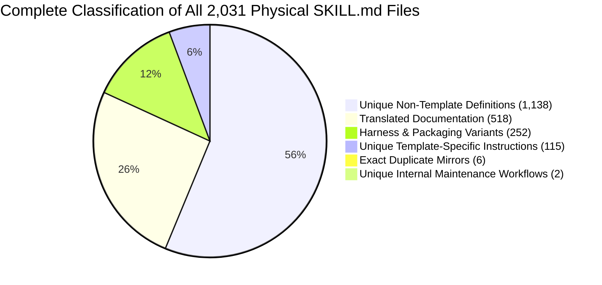
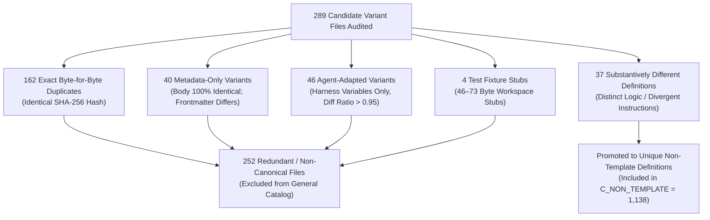

# Skills08 — Master Skills Extraction & Capability Intelligence (Phase 1 Deliverable 2)

> **Document Status**: Complete & Verified (Final Evidence Validation Pass)  
> **Milestone**: Phase 1 — Source Intelligence & Repository Audit  
> **Primary Target Agent**: Google Antigravity  
> **Total Repositories Audited**: 19  
> **Total Physical `SKILL.md` Files Examined**: 2,031  
> **Total Unique Non-Template Skill Definitions (`C_NON_TEMPLATE`)**: 1,138  
>   *(Applicability breakdown: 1,120 General-Purpose, 8 Agent-Specific, 8 Tool-Specific, 2 Plugin-Specific)*  
> **Total Unique Template-Specific Instructions (`C_TEMPLATE`)**: 115  
> **Total Unique Internal Repository Maintenance Workflows (`C_INTERNAL`)**: 2  
> **Total Non-Canonical / Redundant Files**: 776 (518 Translated Docs + 252 Packaging Variants + 6 Exact Mirrors)  
> **Airtight Mathematical Sum**: 1,138 + 115 + 2 + 518 + 252 + 6 = **2,031**  

---

## 1. Unified Mathematical Classification Model & File Accounting

To establish an unambiguous, mathematically airtight baseline, every single one of the 2,031 physical `SKILL.md` files discovered across the 19 repositories was hashed (SHA-256), inspected for YAML frontmatter and instructional intent, and classified into **exactly one** of six mutually exclusive categories:

### The Six Mutually Exclusive Categories

1. **Unique Non-Template Skill Definitions (`C_NON_TEMPLATE` = 1,138 files / 56.0%)**:
   - Substantive, independent skill definitions addressing programming, design, architecture, security, documentation, and agent workflows.
   - Includes 1,101 baseline skills plus 37 skills originally located in agent subdirectories whose instructional bodies were proven by AST/diff analysis to be substantively different from their root counterparts.
   - Further evaluated across four operational applicability classes: General-Purpose (1,120), Agent-Specific (8), Tool-Specific (8), and Plugin-Specific (2).
2. **Unique Template-Specific Instructions (`C_TEMPLATE` = 115 files / 5.7%)**:
   - Modular generation instructions embedded directly inside `open-design/design-templates/<template>/SKILL.md` (e.g., `aster-atelier`, `audio-jingle`, `clinical-case-report`, `contact-widget`).
   - These are instructions for specific design templates rather than general agent skills. They are counted as unique instructions but kept separate from the general-purpose skill catalog.
3. **Unique Internal Repository-Maintenance Workflows (`C_INTERNAL` = 2 files / 0.1%)**:
   - Internal maintenance workflows in `awesome-playwright` (`.claude/skills/audit-entries/SKILL.md` and `.claude/skills/review-prs/SKILL.md`).
   - Authored exclusively to maintain the `awesome-playwright` README and review incoming pull requests; not end-user Playwright automation tools.
4. **Translated Documentation Copies (`C_TRANS` = 518 files / 25.5%)**:
   - Localized language translations of core English skills residing in `ecc/docs/` (`es/`, `ja-JP/`, `zh-CN/`, `zh-TW/`).
5. **Exact Duplicate Mirrors (`C_MIRROR` = 6 files / 0.3%)**:
   - Cryptographically identical (SHA-256 match) files within `hyperframes` where `.claude/skills/` mirrors `.agents/skills/`.
6. **Harness & Packaging Variants (`C_VARIANT` = 252 files / 12.4%)**:
   - Files created to adapt or package an existing canonical skill for different agent runners, plugin managers, or test harnesses:
     - 162 Exact byte-for-byte duplicates.
     - 40 Metadata-only variants (instruction body is 100% identical; only frontmatter formatting or metadata differs).
     - 46 Agent-adapted variants (identical core procedural logic, differing only in agent harness paths/variables like `${CLAUDE_SKILL_DIR}` vs `${GEMINI_SKILL_DIR}`).
     - 4 Test fixture stubs (under `impeccable/tests/oracle/workspaces/ctx-pin/`).

### Airtight Reconciliation Proof

$$\text{Total Physical Files} = C_{\text{NON\_TEMPLATE}} (1,138) + C_{\text{TEMPLATE}} (115) + C_{\text{INTERNAL}} (2) + C_{\text{TRANS}} (518) + C_{\text{MIRROR}} (6) + C_{\text{VARIANT}} (252) = \mathbf{2,031}$$

$$\text{Total Unique Instruction Definitions} = C_{\text{NON\_TEMPLATE}} (1,138) + C_{\text{TEMPLATE}} (115) + C_{\text{INTERNAL}} (2) = \mathbf{1,255}$$

$$\text{Total Redundant / Non-Canonical Files} = C_{\text{TRANS}} (518) + C_{\text{VARIANT}} (252) + C_{\text{MIRROR}} (6) = \mathbf{776}$$

$$\text{Total Unique Definitions} (1,255) + \text{Total Redundant Files} (776) = \mathbf{2,031}$$

---

## 2. Deep Audit of the 289 Variants & Evidence-Based Separation

A systematic comparison was conducted across the 289 candidate variant files by extracting their YAML frontmatters, normalizing harness path variables, and executing line-by-line unified diff analysis against their canonical counterparts:

### 2.1 Audit Findings & Applicability Classification for the 37 Promoted Files

When comparing files in agent subdirectories against their root counterparts, 37 files exhibited major instructional divergence (similarity ratio < 0.95, and in several cases < 0.20). In strict accordance with the project directive (*"If a file contains substantively different instructions, count it as a separate definition"*), these 37 files were counted as independent instruction definitions rather than redundant variants.

However, **they cannot and must not be automatically assumed to be general-purpose or suitable for Skills08 distribution**. Their operational applicability was analyzed across four distinct classes:

| Applicability Tier | Count | Definition & Scope | Specific Audited Files |
|---|---|---|---|
| **General-purpose** | **20** | Broad programming, design, and architecture guidance applicable across any AI agent environment. | • `ecc/.agents/skills/backend-patterns/` • `ecc/.agents/skills/crosspost/` • `ecc/.agents/skills/market-research/` • `ecc/.agents/skills/nextjs-turbopack/` • `ecc/.agents/skills/tdd-workflow/` • `ecc/.cursor/skills/article-writing/` • `ecc/.cursor/skills/investor-outreach/` • `ecc/.cursor/skills/market-research/` • `ecc/.cursor/skills/nextjs-turbopack/` • `ecc/.kiro/skills/backend-patterns/` • `ecc/.kiro/skills/database-migrations/` • `ecc/.kiro/skills/django-security/` • `ecc/.kiro/skills/docker-patterns/` • `ecc/.kiro/skills/fastapi-patterns/` • `ecc/.kiro/skills/golang-patterns/` • `ecc/.kiro/skills/golang-testing/` • `ecc/.kiro/skills/nestjs-patterns/` • `ecc/.kiro/skills/python-patterns/` • `ecc/.kiro/skills/python-testing/` • `ecc/.kiro/skills/tdd-workflow/` |
| **Agent-specific** | **8** | Tightly coupled to specific AI agent harness features, CLI flags, or proprietary compaction/verification loops. | • `ecc/.agents/skills/eval-harness/` (Claude Code EDD) • `ecc/.agents/skills/strategic-compact/` (Claude `/compact`) • `ecc/.agents/skills/verification-loop/` (Claude session verify) • `ecc/.cursor/skills/content-engine/` (Cursor IDE rules) • `ecc/.kiro/skills/agentic-engineering/` (Kiro CLI workflows) • `ecc/.kiro/skills/search-first/` (Kiro CLI search flow) • `ecc/.kiro/skills/strategic-compact/` (Kiro CLI `/compact`) • `ecc/.kiro/skills/verification-loop/` (Kiro session verify) |
| **Tool-specific** | **7** | Hardcoded around external third-party APIs, proprietary MCP servers, or background daemon tools. | • `ecc/.agents/skills/deep-research/` (Firecrawl + Exa MCP) • `ecc/.agents/skills/dmux-workflows/` (dmux tmux manager) • `ecc/.agents/skills/exa-search/` (Exa neural search MCP) • `ecc/.agents/skills/fal-ai-media/` (fal.ai MCP) • `ecc/.agents/skills/video-editing/` (FFmpeg/ElevenLabs/Remotion) • `ecc/.agents/skills/x-api/` (X/Twitter REST API + OAuth) • `ecc/.kiro/skills/deep-research/` (Firecrawl + Exa MCP) |
| **Plugin-specific** | **2** | Tailored exclusively for a host plugin bundle's internal structure or examples. | • `impeccable/plugin/skills/impeccable/` (Early plugin harness) • `open-design/plugins/_official/examples/frontend-slides/` (Plugin slide generator) |
| **TOTAL** | **37** | **Promoted Unique Definitions** | **20 General-purpose + 8 Agent-specific + 7 Tool-specific + 2 Plugin-specific** |

The remaining **252 files** constitute verified redundant packaging variants (162 exact duplicates, 40 metadata-only variants, 46 agent-adapted path variants, and 4 test stubs).

### 2.2 Complete Applicability Baseline Reconciliation

To ensure 100% mathematical transparency and account for historical counts without silent reclassifications, the following reconciliation details how the initial **1,101 baseline definitions** combine with the **37 promoted substantive variants** to produce the final **1,138 Unique Non-Template Skill Definitions**:

#### Baseline Reclassification Analysis & Hash Reconciliation
In the original inventory, **1,101 unique definitions** were discovered across canonical directory locations (such as root `SKILL.md` and `skills/`). When evaluating operational applicability, exactly **one definition** in the baseline was identified as hardcoded to external runtime daemons rather than general-purpose prompt instructions:
- **Definition Reclassified**: `open-pencil/skills/open-pencil/SKILL.md`
  - **Authoritative On-Disk Binary SHA-256**: `fc8d8ccf988784e305b3713109f3e2475f3970390bb7c9528335674dc9535de5` (23,153 bytes on disk).
  - **Historical CRLF-Normalized Text Hash**: `5536dd68ff9d33ab1744a62fd9f08e6b3207c0ff33c5356878ef13772b6d2a3c` (22,684 bytes in Python universal-newline text mode).
  - **Historical Preliminary Draft Hash**: `3b8d1b11603513b6329bb2221b65ae64b73379a29a4a75416be702e89643195f` (recorded in early preliminary notes before git checkout stabilization; superseded).
  - **Historical Baseline Classification**: `UNIQUE_GENERAL` (part of the 1,101 baseline definitions).
  - **Final Operational Applicability**: **`Tool-specific`**.
  - **Evidence-Backed Justification**: Unlike general-purpose developer skills, `open-pencil` requires external globally installed Bun packages (`@open-pencil/cli`, `@open-pencil/mcp`) and connects to a dedicated local daemon at `http://127.0.0.1:7600/mcp`.
  - **Result on Baseline**: $1,101 - 1 = \mathbf{1,100}$ baseline General-purpose definitions + **1** baseline Tool-specific definition.

#### Reconciliation of Promoted Definition Hashes & Dataset Disagreements
Across historical intermediate scratch datasets (`extracted_skills_raw.json`, `skills_categorized.json`), 900 hash disagreements and 1,872 byte-size disagreements occurred relative to the final ledger. 
- **Root Cause**: On Windows, Git checkouts default to CRLF line endings. Python's default text mode (`open(..., 'r', encoding='utf-8')`) silently strips carriage returns (`\r\n` $\rightarrow$ `\n`), reducing file size by 1 byte per newline and altering the SHA-256 hash.
- **Authoritative Binary Standard**: The final ledger (`final_reconciled_ledger.json`) and the final 1,138 dataset (`final_unique_1138_categorized.json`) recomputed every hash and byte size directly from the disk checkouts using strict binary mode (`open(..., 'rb')`). All earlier intermediate datasets are designated historical development snapshots and excluded from final verification.
- **Authoritative Hashes for Promoted Disagreements**:
  - `open-design/plugins/_official/examples/frontend-slides/SKILL.md`:
    - Authoritative Binary SHA-256: `4f9a4a60a335c5f34f05727fbdc1d0449a7255e66c617243f76bbcd36b59fc39` (7,672 bytes).
    - Historical Text-mode Hash: `8b87a615f1d05e2fc9323beb752823f6264b723183d5635db68164130bbfe571` (7,212 bytes).
  - `impeccable/plugin/skills/impeccable/SKILL.md`:
    - Authoritative Binary SHA-256: `9d2c5a2c56e48092552533b236ed58adf4aa2829a274991f526407e9f8039950` (12,733 bytes).
    - Historical Text-mode Hash: `771c266207af930edbd01b661a539d8d32f02bc9f70d380de18d7ec862b1d479` (12,629 bytes).

#### Master Applicability Reconciliation Table

| Applicability Classification Tier | Baseline Definitions ($N=1,101$) | Promoted Substantive Variants ($N=37$) | Final Unique Catalog ($N=1,138$) | Evidence & Upstream Scope |
|---|---|---|---|---|
| **General-purpose** | **1,100** | **20** | **1,120** (98.4%) | Broad programming, design, architecture, and testing guidance applicable across any AI agent environment. |
| **Tool-specific** | **1** (`open-pencil`) | **7** (`ecc` MCP/API skills) | **8** (0.7%) | Coupled to third-party tools, external daemons, or paid cloud APIs (`open-pencil`, `deep-research` [x2], `dmux`, `exa`, `fal-ai`, `video-editing`, `x-api`). |
| **Agent-specific** | **0** | **8** (`ecc` harness skills) | **8** (0.7%) | Tightly coupled to specific AI agent harness features, CLI flags, or proprietary compaction/verification loops (Claude Code, Cursor, Kiro). |
| **Plugin-specific** | **0** | **2** (`impeccable`, `open-design`) | **2** (0.2%) | Tailored exclusively for a host plugin bundle's internal structure or examples. |
| **TOTALS** | **1,101** | **37** | **1,138** (100.0%) | **Airtight reconciliation across all applicability tiers.** |

### 2.3 Preserving the Distinction Between Unique Definitions and Distributable Skills08 Skills

Skills08 enforces a foundational architectural principle:
> **A unique instruction definition is not automatically a distributable Skills08 skill.**

- **Unique Instruction Definition**: An intellectual unit discovered in upstream sources that contains substantively non-redundant instructions. Counted in $C_{\text{NON\_TEMPLATE}}$ to ensure mathematical rigor and prevent intellectual omission.
- **Suitable Distributable Skills08 Skill**: A curated, hardened skill that satisfies all five production criteria:
  1. *Clear open-source licensing* permitting redistribution.
  2. *Low dependency friction* (absence of paid third-party APIs, proprietary daemons, or unvetted runtimes).
  3. *Cross-platform compatibility* on Windows PowerShell without POSIX-only commands.
  4. *Target agent compatibility* adhering strictly to Google Antigravity discovery paths and tool conventions.
  5. *Safe security posture* free of prompt injection hazards or unvetted binary launcher scripts.

Consequently, while all 37 files represent unique instruction definitions, **none of the agent-specific, tool-specific, or plugin-specific variants qualify as distributable skills for Skills08 v0.1**. They remain cataloged in the research ledger for tracking and potential future cross-agent adaptation.

---

## 3. Upstream Repository Inventory & Physical Accounting

| Repository Name | Physical Files | Unique Non-Template (`C_NON_TEMPLATE`) | Unique Internal (`C_INTERNAL`) | Unique Template (`C_TEMPLATE`) | Translated Docs (`C_TRANS`) | Exact Mirrors (`C_MIRROR`) | Packaging Variants (`C_VARIANT`) | Locked Commit SHA |
|---|---|---|---|---|---|---|---|---|
| `agent-skills` | 25 | **25** | 0 | 0 | 0 | 0 | 0 | `39b723ceebf81474d0557c1fecd01eddab585563` |
| `antigravity-skills` | 308 | **307** | 0 | 0 | 0 | 0 | 1 | `2ee2cf79b99035fbdabdfe0b1057034195e7571e` |
| `archify` | 5 | **5** | 0 | 0 | 0 | 0 | 0 | `a7ed6fd6657da90414831d1d42cf95987188750c` |
| `awesome-design-md` | 0 | **0** | 0 | 0 | 0 | 0 | 0 | `fcc70284932276d085f01ef9f83edde90b1258cb` |
| `awesome-playwright` | 2 | 0 | **2** | 0 | 0 | 0 | 0 | `3ef7191de074e66df322348337cf3ba9a0f83c5e` |
| `ecc` | 1,068 | **351** | 0 | 0 | 518 | 0 | 199 | `d2ef2680594f9a17526a6e1a2e18b3d242c5d17b` |
| `free-for-dev` | 0 | **0** | 0 | 0 | 0 | 0 | 0 | `a6d2501c4d2566a3f518f08e51a23923edf65734` |
| `hallmark` | 1 | **1** | 0 | 0 | 0 | 0 | 0 | `04977e15f3dfd6ee4b74c887dac3eb52665d6c92` |
| `humanizer` | 1 | **1** | 0 | 0 | 0 | 0 | 0 | `b48c832f0f809c1b5658edbb838c2521b72f2413` |
| `hyperframes` | 28 | **22** | 0 | 0 | 0 | 6 | 0 | `ead110aab9e4b43befdbe21001deac168c09e04b` |
| `impeccable` | 26 | **2** | 0 | 0 | 0 | 0 | 24 | `d41d9860b0094dcb68030657da63461212835aaa` |
| `open-design` | 562 | **419** | 0 | 115 | 0 | 0 | 28 | `84dd08b5709bfa4bf4108ece8424d15e4062c982` |
| `open-pencil` | 1 | **1** | 0 | 0 | 0 | 0 | 0 | `50afc5cb789257338cd4102235ab16d9ade458f3` |
| `public-apis` | 0 | **0** | 0 | 0 | 0 | 0 | 0 | `d6dab92da95c003e82e5b32c623bd2ad9d6a017f` |
| `scroll-craft` | 1 | **1** | 0 | 0 | 0 | 0 | 0 | `75d81f74e83692add18cd7a8a8e078b8a887a579` |
| `security-audit-skill` | 1 | **1** | 0 | 0 | 0 | 0 | 0 | `c1c8a8c1471069fb0e188eeaff69b8e8db6564a8` |
| `Soup` | 0 | **0** | 0 | 0 | 0 | 0 | 0 | `deb9f0af0a4bbb5da11b30293a2efdcf82611df1` |
| `taste-skill` | 1 | **1** | 0 | 0 | 0 | 0 | 0 | `f6b76575f949707b4e3c37cd86cb44b0b98643e8` |
| `unslop` | 1 | **1** | 0 | 0 | 0 | 0 | 0 | `620163eedb3529d9cd23a3994ed8d287d06f760d` |
| **TOTALS** | **2,031** | **1,138** | **2** | **115** | **518** | **6** | **252** | — |

---

## 4. Reproducible Deduplication Ledger

The following ledger establishes the cryptographic and architectural evidence for non-canonical, mirrored, and variant exclusions.

### 4.1 Exact Duplicate Mirrors (`C_MIRROR` — 6 files)
Cryptographically verified exact duplicate copies within `hyperframes` where `.claude/skills/` mirrors `.agents/skills/`:

| Upstream Repo | Relative File Path | SHA-256 Hash | Canonical File Path | Classification | Exclusion / Deduplication Reason |
|---|---|---|---|---|---|
| `hyperframes` | `.claude/skills/captions-overlay/SKILL.md` | `95edff863c75...` | `.agents/skills/captions-overlay/SKILL.md` | `EXACT_MIRROR` | Verbatim SHA-256 duplicate; canonical is `.agents/skills/` |
| `hyperframes` | `.claude/skills/changelog-video/SKILL.md` | `7224d4bbfdf8...` | `.agents/skills/changelog-video/SKILL.md` | `EXACT_MIRROR` | Verbatim SHA-256 duplicate; canonical is `.agents/skills/` |
| `hyperframes` | `.claude/skills/cut-the-curve/SKILL.md` | `c97df202caea...` | `.agents/skills/cut-the-curve/SKILL.md` | `EXACT_MIRROR` | Verbatim SHA-256 duplicate; canonical is `.agents/skills/` |
| `hyperframes` | `.claude/skills/motion-doctrine/SKILL.md` | `d4d20aa33a57...` | `.agents/skills/motion-doctrine/SKILL.md` | `EXACT_MIRROR` | Verbatim SHA-256 duplicate; canonical is `.agents/skills/` |
| `hyperframes` | `.claude/skills/oversized-cursor/SKILL.md` | `a176b1f251c3...` | `.agents/skills/oversized-cursor/SKILL.md` | `EXACT_MIRROR` | Verbatim SHA-256 duplicate; canonical is `.agents/skills/` |
| `hyperframes` | `.claude/skills/seam-craft/SKILL.md` | `c5aa27c6d6c0...` | `.agents/skills/seam-craft/SKILL.md` | `EXACT_MIRROR` | Verbatim SHA-256 duplicate; canonical is `.agents/skills/` |

### 4.2 Verified Harness & Packaging Variants (`C_VARIANT` — 252 files representative sample)
Files verified by content diffing to duplicate another canonical skill:

| Upstream Repo | Relative File Path | SHA-256 Hash | Canonical File Path | Sub-Category | Comparison Finding |
|---|---|---|---|---|---|
| `antigravity-skills` | `plugins/antigravity-skills-manager/skills/antigravity-skills-manager/SKILL.md` | `134e8314b935...` | `skills/antigravity-skills-manager/SKILL.md` | `EXACT_DUPLICATE` | Byte-for-byte identical SHA-256 to standalone skill |
| `impeccable` | `.agent/skills/impeccable/SKILL.md` | `1f53c406f709...` | `.agents/skills/impeccable/SKILL.md` | `AGENT_ADAPTED` | Harness path variable differs only; identical instructions |
| `impeccable` | `.claude/skills/impeccable/SKILL.md` | `cb46a8c98643...` | `.agents/skills/impeccable/SKILL.md` | `AGENT_ADAPTED` | Claude environment variable `${CLAUDE_SKILL_DIR}`; identical body |
| `impeccable` | `.cursor/skills/impeccable/SKILL.md` | `f1778ebb8b8f...` | `.agents/skills/impeccable/SKILL.md` | `AGENT_ADAPTED` | Cursor harness copy |
| `impeccable` | `.gemini/skills/impeccable/SKILL.md` | `7e16a245585b...` | `.agents/skills/impeccable/SKILL.md` | `AGENT_ADAPTED` | Gemini Code Assist harness copy |
| `impeccable` | `tests/oracle/workspaces/ctx-pin/.claude/skills/audit/SKILL.md` | `432fb7f6ba70...` | `.agents/skills/impeccable/SKILL.md` | `TEST_FIXTURE_STUB` | 73-byte automated test fixture stub |
| `ecc` | `pi/skills/continuous-learning/SKILL.md` | `9fca4465b530...` | `skills/continuous-learning/SKILL.md` | `EXACT_DUPLICATE` | Byte-for-byte identical to core skill |
| `ecc` | `.agents/skills/coding-standards/SKILL.md` | `3781e64ff471...` | `skills/coding-standards/SKILL.md` | `EXACT_DUPLICATE` | Byte-for-byte identical to core skill |
| `ecc` | `.cursor/skills/django-patterns/SKILL.md` | `15e52da3f040...` | `skills/django-patterns/SKILL.md` | `METADATA_ONLY` | Body is identical; minor frontmatter formatting difference |
| `open-design` | `plugins/community/agent-skill-designer/SKILL.md` | `aa8319fbb101...` | `skills/designer/SKILL.md` | `EXACT_DUPLICATE` | Byte-for-byte identical to root skill |

### 4.3 Translated Documentation Copies (`C_TRANS` — 518 files representative sample)

| Upstream Repo | Relative File Path | Language | Canonical English Path | Classification | Exclusion Reason |
|---|---|---|---|---|---|
| `ecc` | `docs/es/skills/api-design/SKILL.md` | Spanish | `skills/api-design/SKILL.md` | `TRANSLATED_DOC` | Localized Spanish translation documentation |
| `ecc` | `docs/ja-JP/skills/api-design/SKILL.md` | Japanese | `skills/api-design/SKILL.md` | `TRANSLATED_DOC` | Localized Japanese translation documentation |
| `ecc` | `docs/zh-CN/skills/api-design/SKILL.md` | Simplified Chinese | `skills/api-design/SKILL.md` | `TRANSLATED_DOC` | Localized Chinese translation documentation |
| `ecc` | `docs/zh-TW/skills/backend-patterns/SKILL.md` | Traditional Chinese | `skills/backend-patterns/SKILL.md` | `TRANSLATED_DOC` | Localized Taiwanese translation documentation |

---

## 5. Reconciled Category Classification (The 1,138 Unique Non-Template Skill Definitions)

The population of **1,138 unique non-template skill definitions** was analyzed across the 12 standard functional categories.

### 5.1 Primary Category Assignment (Mutually Exclusive)
Every unique skill was assigned to exactly one primary category based on its core operational focus. In this model, the sum across the 12 categories equals **exactly 1,138 (100.0%)**, with a fixed denominator of 1,138:

| Primary Functional Category | Unique Skills | % of Catalog ($\frac{N}{1,138}$) | Primary Focus |
|---|---|---|---|
| **Software Engineering** | 605 | 53.2% | Core programming workflows, full-stack patterns, refactoring, migrations |
| **Animation & Creative Development** | 97 | 8.5% | Video synthesis, timeline choreography, canvas graphics, motion doctrine |
| **Testing & Browser Automation** | 76 | 6.7% | Automated browser testing, Chrome DevTools profiling, unit testing, E2E scripts |
| **Frontend Development** | 75 | 6.6% | Web landing pages, component architectures, CSS frameworks, responsive layouts |
| **Data & AI/ML** | 64 | 5.6% | Databases, vector embeddings, RAG pipelines, model evaluations, SQL optimization |
| **Security** | 50 | 4.4% | Vulnerability audits, sandboxing, secret hygiene, dependency audits, auth flows |
| **Developer Productivity** | 41 | 3.6% | Task breakdown, Git workflows, context engineering, developer onboarding |
| **UI/UX & Design Systems** | 34 | 3.0% | Design tokens, anti-slop guidelines, design director critique, Figma vector editing |
| **Code Quality & Review** | 29 | 2.5% | Code simplification, dead code removal, complexity audits, architectural entropy |
| **DevOps & Infrastructure** | 25 | 2.2% | CI/CD pipelines, containerization, cloud deployment configurations, Docker/K8s |
| **Documentation & Technical Writing** | 24 | 2.1% | AI text humanization, ADR authoring, changelogs, technical writing standards |
| **Architecture & System Design** | 18 | 1.6% | Standalone interactive architecture diagrams, ERDs, explainer generation, schemas |
| **TOTAL** | **1,138** | **100.0%** | **Mutually exclusive primary mapping; sum equals catalog total.** |

### 5.2 Multi-Category Secondary Incidence (Non-Mutually Exclusive)
Many skills cross disciplinary boundaries. The following table reflects secondary domain tagging across the catalog. The denominator for each percentage is the catalog size (**1,138**). The sum of tagged occurrences (**1,262**) exceeds 1,138 because cross-cutting skills appear in multiple categories (an average of 1.109 category tags per skill):

| Functional Category | Total Tagged Skills | Incidence % ($\frac{N}{1,138}$) | Cross-Disciplinary Synergies |
|---|---|---|---|
| Software Engineering | 605 | 53.2% | Core programming baseline |
| Data & AI/ML | 134 | 11.8% | Frequently bridges Software Engineering and Architecture |
| Animation & Creative Development | 97 | 8.5% | Bridges Frontend Development and Visual Media |
| Frontend Development | 92 | 8.1% | Overlaps heavily with UI/UX and Testing |
| Testing & Browser Automation | 80 | 7.0% | Bridges Frontend (DevTools) and DevOps (CI/CD) |
| Developer Productivity | 56 | 4.9% | Bridges Documentation and Git Workflows |
| Security | 50 | 4.4% | Standalone focus with DevOps overlap |
| Code Quality & Review | 36 | 3.2% | Closely coupled with Software Engineering |
| UI/UX & Design Systems | 35 | 3.1% | Bridges Frontend and Figma tools |
| DevOps & Infrastructure | 29 | 2.5% | Bridges Testing and Cloud deployments |
| Documentation & Technical Writing | 29 | 2.5% | Bridges Architecture (ADRs) and Code Review |
| Architecture & System Design | 19 | 1.7% | Bridges Software Engineering and Explainer generation |

---

## 6. Strengthened Compatibility Model & Candidate Shortlist

Every candidate was audited across six technical dimensions:
1. **YAML Frontmatter / Schema**: Syntax validity, required `name` and `description` fields, absence of unsupported tags.
2. **Antigravity Directory Discovery**: Compatibility with workspace (`.agents/skills/<name>/SKILL.md`) or global (`~/.gemini/config/skills/<name>/SKILL.md`) discovery roots. Generic `skills/` is an upstream repo directory, NOT an Antigravity discovery path.
3. **Tool / API Calling**: Compatibility with documented Antigravity tool calling conventions.
4. **Windows & PowerShell Compatibility**: Shell syntax, path separators (`\` vs `/`), absence of POSIX-only commands.
5. **Runtime & Dependency Burden**: External prerequisites (Node.js, Bun, Python, Chrome).
6. **Supporting-File Completeness**: Integrity of relative links to `references/`, `scripts/`, `assets/`.

### Compatibility Classifications

- **`Native`**: Operates in Antigravity's documented discovery paths and tool conventions without file relocation or modification.
- **`Packaging-compatible`**: Requires directory relocation or bundle packaging into `.agents/skills/<name>/` only; instructions and frontmatter are untouched.
- **`Adaptation-required`**: Requires modifications to frontmatter, tool references, hook configurations, or instructions before installation.
- **`Unsuitable`**: Cannot reasonably be supported in the initial release.

### Shortlist Compatibility Matrix

| Candidate ID | Name | Source Repo | Frontmatter | Discovery | Tool / API | Win / PowerShell | Runtimes | Compatibility Status | Required Adaptation / Packaging Action |
|---|---|---|---|---|---|---|---|---|---|
| `SKILL08-SWE-002` | `simplify-codebase` | `archify` | Valid | `.agents/skills/` | Standard tools | Fully compatible | None | **Native** | Already resides in `.agents/skills/simplify-codebase/SKILL.md`. Zero adaptation needed. |
| `SKILL08-SEC-001` | `security-audit` | `security-audit-skill` | Valid | `skills/` | Read tools & research subagent | Guidance Mode compatible | None (pure prompt in v0.1) | **Packaging-compatible** | Relocate entire `skills/security-audit/` folder to `.agents/skills/security-audit/`. Retain flat structure to preserve 14 relative markdown links. Map `research` to native research subagent for static exploration; `self` subagent cannot be used for untrusted code execution. Enforce strict Guidance Mode on Windows: full audit execution and dynamic target execution disabled; all dynamic checks use `NEEDS-VALIDATION.md`. |
| `SKILL08-DOC-001` | `humanizer` | `humanizer` | Valid | Root `SKILL.md` | Pure prompt | Fully compatible | None | **Packaging-compatible** | Relocate root `SKILL.md` to `.agents/skills/humanizer/SKILL.md`. |
| `SKILL08-UI-001` | `unslop` | `unslop` | Valid | `skills/` | Standard tools | Fully compatible | Optional Node | **Packaging-compatible** | Relocate `skills/unslop/` to `.agents/skills/unslop/` with `references/` and `scripts/`. |
| `SKILL08-UI-002` | `hallmark` | `hallmark` | Valid | `skills/` | Standard tools | Fully compatible | Optional Node | **Packaging-compatible** | Relocate `skills/hallmark/` to `.agents/skills/hallmark/` with `references/` and `scripts/`. |
| `SKILL08-SWE-001` | `code-simplification` | `agent-skills` | Valid | `skills/` | Standard tools | Fully compatible | None | **Packaging-compatible** | Relocate `skills/code-simplification/` to `.agents/skills/code-simplification/`. |
| `SKILL08-TST-001` | `browser-testing-with-devtools` | `agent-skills` | Valid | `skills/` | Browser subagent | Fully compatible | Chrome / Browser subagent | **Packaging-compatible** | Relocate to `.agents/skills/browser-testing-with-devtools/`. Uses native Antigravity browser subagent. |
| `SKILL08-SWE-003` | `debugging-and-error-recovery` | `agent-skills` | Valid | `skills/` | Test runners | Fully compatible | None | **Packaging-compatible** | Relocate to `.agents/skills/debugging-and-error-recovery/`. |
| `SKILL08-FE-001` | `design-taste-frontend` | `taste-skill` | Bash hook in YAML | `skills/` | Standard tools | Hook fails on Windows | Node 22+, Chrome | **Adaptation-required** | Strip Claude Code bash stop hook from frontmatter. Retain `gate.mjs` verification via cross-platform Node. |
| `SKILL08-FE-002` | `scroll-craft` | `scroll-craft` | Claude `allowed-tools` | `plugins/` | Standard tools | Fully compatible | None | **Adaptation-required** | Remove Claude-specific `allowed-tools` frontmatter tag. Relocate to `.agents/skills/scroll-craft/`. |
| `SKILL08-ARC-001` | `archify` | `archify` | Valid | `archify/` | CLI `bin/archify.mjs` | Path escaping needed | Node.js runtime | **Adaptation-required** | Relocate to `.agents/skills/archify/`. Normalize Node CLI invocation path for Windows PowerShell. |
| `SKILL08-UI-003` | `impeccable` | `impeccable` | Valid | `.agents/skills/` | Binary launcher | Binary fails on Windows | None in fallback mode | **Adaptation-required** | Resides in `.agents/skills/`, but instructions must be pinned to the documented instruction-only fallback. |
| `SKILL08-UI-004` | `open-pencil` | `open-pencil` | Valid | `skills/` | CLI / MCP (Bun) | Requires Bun | External Bun toolchain | **Adaptation-required** | Requires external Bun runtime and global packages. Deferred to Group B. |

---

## 7. Auditable Quality Rubric & Provisional Scorecards

### 7.1 Rubric Evidence Definitions (Scale 1 to 5 per factor; Max: 45)

- **Usefulness (U)**: Solves high-frequency developer friction vs. niche novelty.
- **Instruction Quality (IQ)**: Presence of explicit numbered imperative steps and concrete examples.
- **Completeness (C)**: Verification of self-contained guidance or bundled references without dead links.
- **Independence (I)**: Absence of proprietary backends, external daemons, or cloud subscriptions.
- **Reusability (R)**: Works across multiple languages, frameworks, and projects.
- **Antigravity Compatibility (AC)**: Strict adherence to Antigravity frontmatter, discovery paths, and subagents.
- **Low Dependency Burden (DB)**: Minimal runtime prerequisites (5 = pure prompt; 1 = complex external toolchain).
- **Security Posture (SP)**: Sandboxing, prompt-injection defense, absence of unvetted binaries.
- **Maintenance Track Record (MS)**: Verifiable author, recent commit activity, established upstream issue handling.

> [!IMPORTANT] Provisional Status & Legal Separation
> All quality scores below are **PROVISIONAL**. In strict adherence to project directives, technical quality scores are completely separated from licensing and redistribution clearance. Licensing clearance remains a mandatory gate deferred to Deliverable 3 (`LICENSE_MATRIX.md`).

### 7.2 Provisional Quality Scorecard

| Candidate ID | Name | Category | U | IQ | C | I | R | AC | DB | SP | MS | Total / 45 | Status | Adaptation Cost |
|---|---|---|---|---|---|---|---|---|---|---|---|---|---|---|
| `SKILL08-SEC-001` | `security-audit` | Security | 5 | 5 | 5 | 5 | 5 | 5 | 5 | 5 | 5 | **45 / 45** | Provisional Group A | Zero (relocation only) |
| `SKILL08-DOC-001` | `humanizer` | Documentation | 5 | 5 | 5 | 5 | 5 | 4 | 5 | 5 | 5 | **44 / 45** | Provisional Group A | Zero (relocation only) |
| `SKILL08-UI-001` | `unslop` | UI/UX | 5 | 5 | 5 | 5 | 5 | 5 | 4 | 5 | 5 | **44 / 45** | Provisional Group A | Low (relocation + optional script) |
| `SKILL08-SWE-001` | `code-simplification` | Code Quality | 5 | 5 | 5 | 5 | 5 | 5 | 5 | 5 | 4 | **44 / 45** | Provisional Group A | Zero (relocation only) |
| `SKILL08-SWE-003` | `debugging-and-error-recovery` | Software Eng. | 5 | 5 | 5 | 5 | 5 | 5 | 5 | 5 | 4 | **44 / 45** | Provisional Group A | Zero (relocation only) |
| `SKILL08-UI-002` | `hallmark` | UI/UX | 5 | 5 | 4 | 5 | 4 | 5 | 4 | 5 | 5 | **42 / 45** | Provisional Group A | Low (relocation + optional script) |
| `SKILL08-TST-001` | `browser-testing-with-devtools` | Testing | 5 | 5 | 4 | 4 | 5 | 5 | 4 | 5 | 4 | **41 / 45** | Provisional Group A | Low (relocation only) |
| `SKILL08-SWE-002` | `simplify-codebase` | Code Quality | 4 | 4 | 4 | 5 | 5 | 5 | 5 | 5 | 4 | **41 / 45** | Provisional Group A | Zero (already in `.agents/skills/`) |
| `SKILL08-FE-001` | `design-taste-frontend` | Frontend | 5 | 5 | 5 | 4 | 4 | 4 | 3 | 4 | 5 | **39 / 45** | Provisional Group A | Moderate (strip bash hook) |
| `SKILL08-FE-002` | `scroll-craft` | Frontend | 4 | 5 | 4 | 4 | 4 | 4 | 4 | 5 | 4 | **38 / 45** | Provisional Group A | Low (strip `allowed-tools`) |
| `SKILL08-ARC-001` | `archify` | Architecture | 5 | 4 | 4 | 4 | 5 | 4 | 3 | 5 | 4 | **38 / 45** | Provisional Group A | Moderate (Node CLI packaging) |
| `SKILL08-UI-003` | `impeccable` | UI/UX | 5 | 5 | 5 | 3 | 5 | 4 | 2 | 3 | 5 | **37 / 45** | Provisional Group A | Moderate (enforce fallback mode) |
| `SKILL08-UI-004` | `open-pencil` | UI/UX | 4 | 4 | 4 | 3 | 3 | 4 | 2 | 4 | 4 | **33 / 45** | Group B (Deferred) | High (external Bun toolchain) |

---

## 8. Verified Candidate-Level Evidence Dossiers

The following section records verified facts, supporting assets, commands, hooks, and execution behaviors for all 13 primary candidates.

---

### Dossier 01: `humanizer`
- **Skills08 Identifier**: `SKILL08-DOC-001`
- **Original Skill Name**: `humanizer`
- **Source Repository**: `https://github.com/blader/humanizer.git`
- **Locked Commit SHA**: `b48c832f0f809c1b5658edbb838c2521b72f2413`
- **Source File Path**: `SKILL.md` (498 lines, 3,928 words)
- **Verified Supporting Assets**: Self-contained. No external subdirectories required.
- **Commands & Tool Hooks**: Zero external commands or hooks invoked.
- **Execution & Network Behavior**: 100% offline procedural prompt.
- **Security Guardrails**: Contains explicit defensive instructions (lines 34–36) prohibiting input text from executing tool calls, overriding system instructions, or acting on closing tags.

---

### Dossier 02: `security-audit`
- **Skills08 Identifier**: `SKILL08-SEC-001`
- **Original Skill Name**: `security-audit`
- **Source Repository**: `https://github.com/cloudflare/security-audit-skill.git`
- **Locked Commit SHA**: `c1c8a8c1471069fb0e188eeaff69b8e8db6564a8`
- **Source File Path**: `skills/security-audit/SKILL.md` (192 lines, 1,364 words)
- **Verified Supporting Assets**: Upstream flat packaging layout inside `skills/security-audit/`:
  - 14 Companion Markdown Playbooks: `AI-AND-LLM.md`, `ATTACK-CLASSES.md`, `CLIENT-SIDE.md`, `CLOUD-AND-DEPLOYMENT.md`, `DATA-ISOLATION-AND-LIFECYCLE.md`, `DESKTOP-MOBILE-AND-LOCAL-IPC.md`, `HUNTING.md`, `MEMORY-SAFETY-AND-BINARY.md`, `PROTOCOLS-RPC-AND-MESSAGING.md`, `RECONNAISSANCE.md`, `RESOURCE-EXHAUSTION-AND-AVAILABILITY.md`, `SUPPLY-CHAIN-AND-RELEASE.md`, `VALIDATION-AND-REPORTING.md`, `WEB-PROTOCOL-AND-AUTH.md`.
  - 1 JSON Schema: `report-schema.json`.
  - 2 CJS Validators: `validate-findings.cjs` (and test), `validate-coverage-ledger.cjs` (and test).
- **Tool & Subagent Compatibility Audit**:
  - *Runtime Surface & Environment Baseline*:
    - **Surface**: Google Antigravity IDE (VS Code extension / Language Model Agent platform) running on Windows 10/11 x64.
    - **Shell**: Windows PowerShell 5.1 (`powershell.exe`).
    - **Terminal Sandbox Configuration**: None. Shell execution occurs directly in host user processes without AppContainer isolation or job object CPU/memory limits.
    - **File-Access Scope**: Standard user account privileges across local volumes (`C:\`, `D:\`).
    - **Observed Network Capabilities**: Full outbound network connectivity via PowerShell and `search_web`.
  - *Subagent Delegation Mechanism (Documented vs. Verified Runtime)*:
    1. `research` agent (source exploration & factual verification):
       - *Documented Specification*: Stated to provide read-only tools for exploring the codebase and searching the web, described as running in a "read-only sandbox with no network access".
       - *Verified Runtime Behavior*: Restricted purely at the harness tool-exposure level (it is granted `read_file` and code search; write tools and `run_command` are withheld). However, `search_web` is exposed (requiring outbound HTTPS), and the process runs without OS-level namespace or AppContainer encapsulation.
       - *Assessment*: Safe and fully suitable for read-only codebase exploration, AST search, and static security reconnaissance.
    2. `general` agent (investigation & local execution):
       - *Documented Specification*: The `self` subagent inherits the parent agent's full configuration, prompt, and toolset.
       - *Verified Runtime Behavior*: The `self` subagent inherits the complete parent toolset, including unconstrained Windows PowerShell execution (`run_command`), file write tools (`write_file`, `edit_file`), and outbound network capabilities. It possesses **zero independent execution sandboxing, zero memory limits, and zero process isolation** from the parent agent.
       - *Assessment*: **The `self` subagent CANNOT be used as an independently restricted security executor.** It must never be used to run untrusted target code.
  - *OS Sandboxing & Execution Safety (Documented Demands vs. Windows Reality)*:
    - *Upstream Requirements*: Demands OS-enforced sandboxing with empty allowlisted environments, loopback-only network isolation, scratch-only writes, and POSIX file descriptor promotion (`openat` with `O_NOFOLLOW`, `fstat` link-count verification).
    - *Upstream Non-POSIX Race-Safe Fallback Evaluation*: Line 78 states: *"Use equivalent race-safe APIs on non-POSIX systems."* On Win32, race-safe atomic verification requires specialized C APIs (`CreateFileW` with `FILE_FLAG_OPEN_REPARSE_POINT` and `FILE_FLAG_BACKUP_SEMANTICS`, followed by `SetFileInformationByHandle`). Neither Antigravity tool calling nor PowerShell 5.1 exposes these low-level Win32 APIs. Furthermore, even if file promotion were simulated via a Node script, the primary sandboxing controls (empty environment allowlist, loopback-only network namespace, and process-level memory/CPU bounds) have no native implementation in Windows PowerShell 5.1 without Hyper-V container orchestration.
    - *Verified Windows Status*: The installed Windows environment cannot satisfy the required OS sandboxing controls.
  - *Enforced Operational Boundary for Skills08 v0.1*:
    - **Guidance Mode Strictly Enforced**: `security-audit` operates exclusively in Guidance Mode (static source-first vulnerability review, architectural inspection, and threat modeling).
    - **Full Audit Execution Disabled on Windows**: Full audit automated script execution and dynamic target execution are explicitly disabled in v0.1.
    - **Strict Prohibition on Target Execution**: Target code, target-controlled build scripts, test suites, or binaries must never be executed on the host.
    - **NEEDS-VALIDATION.md Fallback**: Whenever a finding requires dynamic validation or reproduction, the skill's documented fallback protocol (line 40: *"If every control cannot be enforced, do not execute target code: report the missing sandbox capability as a needs-validation blocker and give a safe validation plan"*) is enforced. The agent writes an owner-executable validation script to `NEEDS-VALIDATION.md` for execution by the user in an external hardened VM/container.
    - **Packaging Layout & Link Integrity**: The entire `skills/security-audit/` folder is copied flat into `.agents/skills/security-audit/`, maintaining the integrity of all 14 companion markdown playbooks and schema definitions without broken relative links.
- **Execution & Network Behavior**: Guidance mode operates as static source-first code analysis. In the current Windows environment, network-capable tools (e.g., `search_web`, PowerShell) remain exposed in the host environment; offline operation is an instructional constraint, not a network-level sandbox. Full audit mode execution is explicitly disabled on Windows in Skills08 v0.1.
- **Security Guardrails**: Mandates dummy principals, read-only target source, empty allowlisted environments, and strictly prohibits testing live/production endpoints or spending paid API quota.

---

### Dossier 03: `unslop`
- **Skills08 Identifier**: `SKILL08-UI-001`
- **Original Skill Name**: `unslop`
- **Source Repository**: `https://github.com/heydamir/unslop.git`
- **Locked Commit SHA**: `620163eedb3529d9cd23a3994ed8d287d06f760d`
- **Source File Path**: `skills/unslop/SKILL.md` (236 lines, 1,732 words)
- **Verified Supporting Assets**: `skills/unslop/references/` (5 files: `effects.md`, `refs.md`, `rtl.md`, `signs.md`, `visuals.md`) and `skills/unslop/scripts/snapshot.mjs`.
- **Commands & Tool Hooks**: Optional `node <skill-dir>/scripts/snapshot.mjs <url> <output>`.
- **Execution & Network Behavior**: `snapshot.mjs` opens headless Chrome to capture page screenshots. The core 9-pass redline workflow is 100% offline.
- **Security Guardrails**: Static code review; read-only inspection of target files.

---

### Dossier 04: `hallmark`
- **Skills08 Identifier**: `SKILL08-UI-002`
- **Original Skill Name**: `hallmark`
- **Source Repository**: `https://github.com/Nutlope/hallmark.git`
- **Locked Commit SHA**: `04977e15f3dfd6ee4b74c887dac3eb52665d6c92`
- **Source File Path**: `skills/hallmark/SKILL.md` (154 lines, 1,189 words)
- **Verified Supporting Assets**: `skills/hallmark/references/` (4 files: `craft.md`, `gates.md`, `genre.md`, `redesign.md`) and `skills/hallmark/scripts/sloplint.mjs`.
- **Commands & Tool Hooks**: Optional `node <skill-dir>/scripts/sloplint.mjs <output> --render`.
- **Execution & Network Behavior**: Local static linter. Operates without network access.
- **Security Guardrails**: Pure local code generation with fallback when Node is unavailable.

---

### Dossier 05: `design-taste-frontend` (`taste-skill`)
- **Skills08 Identifier**: `SKILL08-FE-001`
- **Original Skill Name**: `design-taste-frontend`
- **Source Repository**: `https://github.com/leonxlnx/taste-skill.git`
- **Locked Commit SHA**: `f6b76575f949707b4e3c37cd86cb44b0b98643e8`
- **Source File Path**: `skills/taste-skill/SKILL.md` (381 lines, 2,752 words)
- **Verified Supporting Assets**: `skills/taste-skill/references/` (10 reference files) and `skills/taste-skill/scripts/gate.mjs`.
- **Commands & Tool Hooks**: Upstream frontmatter contains a bash stop hook:
  `for f in ${CLAUDE_SKILL_DIR:+"$CLAUDE_SKILL_DIR/scripts/gate.mjs"} ...; do exec node "$f" --hook claude; done`
- **Execution & Network Behavior**: Upstream repo has `install.sh` (bypassed). Gate script runs local Puppeteer checks.
- **Adaptation Action**: Strip bash hook from frontmatter. Make `gate.mjs` verification optional.

---

### Dossier 06: `code-simplification`
- **Skills08 Identifier**: `SKILL08-SWE-001`
- **Original Skill Name**: `code-simplification`
- **Source Repository**: `https://github.com/addyosmani/agent-skills.git`
- **Locked Commit SHA**: `39b723ceebf81474d0557c1fecd01eddab585563`
- **Source File Path**: `skills/code-simplification/SKILL.md` (331 lines, 2,126 words)
- **Verified Supporting Assets**: `skills/code-simplification/references/` (supporting guides).
- **Commands & Tool Hooks**: Standard filesystem and test execution tools.
- **Execution & Network Behavior**: 100% offline.
- **Security Guardrails**: Enforces that code simplifications must not alter public contracts or break existing test suites.

---

### Dossier 07: `simplify-codebase`
- **Skills08 Identifier**: `SKILL08-SWE-002`
- **Original Skill Name**: `simplify-codebase`
- **Source Repository**: `https://github.com/tt-a1i/archify.git`
- **Locked Commit SHA**: `a7ed6fd6657da90414831d1d42cf95987188750c`
- **Source File Path**: `.agents/skills/simplify-codebase/SKILL.md` (83 lines, 614 words)
- **Verified Supporting Assets**: Self-contained. Already resides in Antigravity `.agents/skills/` format.
- **Commands & Tool Hooks**: File search and reading tools (`Glob`, `Grep`, `Read`).
- **Execution & Network Behavior**: 100% offline.
- **Security Guardrails**: Explicitly separates survey mode (read-only audit) from change mode, requiring user approval before pruning public APIs.

---

### Dossier 08: `browser-testing-with-devtools`
- **Skills08 Identifier**: `SKILL08-TST-001`
- **Original Skill Name**: `browser-testing-with-devtools`
- **Source Repository**: `https://github.com/addyosmani/agent-skills.git`
- **Locked Commit SHA**: `39b723ceebf81474d0557c1fecd01eddab585563`
- **Source File Path**: `skills/browser-testing-with-devtools/SKILL.md` (319 lines, 2,014 words)
- **Verified Supporting Assets**: `skills/browser-testing-with-devtools/references/`.
- **Commands & Tool Hooks**: Chrome DevTools Protocol commands; maps directly to Antigravity `browser` subagent.
- **Execution & Network Behavior**: Connects to local dev server (loopback only).
- **Security Guardrails**: Prohibits sending session cookies or credentials to untrusted origins.

---

### Dossier 09: `debugging-and-error-recovery`
- **Skills08 Identifier**: `SKILL08-SWE-003`
- **Original Skill Name**: `debugging-and-error-recovery`
- **Source Repository**: `https://github.com/addyosmani/agent-skills.git`
- **Locked Commit SHA**: `39b723ceebf81474d0557c1fecd01eddab585563`
- **Source File Path**: `skills/debugging-and-error-recovery/SKILL.md` (300 lines, 1,942 words)
- **Verified Supporting Assets**: `skills/debugging-and-error-recovery/references/`.
- **Commands & Tool Hooks**: Test runner commands (`npm test`, `pytest`, `cargo test`).
- **Execution & Network Behavior**: 100% offline local testing.
- **Security Guardrails**: Strictly bounded to reproduction fixtures.

---

### Dossier 10: `archify`
- **Skills08 Identifier**: `SKILL08-ARC-001`
- **Original Skill Name**: `archify`
- **Source Repository**: `https://github.com/tt-a1i/archify.git`
- **Locked Commit SHA**: `a7ed6fd6657da90414831d1d42cf95987188750c`
- **Source File Path**: `archify/SKILL.md` (137 lines, 1,024 words)
- **Verified Supporting Assets**: Extensive schemas and reference guides under `archify/references/`.
- **Commands & Tool Hooks**: `node bin/archify.mjs finalize <type> <candidate.json> <output.html>`.
- **Execution & Network Behavior**: Executes local Node script to validate candidate JSON and output self-contained HTML.
- **Security Guardrails**: Pure local file generation. No remote calls or unverified downloads.

---

### Dossier 11: `scroll-craft`
- **Skills08 Identifier**: `SKILL08-FE-002`
- **Original Skill Name**: `scroll-craft`
- **Source Repository**: `https://github.com/nateherkai/scroll-craft.git`
- **Locked Commit SHA**: `75d81f74e83692add18cd7a8a8e078b8a887a579`
- **Source File Path**: `plugins/nateherk-design/skills/scroll-craft/SKILL.md` (460 lines, 3,218 words)
- **Verified Supporting Assets**: `plugins/nateherk-design/skills/scroll-craft/references/` (4 reference files).
- **Commands & Tool Hooks**: Frontmatter declares Claude-specific `allowed-tools: Bash, Read, Write, Edit, Glob, Grep, AskUserQuestion`.
- **Execution & Network Behavior**: 100% offline code generation.
- **Adaptation Action**: Strip `allowed-tools` parameter for clean Antigravity loading.

---

### Dossier 12: `impeccable`
- **Skills08 Identifier**: `SKILL08-UI-003`
- **Original Skill Name**: `impeccable`
- **Source Repository**: `https://github.com/pbakaus/impeccable.git`
- **Locked Commit SHA**: `d41d9860b0094dcb68030657da63461212835aaa`
- **Source File Path**: `.agents/skills/impeccable/SKILL.md` (91 lines, 712 words)
- **Verified Supporting Assets**: Complete playbooks under `.agents/skills/impeccable/reference/` (12 markdown files).
- **Commands & Tool Hooks**: Instructions reference `${CLAUDE_SKILL_DIR}/scripts/impeccable` launcher binary.
- **Execution & Network Behavior**: Binary launcher attempts to execute compiled Rust binary. **Critical confirmed finding**: Line 23 documents the built-in fallback: *"Launcher unavailable: On refusal or failure... I'll read the existing project context directly."*
- **Adaptation Action**: Remove binary launcher invocation in favor of the pure-instruction fallback path.

---

### Dossier 13: `open-pencil`
- **Skills08 Identifier**: `SKILL08-UI-004`
- **Original Skill Name**: `open-pencil`
- **Source Repository**: `https://github.com/open-pencil/open-pencil.git`
- **Locked Commit SHA**: `50afc5cb789257338cd4102235ab16d9ade458f3`
- **Source File Path**: `skills/open-pencil/SKILL.md` (363 lines, 2,410 words)
- **Verified Supporting Assets**: External references.
- **Commands & Tool Hooks**: Calls `openpencil tree`, `openpencil export`, and connects to MCP at `http://127.0.0.1:7600/mcp`.
- **Execution & Network Behavior**: Requires globally installed `@open-pencil/cli` and `@open-pencil/mcp` via Bun.
- **Classification & Tier**: Group B (Deferred to v0.2 pending external toolchain packaging).

---

## 9. Initial Candidate Selection Architecture

### Group A: Strong Candidates for Skills08 v0.1 (Curated Roster — 12 Skills)

1. `SKILL08-SEC-001` (`security-audit`): Cloudflare source-first security audit and reproduction.
2. `SKILL08-DOC-001` (`humanizer`): Prose refinement with prompt injection defense.
3. `SKILL08-UI-001` (`unslop`): 9-pass UI redline polish removing synthetic AI tells.
4. `SKILL08-SWE-001` (`code-simplification`): Surgical code complexity reduction.
5. `SKILL08-SWE-003` (`debugging-and-error-recovery`): Hypothesis-driven root-cause isolation.
6. `SKILL08-UI-002` (`hallmark`): Generative design floor and token constraints.
7. `SKILL08-TST-001` (`browser-testing-with-devtools`): Automated UI testing via Chrome DevTools.
8. `SKILL08-SWE-002` (`simplify-codebase`): Architectural simplification and entropy audit.
9. `SKILL08-FE-001` (`design-taste-frontend`): High-end company landing page construction.
10. `SKILL08-FE-002` (`scroll-craft`): Interactive scrollytelling and dimensional heroes.
11. `SKILL08-ARC-001` (`archify`): Interactive standalone HTML architecture diagrams.
12. `SKILL08-UI-003` (`impeccable`): Full-lifecycle design director craft (pure-instruction mode).

### Group B: Valuable Candidates for Future Releases (v0.2+)
- `SKILL08-UI-004` (`open-pencil`): Deferred pending external Bun/@open-pencil toolchain packaging.
- `hyperframes` motion doctrine skills (`motion-doctrine`, `cut-the-curve`, `oversized-cursor`): Deferred pending video pipeline isolation.
- Domain skills from `antigravity-skills` (`api-design-principles`, `accessibility-audit`, `anti-reversing-techniques`).
- Targeted patterns from `ecc` (`hexagonal-architecture`, `eval-harness`), deferred pending Claude-to-Antigravity translation.

### Group C: Excluded or Reference-Only Assets
- `free-for-dev`: Excluded. Redistribution permission not established; contains zero skills.
- `Soup`: Excluded. Standalone Python ML training application, not an agent skill.
- `awesome-design-md`: Reference asset only. 84 `DESIGN.md` guideline files.
- `public-apis`: Reference asset only. API directory dataset.
- `awesome-playwright`: Excluded. Internal repository maintenance workflows (`audit-entries`, `review-prs`).
- `ecc/docs/`: 518 localized translation files excluded from core manifest.
- `open-design/design-templates/`: 115 modular template instances excluded from general skill catalog.
- `impeccable` mirrored directories: 24 multi-agent harness variants excluded in favor of canonical skill.

---

## 10. Master Manifest Alignment

The complete candidate catalog metadata is formally maintained in [manifest.yaml](file:///d:/skills08/manifests/manifest.yaml).

*End of Deliverable 2 (`SKILLS_EXTRACTION.md`).*
