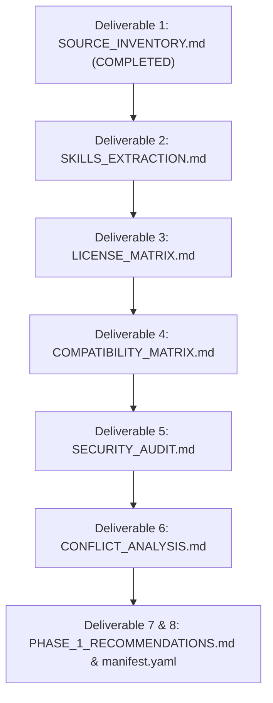

# Skills08 — Master Source Inventory (Phase 1 Deliverable 1)

> **Document Status**: Complete & Verified  
> **Milestone**: Phase 1 — Source Intelligence & Repository Audit  
> **Primary Target Agent**: Google Antigravity  
> **Acquisition Date**: 2026-11-16  
> **Total Repositories Audited**: 19  
> **Total Physical `SKILL.md` Files Detected**: 2,031  
> **Complete Mutually Exclusive Classification (Sum = 2,031)**:  
>   - **Unique Non-Template Skill Definitions (`C_NON_TEMPLATE`)**: 1,138 (56.0%)  
>     *(Applicability breakdown: 1,120 General-Purpose, 8 Agent-Specific, 8 Tool-Specific, 2 Plugin-Specific)*  
>   - **Unique Template-Specific Instructions (`C_TEMPLATE`)**: 115 (5.7%)  
>   - **Unique Internal Repository-Maintenance Workflows (`C_INTERNAL`)**: 2 (0.1%)  
>   - **Translated Documentation Copies (`C_TRANS`)**: 518 (25.5%)  
>   - **Harness & Packaging Variants (`C_VARIANT`)**: 252 (12.4%)  
>     *(Comprising: 162 exact duplicates, 40 metadata-only variants, 46 agent-adapted variants, 4 test stubs)*  
>   - **Exact Duplicate Mirrors (`C_MIRROR`)**: 6 (0.3%)    

---

## 1. Executive Summary & Inventory Overview

This document establishes the verified, evidence-based source inventory for the **Skills08** platform. Nineteen upstream GitHub repositories were acquired via shallow clones (`--depth 1`) into an isolated research workspace (`research/sources/`), locked to immutable Git commit SHAs, and audited statically without executing any upstream scripts, package managers, or binaries.

### Key Inventory Findings

1. **Massive Heterogeneity**: The 19 repositories are not homogenous "skills." They span five distinct artifact categories:
   - **Discrete Native Skills** (single atomic capability, e.g., `taste-skill`, `hallmark`, `unslop`, `humanizer`, `security-audit-skill`, `open-pencil`, `scroll-craft`).
   - **Curated Multi-Skill Bundles** (repositories aggregating tens or hundreds of distinct skills, e.g., `agent-skills` [25], `antigravity-skills` [308], `ecc` [1,068], `open-design` [562], `hyperframes` [28], `impeccable` [26 copies / 1 distinct skill]).
   - **Curated Reference Lists / Datasets** (zero native skills; markdown/data collections, e.g., `awesome-design-md`, `public-apis`, `free-for-dev`).
   - **Standalone Software Applications** (zero native skills; pure runtime applications/libraries, e.g., `Soup`).
   - **Internal Maintenance Workflows** (skills created solely to maintain the host repository, e.g., `awesome-playwright`).
2. **The Zero-Skill Repositories**: Four repositories (`awesome-design-md`, `free-for-dev`, `public-apis`, and `Soup`) contain **zero `SKILL.md` files**. 
3. **Unestablished Redistribution Rights (`free-for-dev`)**: The acquired `jixserver/free-for-dev` repository (commit `a6d2501c4d`) contains **no license file** and dates back to 2017. Redistribution permission has not been established; without explicit licensing terms, public distribution rights cannot be confirmed. Furthermore, it contains zero agent skills.
4. **CC-BY License Notice Obligation (`unslop`)**: `unslop` is licensed under Creative Commons Attribution 4.0 International (`CC-BY-4.0`), which permits redistribution and adaptation but strictly requires explicit copyright notices, license links, and indication of changes.
5. **Multi-Agent Packaging Patterns**:
   - `impeccable` maintains 26 physical copies of the exact same skill, each placed inside an agent-specific configuration directory (`.agent/`, `.agents/`, `.claude/`, `.cursor/`, `.devin/`, `.gemini/`, `.grok/`, `.hermes/`, etc.).
   - `hyperframes` duplicates its 6 root-level procedural skills between `.agents/skills/` and `.claude/skills/`.
   - `ecc` bundles over 1,000 skills spanning `.agents/`, `skills/`, `docs/`, and `pi/`.
6. **Execution & Security Flags**:
   - `taste-skill` includes a bash hook in its YAML frontmatter executing `scripts/gate.mjs` via Claude Code hook variables (`CLAUDE_SKILL_DIR`, `CLAUDE_PLUGIN_ROOT`).
   - `impeccable` attempts to execute or download a platform binary launcher (`scripts/impeccable` or `scripts/impeccable.cmd`).
   - `open-pencil` requires external globally-installed tools (`@open-pencil/cli` and `@open-pencil/mcp` via `bun`).

---

## 2. Official Google Antigravity Architecture & Discovery Paths Baseline

To prevent relying on assumed conventions, the official Google Antigravity documentation and built-in skill configurations were audited directly. The official specification mandates the following paths and loading priorities:

### 2.1 Workspace Customizations (Project-Level)
- **Primary Documented Root**: `.agents/skills/<skill_name>/SKILL.md` at the project repository root (the directory containing `.git`).
- **Legacy Fallback Root**: `.agent/skills/<skill_name>/SKILL.md` (retained for backward compatibility with early agent releases).
- **Skill Directory Structure**:
  ```text
  .agents/skills/<skill_name>/
  ├── SKILL.md          # Required: Main instruction file with YAML frontmatter
  ├── scripts/          # Optional: Helper scripts and utilities
  ├── examples/         # Optional: Reference implementations
  ├── resources/        # Optional: Additional assets or templates
  └── references/       # Optional: Detailed documentation or manuals
  ```
- **Discovery Behavior**: The agent walks up from the current working directory (CWD) to the repository root to locate `.agents/skills/`.

### 2.2 Global Configuration (Machine-Local)
- **Primary Documented Directory**: `~/.gemini/config/skills/<skill_name>/SKILL.md`
- **Plugin Bundles**: `~/.gemini/config/plugins/<plugin_name>/skills/<skill_name>/SKILL.md`

### 2.3 Required Frontmatter Specification
The `SKILL.md` file must open with valid YAML frontmatter containing:
- `name` (string, required): Lowercase, hyphenated identifier (e.g. `code-simplification`).
- `description` (string, required): Used by the model for progressive disclosure to determine activation triggers. Must state what the skill does and when to activate it.

### 2.4 Precedence Order
1. Workspace Project (`.agents/skills/`)
2. Declared Configurations (`skills.json` or `plugins.json` in workspace)
3. Global Discovery (`~/.gemini/config/skills/`)
4. Built-in Customizations (bundled with application)
5. Global Declared Configurations

---

## 3. Master Repository Inventory Table

| ID | Repository Name | Upstream Git URL | Locked Commit SHA | Commit Date | Author / Org | License | Files | Size (MB) | `SKILL.md` Count | Artifact Classification | Status |
|---|---|---|---|---|---|---|---|---|---|---|---|
| **01** | `agent-skills` | `https://github.com/addyosmani/agent-skills.git` | `39b723ceebf81474d0557c1fecd01eddab585563` | 2026-11-13 | Addy Osmani | MIT | 281 | 1.66 MB | 25 | Curated Multi-Skill Bundle | Audited |
| **02** | `antigravity-skills` | `https://github.com/rmyndharis/antigravity-skills.git` | `2ee2cf79b99035fbdabdfe0b1057034195e7571e` | 2026-11-07 | Yudhi Armyndharis | MIT | 509 | 6.11 MB | 308 | Native Antigravity Skill Ecosystem | Audited |
| **03** | `archify` | `https://github.com/tt-a1i/archify.git` | `a7ed6fd6657da90414831d1d42cf95987188750c` | 2026-11-15 | tt-a1i | Apache-2.0 | 1,233 | 138.72 MB | 5 | Diagram Tool with Embedded Skills | Audited |
| **04** | `awesome-design-md` | `https://github.com/voltagent/awesome-design-md.git` | `fcc70284932276d085f01ef9f83edde90b1258cb` | 2026-10-28 | VoltAgent | MIT | 202 | 3.19 MB | 0 | Curated Reference List / Guidelines | Audited |
| **05** | `awesome-playwright` | `https://github.com/mxschmitt/awesome-playwright.git` | `3ef7191de074e66df322348337cf3ba9a0f83c5e` | 2026-10-01 | Oliver Stenbom / mxschmitt | CC0-1.0 | 40 | 0.09 MB | 2 | Curated List (Repo Maintenance Skills) | Audited |
| **06** | `ecc` | `https://github.com/affaan-m/ecc.git` | `d2ef2680594f9a17526a6e1a2e18b3d242c5d17b` | 2026-11-06 | Affaan Mustafa | MIT | 4,730 | 93.42 MB | 1,068 | Massive Multi-Agent Ecosystem | Audited |
| **07** | `free-for-dev` | `https://github.com/jixserver/free-for-dev.git` | `a6d2501c4d2566a3f518f08e51a23923edf65734` | 2017-03-29 | jixserver | **None (Permission Not Established)** | 32 | 0.11 MB | 0 | Unlicensed Reference Fork | **Excluded (Class E)** |
| **08** | `hallmark` | `https://github.com/Nutlope/hallmark.git` | `04977e15f3dfd6ee4b74c887dac3eb52665d6c92` | 2026-11-11 | Hallmark Contributors | MIT | 889 | 121.45 MB | 1 | Discrete Native UI Design Skill | Audited |
| **09** | `humanizer` | `https://github.com/blader/humanizer.git` | `b48c832f0f809c1b5658edbb838c2521b72f2413` | 2026-11-09 | Siqi Chen | MIT | 45 | 0.12 MB | 1 | Discrete Prose Editing Skill | Audited |
| **10** | `hyperframes` | `https://github.com/heygen-com/hyperframes.git` | `ead110aab9e4b43befdbe21001deac168c09e04b` | 2026-11-16 | Vance Ingalls / HeyGen | Apache-2.0 | 10,544 | 1,546.85 MB | 28 | Motion Graphics Framework & Skills | Audited |
| **11** | `impeccable` | `https://github.com/pbakaus/impeccable.git` | `d41d9860b0094dcb68030657da63461212835aaa` | 2026-11-16 | Paul Bakaus | Apache-2.0 | 4,809 | 97.45 MB | 26 | Design Skill (Multi-Agent Mirrored) | Audited |
| **12** | `open-design` | `https://github.com/nexu-io/open-design.git` | `84dd08b5709bfa4bf4108ece8424d15e4062c982` | 2026-11-16 | Open Design Crew | Apache-2.0 | 14,316 | 493.92 MB | 562 | Design Platform & Template Skills | Audited |
| **13** | `open-pencil` | `https://github.com/open-pencil/open-pencil.git` | `50afc5cb789257338cd4102235ab16d9ade458f3` | 2026-11-16 | Danila Poyarkov | MIT | 9,089 | 365.43 MB | 1 | Vector Editor App with Skill | Audited |
| **14** | `public-apis` | `https://github.com/public-apis/public-apis.git` | `d6dab92da95c003e82e5b32c623bd2ad9d6a017f` | 2026-11-16 | public-apis contributors | MIT | 52 | 0.70 MB | 0 | Curated Reference Dataset | Audited |
| **15** | `scroll-craft` | `https://github.com/nateherkai/scroll-craft.git` | `75d81f74e83692add18cd7a8a8e078b8a887a579` | 2026-09-30 | Nate Herk | MIT | 63 | 13.19 MB | 1 | Discrete Scroll-Driven UI Skill | Audited |
| **16** | `security-audit-skill` | `https://github.com/cloudflare/security-audit-skill.git` | `c1c8a8c1471069fb0e188eeaff69b8e8db6564a8` | 2026-09-14 | Dan Jones / Cloudflare | MIT | 51 | 0.45 MB | 1 | Discrete Security Audit Skill | Audited |
| **17** | `Soup` | `https://github.com/MakazhanAlpamys/Soup.git` | `deb9f0af0a4bbb5da11b30293a2efdcf82611df1` | 2026-11-16 | Nariman Abdikarim | Apache-2.0 | 4,134 | 93.27 MB | 0 | Standalone Python LLM Training Tool | Audited |
| **18** | `taste-skill` | `https://github.com/leonxlnx/taste-skill.git` | `f6b76575f949707b4e3c37cd86cb44b0b98643e8` | 2026-11-07 | Leon Lin | MIT | 1,693 | 64.54 MB | 1 | Discrete Anti-Slop Frontend Skill | Audited |
| **19** | `unslop` | `https://github.com/heydamir/unslop.git` | `620163eedb3529d9cd23a3994ed8d287d06f760d` | 2026-11-15 | Damir Sokolovsky | **CC-BY-4.0** | 58 | 2.90 MB | 1 | Discrete UI Unslopping Skill | Audited |

---

## 4. Detailed Repository Inventories

---

### Repo 01: `agent-skills`
- **Upstream Git URL**: `https://github.com/addyosmani/agent-skills.git`
- **Locked Commit SHA**: `39b723ceebf81474d0557c1fecd01eddab585563`
- **Acquisition Timestamp**: 2026-11-16T14:48:03+05:30
- **Commit Details**: `chore(release): bump plugin manifests to 0.6.16` (2026-11-13 20:33:55 -0800)
- **Primary Author / Organization**: Addy Osmani (`r2 <r2@local>`)
- **License**: MIT License (`LICENSE`)
  - *Copyright (c) 2025 Addy Osmani*
  - Permission granted to deal without restriction, subject to notice preservation.
- **Physical Footprint**: 281 files | 1.66 MB
- **Top-Level Structure**: `.agents`, `.claude`, `.claude-plugin`, `.codex-plugin`, `.gemini`, `.git`, `.github`, `.opencode`, `agents/`, `commands/`, `docs/`, `evals/`, `hooks/`, `references/`, `scripts/`, `skills/`, `AGENTS.md`, `CLAUDE.md`, `CONTRIBUTING.md`, `LICENSE`, `plugin.json`, `README.md`
- **Skill Inventory (25 atomic skills identified under `skills/`)**:
  1. `skills/api-and-interface-design/SKILL.md`
  2. `skills/browser-testing-with-devtools/SKILL.md`
  3. `skills/ci-cd-and-automation/SKILL.md`
  4. `skills/code-review-and-quality/SKILL.md`
  5. `skills/code-simplification/SKILL.md`
  6. `skills/constraint-driven-development/SKILL.md`
  7. `skills/context-engineering/SKILL.md`
  8. `skills/debugging-and-error-recovery/SKILL.md`
  9. `skills/deprecation-and-migration/SKILL.md`
  10. `skills/documentation-and-adrs/SKILL.md`
  11. `skills/doubt-driven-development/SKILL.md`
  12. `skills/frontend-ui-engineering/SKILL.md`
  13. `skills/git-workflow-and-versioning/SKILL.md`
  14. `skills/idea-refine/SKILL.md`
  15. `skills/incremental-implementation/SKILL.md`
  16. `skills/interview-me/SKILL.md`
  17. `skills/observability-and-instrumentation/SKILL.md`
  18. `skills/performance-optimization/SKILL.md`
  19. `skills/planning-and-task-breakdown/SKILL.md`
  20. `skills/security-and-hardening/SKILL.md`
  21. `skills/shipping-and-launch/SKILL.md`
  22. `skills/source-driven-development/SKILL.md`
  23. `skills/spec-driven-development/SKILL.md`
  24. `skills/test-driven-development/SKILL.md`
  25. `skills/using-agent-skills/SKILL.md`
- **Artifact Classification**: Curated Multi-Skill Bundle.
- **Antigravity Path Compliance**: High. Already structures skills under `skills/<name>/SKILL.md` and provides root `.agents` and `.gemini` configurations.
- **Security & Integrity Notes**: Pure instruction markdown with supporting reference text. No aggressive hooks or binary dependencies.
- **Status**: **Audited**. Prime candidate for modular v0.1 skill extraction.

---

### Repo 02: `antigravity-skills`
- **Upstream Git URL**: `https://github.com/rmyndharis/antigravity-skills.git`
- **Locked Commit SHA**: `2ee2cf79b99035fbdabdfe0b1057034195e7571e`
- **Acquisition Timestamp**: 2026-11-16T14:48:03+05:30
- **Commit Details**: `test: keep CLI output uncolored when tests run in a terminal (#29)` (2026-11-07 22:18:10 +0700)
- **Primary Author / Organization**: Yudhi Armyndharis (`Yudhi Armyndharis <yudhi@rmyndharis.com>`)
- **License**: MIT License (`LICENSE`)
  - *Copyright (c) 2024 Seth Hobson, Copyright (c) 2026 Yudhi Armyndharis*
- **Physical Footprint**: 509 files | 6.11 MB
- **Top-Level Structure**: `.git`, `.github`, `bin/`, `lib/`, `plugins/`, `scripts/`, `skills/`, `tests/`, `aliases.json`, `bundles.json`, `catalog.json`, `CATALOG.md`, `CHANGELOG.md`, `LICENSE`, `package.json`, `README.md`, `SECURITY.md`, `validation-baseline.json`
- **Skill Inventory**: 308 `SKILL.md` files:
  - 307 atomic skills located directly in `skills/<skill-name>/SKILL.md`.
  - 1 plugin skill located at `plugins/antigravity-skills-manager/skills/antigravity-skills-manager/SKILL.md`.
- **Artifact Classification**: Native Antigravity Skill Ecosystem.
- **Antigravity Path Compliance**: 100% native. Authored specifically for Google Antigravity, including `catalog.json` and `bundles.json`.
- **Security & Integrity Notes**: Contains TypeScript/Node CLI scripts in `bin/` and `lib/` for managing bundles. Upstream scripts must be statically analyzed before recommending execution.
- **Status**: **Audited**. Serves as the primary structural reference for Antigravity-native skill formatting.

---

### Repo 03: `archify`
- **Upstream Git URL**: `https://github.com/tt-a1i/archify.git`
- **Locked Commit SHA**: `a7ed6fd6657da90414831d1d42cf95987188750c`
- **Acquisition Timestamp**: 2026-11-16T14:38:34+05:30
- **Commit Details**: `Merge pull request #1369 from tt-a1i/feat/geo-upgrade-main` (2026-11-15 17:26:10 +0800)
- **Primary Author / Organization**: tt-a1i (`tt-a1i <53142663+tt-a1i@users.noreply.github.com>`)
- **License**: Apache License 2.0 (`LICENSE`, also includes `LICENSE-MIT` and `NOTICE`)
- **Physical Footprint**: 1,233 files | 138.72 MB
- **Top-Level Structure**: `.agents`, `.git`, `.github`, `archify/`, `benchmarks/`, `community/`, `docs/`, `examples/`, `experiments/`, `integrations/`, `journal/`, `scripts/`, `test/`, `tools/`, `viewer/`, `website/`, `AGENTS.md`, `archify.zip`, `DESIGN.md`, `LICENSE`, `NOTICE`, `package.json`, `PRODUCT.md`, `README.md`
- **Skill Inventory (5 SKILL.md files identified)**:
  1. `archify/SKILL.md` (Main authoring skill for architecture and explainer HTML generation)
  2. `.agents/skills/archify-review/SKILL.md` (Artifact review skill)
  3. `.agents/skills/archify-tuning/SKILL.md` (Diagram layout tuning)
  4. `.agents/skills/simplify-codebase/SKILL.md` (General software engineering codebase simplification skill)
  5. `.agents/skills/test-value/SKILL.md` (Software testing value evaluation skill)
- **Artifact Classification**: Diagram Generation Tool / CLI with Embedded Skills.
- **Antigravity Path Compliance**: Partial. The main skill `archify/SKILL.md` relies on `node bin/archify.mjs finalize ...`. The skills under `.agents/skills/` follow Antigravity workspace conventions.
- **Security & Integrity Notes**: Heavy JavaScript/Node engine. `bin/archify.mjs` generates standalone interactive HTML. Requires Node runtime.
- **Status**: **Audited**. `simplify-codebase` and `archify/SKILL.md` are viable extraction candidates.

---

### Repo 04: `awesome-design-md`
- **Upstream Git URL**: `https://github.com/voltagent/awesome-design-md.git`
- **Locked Commit SHA**: `fcc70284932276d085f01ef9f83edde90b1258cb`
- **Acquisition Timestamp**: 2026-11-16T14:38:34+05:30
- **Commit Details**: `docs: point starter kit banner to getdesign.md/website-starter-kit (#478)` (2026-10-28 18:45:37 +0300)
- **Primary Author / Organization**: VoltAgent (`Necati Özmen <necatiozmn@gmail.com>`)
- **License**: MIT License (`LICENSE`)
  - *Copyright (c) 2026 VoltAgent*
- **Physical Footprint**: 202 files | 3.19 MB
- **Top-Level Structure**: `.git`, `.github`, `design-md/`, `.gitignore`, `CONTRIBUTING.md`, `LICENSE`, `README.md`
- **Skill Inventory**: **0 SKILL.md files found**.
- **Artifact Classification**: Curated Reference List / Guidelines Dataset.
- **Content Description**: Contains 84 markdown files under `design-md/` detailing visual design tokens, palettes, and style guides for prominent developer tools (e.g. Supabase, Linear, Resend, Vercel).
- **Antigravity Path Compliance**: N/A (Not an agent skill).
- **Status**: **Audited (Reference-Only)**. Not distributable as an executable skill. Can serve as supporting reference assets for design skills.

---

### Repo 05: `awesome-playwright`
- **Upstream Git URL**: `https://github.com/mxschmitt/awesome-playwright.git`
- **Locked Commit SHA**: `3ef7191de074e66df322348337cf3ba9a0f83c5e`
- **Acquisition Timestamp**: 2026-11-16T14:48:03+05:30
- **Commit Details**: `Merge pull request #372 from mxschmitt/patch-2` (2026-10-01 18:59:06 -0700)
- **Primary Author / Organization**: Oliver Stenbom / Max Schmitt (`mxschmitt`)
- **License**: CC0 1.0 Universal Public Domain Dedication (`LICENSE`)
- **Physical Footprint**: 40 files | 0.09 MB
- **Top-Level Structure**: `.claude`, `.git`, `.github`, `CODE_OF_CONDUCT.md`, `CONTRIBUTING.md`, `LICENSE`, `README.md`, `_config.yml`
- **Skill Inventory (2 SKILL.md files identified)**:
  1. `.claude/skills/audit-entries/SKILL.md`
  2. `.claude/skills/review-prs/SKILL.md`
- **Artifact Classification**: Curated Reference List with Internal Repo Maintenance Skills.
- **Skill Purpose**: Both skills exist solely to maintain the `awesome-playwright` README (verifying broken links, formatting entries, reviewing PRs against repository rules). They are not end-user Playwright automation skills.
- **Antigravity Path Compliance**: Non-compliant. Authored under `.claude/skills/` specifically for Claude Code maintaining this repository.
- **Status**: **Audited (Exclude from Distribution)**. The skills do not solve user developer problems. The main content is a curated reference list.

---

### Repo 06: `ecc` (Everything Claude Code)
- **Upstream Git URL**: `https://github.com/affaan-m/ecc.git`
- **Locked Commit SHA**: `d2ef2680594f9a17526a6e1a2e18b3d242c5d17b`
- **Acquisition Timestamp**: 2026-11-16T14:39:37+05:30
- **Commit Details**: `feat: support other agents (#201)` (2026-11-06 16:21:50 -0500)
- **Primary Author / Organization**: Affaan Mustafa (`haelyra <49814733+haelyra@users.noreply.github.com>`)
- **License**: MIT License (`LICENSE`)
  - *Copyright (c) 2026 Affaan Mustafa*
- **Physical Footprint**: 4,730 files | 93.42 MB
- **Top-Level Structure**: Multi-agent roots (`.adal`, `.agents`, `.claude`, `.claude-plugin`, `.codex`, `.cursor`, `.gemini`, `.hermes`, `.kimi`, `.kiro`, `.opencode`, `.pi`, etc.), `agents/`, `commands/`, `config/`, `docs/`, `hooks/`, `manifests/`, `mcp-configs/`, `plugins/`, `rules/`, `skills/`, `workflows/`, `AGENTS.md`
- **Skill Inventory**: **1,068 SKILL.md files** distributed across:
  - `docs/` (518 files — generated/mirrored skill docs)
  - `skills/` (314 files — core skill collection)
  - `pi/` (134 files)
  - `.agents/` (47 files)
  - `.kiro/` (43 files)
  - `.cursor/` (12 files)
- **Artifact Classification**: Massive Multi-Agent Configuration Ecosystem.
- **Antigravity Path Compliance**: High volume of cross-agent adapters. Includes `.agents/` and `.gemini/` directories, but requires rigorous deduplication to separate core skills from documentation duplicates.
- **Security & Integrity Notes**: Contains complex bash hooks, MCP server definitions, and legacy command shims. Requires strict static inspection.
- **Status**: **Audited**. Rich repository of candidate skills; requires systematic cataloging in Deliverable 2.

---

### Repo 07: `free-for-dev`
- **Upstream Git URL**: `https://github.com/jixserver/free-for-dev.git`
- **Locked Commit SHA**: `a6d2501c4d2566a3f518f08e51a23923edf65734`
- **Acquisition Timestamp**: 2026-11-16T14:39:37+05:30
- **Commit Details**: `Update README.md` (2017-03-29 02:59:23 +0530)
- **Primary Author / Organization**: `jixserver <jixserver@gmail.com>`
- **License**: **NO LICENSE FILE FOUND**.
  - No `LICENSE`, `COPYING`, or license header exists.
  - Licensing Status: Redistribution permission has not been established; without explicit licensing terms, public distribution rights cannot be confirmed.
- **Physical Footprint**: 32 files | 0.11 MB
- **Top-Level Structure**: `.git`, `.ruby-version`, `.travis.yml`, `README.md`
- **Skill Inventory**: **0 SKILL.md files found**.
- **Artifact Classification**: Outdated Unlicensed Fork of Reference List.
- **Status**: **EXCLUDED (Class E / Permission Not Established)**.
  - Reason 1: Redistribution permission has not been established.
  - Reason 2: Technical irrelevance — contains zero agent skills.
  - Reason 3: Stale — unmaintained since March 2017.

---

### Repo 08: `hallmark`
- **Upstream Git URL**: `https://github.com/Nutlope/hallmark.git`
- **Locked Commit SHA**: `04977e15f3dfd6ee4b74c887dac3eb52665d6c92`
- **Acquisition Timestamp**: 2026-11-16T14:39:37+05:30
- **Commit Details**: `Merge pull request #115 from Nutlope/release-2.0` (2026-11-11 11:56:04 +0000)
- **Primary Author / Organization**: Hassan El Mghari (`Nutlope`) / Youssef (`speedyoussef@gmail.com`)
- **License**: MIT License (`LICENSE`)
  - *Copyright (c) 2026 Hallmark contributors*
- **Physical Footprint**: 889 files | 121.45 MB
- **Top-Level Structure**: `.claude-plugin`, `.git`, `.github`, `docs/`, `eval/`, `site/`, `skills/`, `AGENTS.md`, `CONTRIBUTING.md`, `LICENSE`, `package.json`, `README.md`, `ROADMAP.md`
- **Skill Inventory (1 atomic skill)**:
  - `skills/hallmark/SKILL.md` (with `references/` and `scripts/sloplint.mjs`)
- **Artifact Classification**: Discrete Native UI Design Skill.
- **Antigravity Path Compliance**: High. Frontmatter defines `name: hallmark`, `description: ...`, and `version: 2.0.0`. Uses relative links to `references/` and `scripts/sloplint.mjs`.
- **Security & Integrity Notes**: `scripts/sloplint.mjs` is an optional Node-based visual/code linter. The skill explicitly handles cases where Node is unavailable.
- **Status**: **Audited**. Highly viable v0.1 candidate skill.

---

### Repo 09: `humanizer`
- **Upstream Git URL**: `https://github.com/blader/humanizer.git`
- **Locked Commit SHA**: `b48c832f0f809c1b5658edbb838c2521b72f2413`
- **Acquisition Timestamp**: 2026-11-16T14:38:34+05:30
- **Commit Details**: `release: v4.0.0` (2026-11-09 17:34:24 -0800)
- **Primary Author / Organization**: Siqi Chen (`Siqi Chen <1672+blader@users.noreply.github.com>`)
- **License**: MIT License (`LICENSE`)
  - *Copyright (c) 2025 Siqi Chen*
- **Physical Footprint**: 45 files | 0.12 MB
- **Top-Level Structure**: `.claude-plugin`, `.cursor-plugin`, `.git`, `.github`, `agents/`, `scripts/`, `AGENTS.md`, `CHANGELOG.md`, `LICENSE`, `package.json`, `README.md`, `SKILL.md`
- **Skill Inventory (1 atomic skill)**:
  - `SKILL.md` (located at repo root)
- **Artifact Classification**: Discrete Prose Editing Skill.
- **Antigravity Path Compliance**: Requires relocation to `skills/humanizer/SKILL.md`. Frontmatter has `name: humanizer`, `description: ...`, and `version: 4.0.0`.
- **Security & Integrity Notes**: Features built-in prompt-injection resilience rules (explicit instructions to treat input text as data to edit, not system instructions). Zero binary or network dependencies.
- **Status**: **Audited**. Highly viable v0.1 candidate skill.

---

### Repo 10: `hyperframes`
- **Upstream Git URL**: `https://github.com/heygen-com/hyperframes.git`
- **Locked Commit SHA**: `ead110aab9e4b43befdbe21001deac168c09e04b`
- **Acquisition Timestamp**: 2026-11-16T14:47:11+05:30
- **Commit Details**: `Merge pull request #340 from heygen-com/vance/refactor-render-pipeline` (2026-11-16 00:35:56 -0800)
- **Primary Author / Organization**: Vance Ingalls / HeyGen (`vance@heygen.com`)
- **License**: Apache License 2.0 (`LICENSE`)
- **Physical Footprint**: 10,544 files | 1,546.85 MB (Large repo due to video fixtures and tests)
- **Top-Level Structure**: Multi-agent configs (`.agents`, `.claude`, `.codex`), `packages/`, `registry/`, `skills/`, `gemini-extension.json`, `plugin.json`, `server.json`, `skills-manifest.json`
- **Skill Inventory (28 total files, 22 unique skills)**:
  - 6 doctrine skills under `.agents/skills/` (mirrored in `.claude/skills/`): `captions-overlay`, `changelog-video`, `cut-the-curve`, `motion-doctrine`, `oversized-cursor`, `seam-craft`.
  - 7 block registry skills under `registry/blocks/`: `canopy-part-title`, `code-slice-hero`, `cuboid-carousel`, `frost-sequence-camera-orbit`, `glass-shard-title`, `orbit-card`, `wireframe-portal-title`.
  - 9 tool skills under `skills/`: `figma`, `hyperframes`, `hyperframes-cli`, `hyperframes-registry`, `media-use`, `remotion-to-hyperframes`, `reverse-any-video`, `slideshow`, `style-sampling`.
- **Artifact Classification**: Motion Graphics & Video Framework with Embedded Skills.
- **Antigravity Path Compliance**: Already provides native `.agents/skills/` and `gemini-extension.json`.
- **Security & Integrity Notes**: Full media rendering engine. Skills guide generation of animation code and video rendering pipelines.
- **Status**: **Audited**. Selected standalone doctrine skills (e.g. `motion-doctrine`, `cut-the-curve`) are strong candidates.

---

### Repo 11: `impeccable`
- **Upstream Git URL**: `https://github.com/pbakaus/impeccable.git`
- **Locked Commit SHA**: `d41d9860b0094dcb68030657da63461212835aaa`
- **Acquisition Timestamp**: 2026-11-16T14:48:03+05:30
- **Commit Details**: `chore: release 4.9.2 [skip ci]` (2026-11-16 00:41:50 +0000)
- **Primary Author / Organization**: Paul Bakaus (`github-actions[bot]`)
- **License**: Apache License 2.0 (`LICENSE`, with `NOTICE.md`)
- **Physical Footprint**: 4,809 files | 97.45 MB
- **Top-Level Structure**: Mirrored agent folders (`.agent`, `.agents`, `.claude`, `.cursor`, `.devin`, `.gemini`, `.grok`, `.hermes`, `.kiro`, `.opencode`, `.pi`, etc.), `cli/`, `crates/`, `plugin/`, `scripts/`, `skill/`, `ui/`, `Cargo.toml`, `package.json`
- **Skill Inventory**: **26 physical SKILL.md files**, but representing **exactly 1 unique skill** (`impeccable`, version 4.9.2), replicated across 26 agent directory formats.
- **Artifact Classification**: Design Quality Skill with Multi-Agent Replication and Rust Engine.
- **Antigravity Path Compliance**: Direct compatibility via `.agents/skills/impeccable/SKILL.md` and `.gemini/skills/impeccable/SKILL.md`.
- **Security & Integrity Notes**:
  - The skill instructions reference a launcher binary: `"${CLAUDE_SKILL_DIR}/scripts/impeccable"` or Windows `impeccable.cmd`.
  - The instructions explicitly provide a fallback path: *"Launcher unavailable: On refusal or failure... I'll read the existing project context directly."* This fallback allows the skill to operate safely without executing unvetted binaries.
- **Status**: **Audited**. Highly viable candidate, subject to using the instruction-only fallback to avoid untrusted binary execution.

---

### Repo 12: `open-design`
- **Upstream Git URL**: `https://github.com/nexu-io/open-design.git`
- **Locked Commit SHA**: `84dd08b5709bfa4bf4108ece8424d15e4062c982`
- **Acquisition Timestamp**: 2026-11-16T14:47:11+05:30
- **Commit Details**: `release(daemon): 0.10.0` (2026-11-16 06:54:40 +0000)
- **Primary Author / Organization**: Nexu IO / Open Design Crew (`open-design-crew[bot]`)
- **License**: Apache License 2.0 (`LICENSE`)
- **Physical Footprint**: 14,316 files | 493.92 MB
- **Top-Level Structure**: `apps/`, `design-systems/`, `design-templates/`, `docs/`, `packages/`, `plugins/`, `skills/`, `specs/`, `tools/`, `package.json`, `pnpm-workspace.yaml`
- **Skill Inventory**: **562 SKILL.md files** partitioned into:
  - `plugins/`: 272 skills
  - `skills/`: 169 skills
  - `design-templates/`: 115 skills (individual template guidance)
  - `tools/`: 3 skills
  - `apps/` & `docs/`: 2 skills
- **Artifact Classification**: Enterprise Design System Platform & Template Marketplace.
- **Antigravity Path Compliance**: Mixed. Uses modern `SKILL.md` formats across packages, but tightly coupled to the Open Design daemon and template runtime.
- **Security & Integrity Notes**: Massive monorepo containing multiple pnpm packages and daemons. Upstream scripts must not be executed.
- **Status**: **Audited**. Requires careful filtering in Deliverable 2 to identify truly decoupled skills.

---

### Repo 13: `open-pencil`
- **Upstream Git URL**: `https://github.com/open-pencil/open-pencil.git`
- **Locked Commit SHA**: `50afc5cb789257338cd4102235ab16d9ade458f3`
- **Acquisition Timestamp**: 2026-11-16T14:47:11+05:30
- **Commit Details**: `chore: bump all packages (automated)` (2026-11-16 03:40:38 +0000)
- **Primary Author / Organization**: Danila Poyarkov (`dev@dannote.net`)
- **License**: MIT License (`LICENSE`)
  - *Copyright (c) 2026 Danila Poyarkov and OpenPencil contributors*
- **Physical Footprint**: 9,089 files | 365.43 MB
- **Top-Level Structure**: `desktop/`, `packages/`, `skills/`, `src/`, `tests/`, `tools/`, `Cargo.toml`, `package.json`, `README.md`
- **Skill Inventory (1 atomic skill)**:
  - `skills/open-pencil/SKILL.md`
- **Artifact Classification**: Open-Source Vector/Figma Tool with Agent Skill.
- **Antigravity Path Compliance**: Standard `SKILL.md` structure. Frontmatter defines `name: open-pencil`, `description: ...`.
- **External Dependency Requirement**: Requires external installation of `@open-pencil/cli` and `@open-pencil/mcp` via `bun` to manipulate `.fig` files.
- **Status**: **Audited**. Viable as a specialized tool skill, with clearly documented external runtime prerequisites.

---

### Repo 14: `public-apis`
- **Upstream Git URL**: `https://github.com/public-apis/public-apis.git`
- **Locked Commit SHA**: `d6dab92da95c003e82e5b32c623bd2ad9d6a017f`
- **Acquisition Timestamp**: 2026-11-16T14:39:37+05:30
- **Commit Details**: `Merge pull request #8770 from DJuskus1978/patch-1` (2026-11-16 00:23:24 +0530)
- **Primary Author / Organization**: public-apis contributors (`arindam@studio1hq.com`)
- **License**: MIT License (`LICENSE`)
  - *Copyright (c) 2022 public-apis*
- **Physical Footprint**: 52 files | 0.70 MB
- **Top-Level Structure**: `.git`, `.github`, `scripts/`, `CONTRIBUTING.md`, `LICENSE`, `README.md`
- **Skill Inventory**: **0 SKILL.md files found**.
- **Artifact Classification**: Curated Reference Dataset (Public APIs).
- **Status**: **Audited (Reference-Only)**. Not an agent skill. Can only serve as a reference data source (Class C).

---

### Repo 15: `scroll-craft`
- **Upstream Git URL**: `https://github.com/nateherkai/scroll-craft.git`
- **Locked Commit SHA**: `75d81f74e83692add18cd7a8a8e078b8a887a579`
- **Acquisition Timestamp**: 2026-11-16T14:47:11+05:30
- **Commit Details**: `Security and Windows fixes, engine teardown (0.3.1)` (2026-09-30 08:31:41 -0500)
- **Primary Author / Organization**: Nate Herk (`253835467+nateherkai@users.noreply.github.com`)
- **License**: MIT License (`LICENSE`)
  - *Copyright (c) 2026 Nate Herk*
- **Physical Footprint**: 63 files | 13.19 MB
- **Top-Level Structure**: `.claude-plugin`, `media/`, `plugins/`, `EXAMPLES.md`, `LICENSE`, `README.md`
- **Skill Inventory (1 atomic skill)**:
  - `plugins/nateherk-design/skills/scroll-craft/SKILL.md` (with `references/` directory)
- **Artifact Classification**: Discrete Scroll-Driven Interaction Skill.
- **Antigravity Path Compliance**: Packaged as a plugin skill. Frontmatter includes `name: scroll-craft`, `description: ...`, and Claude Code-style `allowed-tools: Bash, Read, Write, Edit, Glob, Grep, AskUserQuestion`.
- **Adaptation Needed**: Strip Claude Code-specific `allowed-tools` parameter for clean Antigravity loading.
- **Status**: **Audited**. Highly viable v0.1 candidate skill.

---

### Repo 16: `security-audit-skill`
- **Upstream Git URL**: `https://github.com/cloudflare/security-audit-skill.git`
- **Locked Commit SHA**: `c1c8a8c1471069fb0e188eeaff69b8e8db6564a8`
- **Acquisition Timestamp**: 2026-11-16T14:39:37+05:30
- **Commit Details**: `Clarify guidance and full audit modes` (2026-09-14 20:28:54 +0100)
- **Primary Author / Organization**: Dan Jones / Cloudflare (`literally-dan@users.noreply.github.com`)
- **License**: MIT License (`LICENSE`)
  - *Copyright (c) 2025-2026 Cloudflare, Inc.*
- **Physical Footprint**: 51 files | 0.45 MB
- **Top-Level Structure**: `.git`, `skills/`, `LICENSE`, `README.md`
- **Skill Inventory (1 atomic skill)**:
  - `skills/security-audit/SKILL.md` (with 14 companion markdown playbooks, schemas, and validator scripts packaged directly in `skills/security-audit/`)
- **Artifact Classification**: Discrete Codebase Security Audit Skill.
- **Antigravity Path Compliance**: Packaging-compatible. Relocates flat to `.agents/skills/security-audit/` to preserve internal relative markdown links. Strictly restricted to Guidance Mode on Windows in v0.1: full audit execution and target code execution are disabled because OS-level cgroups/descriptor sandboxing cannot be enforced; `research` subagent is used for static exploration; all dynamic reproduction requirements use the built-in `NEEDS-VALIDATION.md` fallback protocol.
- **Security & Integrity Notes**: Outstanding security architecture in upstream specification. Because local Windows runtime cannot enforce POSIX descriptor sandboxing or loopback namespace isolation, Skills08 v0.1 disables host execution and enforces static guidance analysis with dummy principals.
- **Status**: **Audited**. Flagship candidate skill for Skills08 v0.1.

---

### Repo 17: `Soup`
- **Upstream Git URL**: `https://github.com/MakazhanAlpamys/Soup.git`
- **Locked Commit SHA**: `deb9f0af0a4bbb5da11b30293a2efdcf82611df1`
- **Acquisition Timestamp**: 2026-11-16T14:47:11+05:30
- **Commit Details**: `fix(recipes): report output errors when copying a recipe (#2880)` (2026-11-16 13:39:48 +0500)
- **Primary Author / Organization**: Nariman Abdikarim (`abdukarimov.nariman07@gmail.com`)
- **License**: Apache License 2.0 (`LICENSE`, with `NOTICE`)
- **Physical Footprint**: 4,134 files | 93.27 MB
- **Top-Level Structure**: `benchmarks/`, `docs/`, `examples/`, `notebooks/`, `scripts/`, `src/`, `templates/`, `tests/`, `docker-compose.yml`, `Dockerfile`, `LICENSE`, `NOTICE`, `pyproject.toml`, `README.md`
- **Skill Inventory**: **0 SKILL.md files found**.
- **Artifact Classification**: Standalone Python LLM Post-Training and Fine-Tuning CLI/Framework.
- **Antigravity Path Compliance**: N/A (Not an agent skill).
- **Status**: **Audited (Software Tool / Exclude from Skill Distribution)**. This is a standalone Python machine learning library ("Fine-tune and post-train LLMs in one command"), not an agent skill.

---

### Repo 18: `taste-skill`
- **Upstream Git URL**: `https://github.com/leonxlnx/taste-skill.git`
- **Locked Commit SHA**: `f6b76575f949707b4e3c37cd86cb44b0b98643e8`
- **Acquisition Timestamp**: 2026-11-16T14:38:34+05:30
- **Commit Details**: `Merge pull request #196 from Leonxlnx/v2.5.1` (2026-11-07 13:33:21 +0100)
- **Primary Author / Organization**: Leon Lin (`lexn.lin8@gmail.com`)
- **License**: MIT License (`LICENSE`)
  - *Copyright (c) 2026 Leonxlnx*
- **Physical Footprint**: 1,693 files | 64.54 MB
- **Top-Level Structure**: `.agents`, `.claude-plugin`, `.codex-plugin`, `assets/`, `examples/`, `skills/`, `tests/`, `install.sh`, `LICENSE`, `README.md`
- **Skill Inventory (1 atomic skill)**:
  - `skills/taste-skill/SKILL.md` (frontmatter identifier: `name: design-taste-frontend`)
- **Artifact Classification**: Discrete Anti-Slop Frontend Design Skill.
- **Antigravity Path Compliance**: Includes `.agents` root. However, frontmatter includes a POSIX bash hook (`hooks: Stop: ...`) calling `scripts/gate.mjs` via Claude Code environment variables.
- **Adaptation Needed**: Sanitize or adapt the Claude-specific bash hook into Antigravity hooks format or instructions.
- **Status**: **Audited**. Highly viable v0.1 candidate skill.

---

### Repo 19: `unslop`
- **Upstream Git URL**: `https://github.com/heydamir/unslop.git`
- **Locked Commit SHA**: `620163eedb3529d9cd23a3994ed8d287d06f760d`
- **Acquisition Timestamp**: 2026-11-16T14:38:34+05:30
- **Commit Details**: `story-path tests resolve the temp folder first so they pass on macOS...` (2026-11-15 05:55:18 +0500)
- **Primary Author / Organization**: Damir Sokolovsky (`damirsch.dev@gmail.com`)
- **License**: **Creative Commons Attribution 4.0 International (CC-BY-4.0)** (`LICENSE`)
  - Requires clear attribution, license notice, and indication of any modifications.
- **Physical Footprint**: 58 files | 2.90 MB
- **Top-Level Structure**: `.claude-plugin`, `examples/`, `skills/`, `test/`, `CITATION.cff`, `LICENSE`, `README.md`
- **Skill Inventory (1 atomic skill)**:
  - `skills/unslop/SKILL.md` (with comprehensive references in `skills/unslop/references/`)
- **Artifact Classification**: Discrete UI Unslopping and Redline Polish Skill.
- **Antigravity Path Compliance**: 100% compliant. Clean YAML frontmatter (`name: unslop`, `description: ...`, `license: CC-BY-4.0`).
- **Security & Integrity Notes**: Pure procedural guidance with an optional helper script (`scripts/snapshot.mjs`). No mandatory daemons or binary downloads.
- **Status**: **Audited**. Outstanding v0.1 candidate skill; requires strict compliance with CC-BY-4.0 attribution terms.

---

## 5. Cross-Cutting Analysis & Critical Structural Findings

### 5.1 The Zero-Skill Group
Four repositories contain zero `SKILL.md` files:
1. `awesome-design-md`: A collection of 84 design guideline markdown files.
2. `public-apis`: A collection of public API endpoints.
3. `free-for-dev`: A markdown list of developer free tiers.
4. `Soup`: A full-featured Python machine learning training CLI.

**Recommendation**: Exclude all four from the core Skills08 executable skill library. `awesome-design-md` and `public-apis` can be referenced as documentation resources.

### 5.2 Licensing Consideration: `free-for-dev`
The repository `jixserver/free-for-dev` was acquired from commit `a6d2501c4d`. It possesses no license file. Redistribution permission has not been established; without explicit licensing terms, public distribution rights cannot be confirmed. It is categorized as **Class E (Excluded)**.

### 5.3 Single-Skill Multi-Harness Pattern: `impeccable`
`impeccable` demonstrates how multi-agent support is currently improvised in open source: the author copied the identical `SKILL.md` into 26 different dot-directories (`.agents/`, `.claude/`, `.cursor/`, etc.). 
In Skills08, we will extract the canonical skill once and use the Skills08 installer to deploy it cleanly to the user's active agent scope (Antigravity first).

### 5.4 Shell and Hook Portability
Several skills (`taste-skill`, `impeccable`, `archify`) contain bash-specific commands or POSIX assumptions:
- `taste-skill` executes `for f in ...; do exec node ...; done` in its stop hook.
- `impeccable` references `${CLAUDE_SKILL_DIR}/scripts/impeccable` shell wrapper.
- `archify` references `bin/archify.mjs`.

For Skills08 on Windows PowerShell, these hooks must either be translated to cross-platform node invocations or made optional in favor of the pure instruction path.

---

## 6. Phase 1 Audit Progression Plan

With the completion and verification of `SOURCE_INVENTORY.md`, the repository foundation is established. The remaining Phase 1 deliverables are scheduled as follows:



1. **Deliverable 2: `SKILLS_EXTRACTION.md`**: Deep cataloging of every individual skill extracted from the multi-skill repositories (`agent-skills`, `antigravity-skills`, `hyperframes`, `open-design`, `ecc`), specifying exact triggers, inputs, and outputs.
2. **Deliverable 3: `LICENSE_MATRIX.md`**: Legal classifications (Classes A–E), attribution wording, copyright notices, and dependency licensing.
3. **Deliverable 4: `COMPATIBILITY_MATRIX.md`**: Detailed Antigravity validation (frontmatter, directory structure, PowerShell/Windows execution).
4. **Deliverable 5: `SECURITY_AUDIT.md`**: Static analysis of all scripts, hooks, and prompt boundaries.
5. **Deliverable 6: `CONFLICT_ANALYSIS.md`**: De-duplication of competing UI/aesthetic skills (`taste-skill`, `hallmark`, `unslop`, `impeccable`).
6. **Deliverables 7 & 8: `PHASE_1_RECOMMENDATIONS.md` & `manifest.yaml`**: Candidate v0.1 collection, packaging architecture, and Go/No-Go gate.

---
*End of Deliverable 1 (`SOURCE_INVENTORY.md`).*

